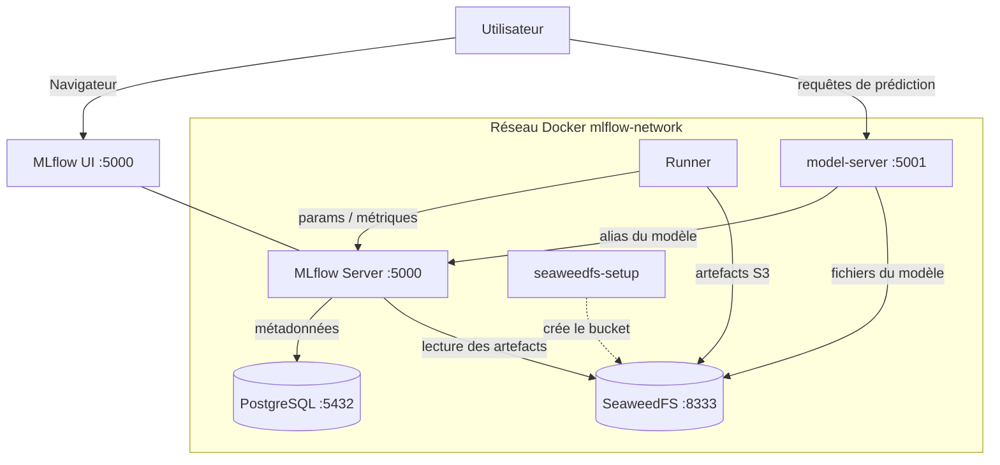

# MLflow + Docker - Tutoriel avec bonnes pratiques

**Un environnement MLflow prêt à l'emploi avec Docker pour le tracking d'expériences ML, avec tutoriel en français et exemples commentés.**


Ce projet fournit :

- Un **serveur MLflow** containerisé avec backend PostgreSQL et artifact store S3 (SeaweedFS)
- Un **manuel utilisateur** illustré pour découvrir le projet ([manuel-utilisateur.md](documentation/manuel-utilisateur.md))
- Un **tutoriel complet** en français pour apprendre MLflow ([TUTORIAL.md](TUTORIAL.md)), du suivi des essais jusqu'au modèle servi par une API
- Des **exemples de code** exécutés en CI, avec les bonnes pratiques : scikit-learn, XGBoost, PyTorch, modèle maison et assistant LLM

## Sommaire

- [Architecture](#architecture)
- [Démarrage rapide](#démarrage-rapide)
- [Configuration](#configuration)
- [Structure du projet](#structure-du-projet)
- [Licences & composants](#licences--composants)
- [Ports exposés](#ports-exposés)
- [Commandes utiles](#commandes-utiles)
- [Exemples inclus](#exemples-inclus)
- [Documentation](#documentation)
- [Troubleshooting](#troubleshooting)

## Architecture

Le `docker compose up` orchestre **5 services** (un conteneur `seaweedfs-setup` éphémère
crée le bucket S3 au démarrage puis s'arrête). **2 services** de plus démarrent à la demande,
avec leur profil :

| Service | Image / Build | Port interne | Port hôte | Rôle |
|---|---|---|---|---|
| `mlflow` | build `./mlflow` (Python 3.12 + MLflow 3.17.2) | 5000 | 5000 (`127.0.0.1`) | Serveur de tracking + UI |
| `postgres` | `postgres:15-alpine` | 5432 | *(non exposé)* | Backend store (métadonnées) |
| `seaweedfs` | `chrislusf/seaweedfs:4.51` | 8333 / 8888 / 9333 | 8333 / 8888 / 9333 (`127.0.0.1`) | Artifact store S3 + interfaces web |
| `seaweedfs-setup` | `chrislusf/seaweedfs:4.51` | — | — | Crée le bucket `mlflow-artifacts` puis s'arrête |
| `runner` | build `./examples` (Python 3.12) | — | *(non exposé)* | Environnement d'exécution des exemples |
| `model-server` | même image que `runner`, profil `serving` | 8080 | 5001 (`127.0.0.1`) | API de prédiction du modèle `@champion` |
| `runner-torch` | build `./examples`, cible `torch`, profil `deep` | — | *(non exposé)* | Le runner avec PyTorch en version CPU |



> Détails structurels (flux, décisions, réseaux/volumes) :
> [documentation/architecture.md](documentation/architecture.md).
> Détails pédagogiques (rôle de chaque brique, concepts MLflow) :
> [TUTORIAL.md](TUTORIAL.md).

## Démarrage rapide

**Prérequis** :

- **WSL 2** (recommandé) avec une distribution Linux (ex : Ubuntu)
- [Docker Desktop](https://www.docker.com/products/docker-desktop/) avec l'intégration WSL 2 activée
- Aucune installation Python locale requise (tout tourne dans le conteneur `runner`)

**Lancer les services** :

```bash
cp .env.example .env        # renseigner les secrets
docker compose up -d
docker compose ps           # vérifier le statut
```

**Accéder à MLflow** : ouvrir **http://localhost:5000** dans le navigateur.

**Exécuter un exemple** :

```bash
docker compose exec runner python sklearn_example.py
```

Le service `runner` contient un environnement Python isolé avec toutes les dépendances.
Il n'entraîne rien au démarrage : un `docker compose up` ne crée pas de version de modèle
et ne déplace aucun alias.

**Promouvoir le modèle et le servir** :

```bash
docker compose exec runner python promotion_example.py
```

```bash
docker compose --profile serving up -d --wait model-server
```

```bash
docker compose exec runner python serving_example.py
```

Dans l'interface, choisissez **Model training** en haut à gauche pour retrouver les runs et
les modèles, le mode **GenAI** étant affiché par défaut.

| Service | URL |
|---|---|
| MLflow UI | http://localhost:5000 |
| API de prédiction (profil `serving`) | http://localhost:5001/invocations |
| SeaweedFS API (S3) | http://localhost:8333 |
| SeaweedFS interface du filer | http://localhost:8888/buckets/mlflow-artifacts/ |
| SeaweedFS état du cluster | http://localhost:9333 |

## Configuration

Copiez `.env.example` en `.env`, puis renseignez les valeurs. Variables réelles
(source : [`.env.example`](.env.example)) :

| Variable | Défaut (`.env.example`) | Effet |
|---|---|---|
| `POSTGRES_USER` | `mlflow` | Utilisateur du backend store PostgreSQL |
| `POSTGRES_PASSWORD` | `CHANGEZ_MOI_EN_PRODUCTION` | Mot de passe PostgreSQL (**à changer**) |
| `POSTGRES_DB` | `mlflow` | Nom de la base de métadonnées |
| `S3_ACCESS_KEY` | `mlflow_s3` | Clé d'accès SeaweedFS = `AWS_ACCESS_KEY_ID` |
| `S3_SECRET_KEY` | `CHANGEZ_MOI_EN_PRODUCTION` | Secret SeaweedFS = `AWS_SECRET_ACCESS_KEY` (**à changer**) |
| `S3_BUCKET` | `mlflow-artifacts` | Bucket S3 des artefacts (créé par `seaweedfs-setup`) |
| `MLFLOW_TRACKING_URI` | `http://localhost:5000` | URL du serveur MLflow (usage depuis l'hôte) |
| `MLFLOW_PORT` | `5000` *(si absent)* | Port de l'interface sur la machine, si le 5000 est déjà pris |
| `MODELE_SERVI` | `models:/wine-classifier@champion` *(si absent)* | Modèle servi par `model-server` |
| `OLLAMA_BASE_URL` | `http://localhost:11434/v1` *(si absent)* | Serveur Ollama de l'assistant LLM, quand `model-server` le sert |

**Attention** : `.env` contient les secrets et n'est **pas** versionné (voir
`.gitignore`). Ne jamais committer ce fichier. Détails :
[documentation/SECURITY.md](documentation/SECURITY.md).

## Structure du projet

```text
MLflow-Test-Bench/
├── docker-compose.yml       # Orchestration des 5 services et des 2 services à la demande
├── .env.example             # Modèle de configuration (à copier en .env)
├── mlflow/
│   ├── Dockerfile           # Image serveur MLflow (multi-stage, non-root)
│   ├── requirements.txt     # Dépendances directes du serveur
│   ├── requirements.lock    # Versions exactes, installées par le Dockerfile
│   └── entrypoint.sh        # Lancement de `mlflow server`
├── examples/
│   ├── Dockerfile           # Image du runner Python, et sa variante avec PyTorch
│   ├── requirements.txt     # Dépendances directes des exemples
│   ├── requirements.lock    # Versions exactes, installées par le Dockerfile
│   ├── requirements-torch.txt  # PyTorch en version CPU
│   ├── requirements-torch.lock # Versions exactes pour l'image avec PyTorch
│   ├── basic_example.py     # Logging manuel : params, métriques, tags
│   ├── autolog_example.py   # Auto-logging scikit-learn
│   ├── dataset_example.py   # Logging de datasets
│   ├── sklearn_example.py   # Exemple complet : comparaison + Model Registry
│   ├── evaluation_example.py # Logged Models, évaluation, seuils, métriques système
│   ├── promotion_example.py # Promotion contrôlée : @challenger vers @champion
│   ├── serving_example.py   # Interroger l'API, prédire par lot
│   ├── recherche_example.py # Recherche d'hyperparamètres, runs imbriqués, search_runs
│   ├── images_example.py    # Une image par étape, tableaux
│   ├── xgboost_example.py   # XGBoost, le même parcours
│   ├── pyfunc_example.py    # Enregistre un modèle maison
│   ├── modele_maison.py     # Le code de ce modèle maison
│   ├── pytorch_example.py   # Un réseau de neurones (image runner-torch)
│   ├── genai_example.py     # Assistant LLM : prompt, traces, évaluation, promotion (Ollama)
│   ├── assistant_modele.py  # Le code de cet assistant
│   └── faux_llm.py          # Remplace Ollama en CI
├── documentation/
│   ├── manuel-utilisateur.md # Présentation et visite de l'interface
│   ├── images/              # Captures, régénérées par le script ci-dessous
│   ├── architecture.md      # Architecture technique : flux, décisions, volumes
│   └── SECURITY.md          # Posture de sécurité (secrets, réseau, conteneurs)
├── scripts/
│   └── capture_screenshots.py # Régénère les captures de la documentation
├── .github/workflows/
│   └── smoke.yml            # CI : lance chaque exemple, sert les modèles, construit une image
├── TUTORIAL.md              # Tutoriel pédagogique complet
├── LICENSE                  # MIT
└── README.md
```

## Licences & composants

Briques réellement utilisées (source : `docker-compose.yml`, `mlflow/Dockerfile`,
`examples/requirements.txt`) et leur licence. Valeurs à vérifier avant tout usage
en production.

| Composant | Rôle | Licence |
|---|---|---|
| MLflow 3.17.2 | Serveur de tracking + Model Registry | Apache-2.0 |
| PostgreSQL 15 | Backend store (métadonnées) | PostgreSQL License (open-source, proche BSD/MIT) |
| SeaweedFS 4.51 | Artifact store S3 et création du bucket | Apache-2.0 |
| Python 3.12 | Runtime des images | PSF License |
| scikit-learn, pandas, numpy | ML & données (exemples) | BSD-3-Clause |
| XGBoost | Boosting (exemple) | Apache-2.0 |
| PyTorch | Réseau de neurones (exemple) | BSD-3-Clause |
| matplotlib | Graphiques (matrices de confusion) | Matplotlib License (type BSD) |
| boto3 | Client S3 pour SeaweedFS | Apache-2.0 |
| psycopg | Driver PostgreSQL du serveur | LGPL-3.0 *(à confirmer)* |
| openai, litellm | Client du LLM et juges GenAI (exemple Ollama) | Apache-2.0 / MIT *(à confirmer)* |
| python-dotenv | Chargement du `.env` | BSD-3-Clause |
| **Ce projet** | Code & documentation | MIT — Copyright (c) 2026 Florian H. |

Ce projet est sous licence **MIT** — voir le fichier [LICENSE](LICENSE) pour le détail.

---

## Ports exposés

Tous les ports sont publiés sur la boucle locale (`127.0.0.1`) uniquement.

| Service | Port | URL |
|---|---|---|
| MLflow UI | 5000 (`MLFLOW_PORT`) | http://localhost:5000 |
| API de prédiction, profil `serving` | 5001 | http://localhost:5001/invocations |
| SeaweedFS API S3 | 8333 | http://localhost:8333 |
| SeaweedFS filer | 8888 | http://localhost:8888/buckets/mlflow-artifacts/ |
| SeaweedFS cluster | 9333 | http://localhost:9333 |

## Commandes utiles

```bash
# Démarrer les services
docker compose up -d

# Voir les logs
docker compose logs -f mlflow

# Démarrer aussi l'API de prédiction, ou le runner PyTorch
docker compose --profile serving up -d --wait model-server
docker compose --profile deep up -d --build runner-torch

# Après une promotion : charger le nouveau champion
docker compose --profile serving restart model-server

# Arrêter les services, y compris ceux à la demande
docker compose --profile serving --profile deep down

# Réinitialiser (supprime les données)
docker compose --profile serving --profile deep down -v
docker compose up -d --build
```

## Exemples inclus

| Fichier | Description |
|---|---|
| `examples/basic_example.py` | Logging manuel : paramètres, métrique suivie par étape, tags |
| `examples/autolog_example.py` | Auto-logging scikit-learn : aucun appel à `log_param` ni `log_metric` |
| `examples/dataset_example.py` | Logging des datasets d'entraînement et de test avec `log_input` |
| `examples/sklearn_example.py` | Exemple complet de bout en bout : chargement du dataset **Wine**, comparaison de 4 modèles scikit-learn (Random Forest, Logistic Regression, SVM RBF, Random Forest Large), logging des paramètres/métriques/artefacts (matrices de confusion via `log_figure`), puis enregistrement du meilleur modèle dans le **Model Registry** avec l'alias `@challenger` |
| `examples/evaluation_example.py` | Logged Models, `mlflow.models.evaluate`, validation par seuils et métriques système |
| `examples/promotion_example.py` | Évalue `@challenger`, le compare à `@champion` et ne le promeut que s'il respecte les seuils. `--modele-degrade` montre un refus |
| `examples/serving_example.py` | Interroge l'API de `model-server`, montre un refus de requête et une prédiction par lot |
| `examples/recherche_example.py` | `GridSearchCV` avec runs imbriqués, puis requête avec `search_runs` |
| `examples/images_example.py` | `log_image` par étape (matrice de confusion) et `log_table` |
| `examples/xgboost_example.py` | XGBoost : autolog, `log_model`, même registre et même contrôle |
| `examples/pyfunc_example.py` | Modèle maison enregistré en clair (*models from code*), avec un paramètre par requête |
| `examples/pytorch_example.py` | Réseau convolutif avec une image par époque. Se lance dans `runner-torch` |
| `examples/genai_example.py` | Assistant LLM : registre de prompts, traces, `mlflow.genai.evaluate`, promotion. Demande un serveur Ollama ; en CI, `faux_llm.py` le remplace |

Chaque script se lance dans le conteneur `runner` :
`docker compose exec runner python <script>.py`.

## Documentation

| Document | Contenu |
|---|---|
| [documentation/manuel-utilisateur.md](documentation/manuel-utilisateur.md) | Manuel utilisateur illustré : démarrage, visite de l'interface, scénarios d'usage, exploitation, glossaire |
| [documentation/architecture.md](documentation/architecture.md) | Architecture technique : services, flux de bout en bout, décisions, réseaux et volumes |
| [documentation/SECURITY.md](documentation/SECURITY.md) | Posture de sécurité : secrets, isolation réseau, conteneurs, risques connus |
| [TUTORIAL.md](TUTORIAL.md) | Tutoriel pédagogique complet : concepts, guide pratique, Model Registry, évaluation, mise en production, autres types de modèles, images, GenAI, bonnes pratiques, troubleshooting |

Pour découvrir le projet, commencez par le [manuel utilisateur](documentation/manuel-utilisateur.md). Pour apprendre le code de MLflow, suivez le [tutoriel complet](TUTORIAL.md).

## Troubleshooting

| Problème | Solution |
|---|---|
| "Connection refused" | `docker compose up -d` puis attendre environ 30 secondes |
| "port is already allocated" | Ajoutez `MLFLOW_PORT=15000` à `.env`, l'interface passe sur ce port |
| L'UI est vide | Exécutez un exemple, puis choisissez **Model training** en haut à gauche |
| Erreur S3 | Vérifiez `S3_ACCESS_KEY` et `S3_SECRET_KEY` dans `.env` |
| "Permission denied" sur `entrypoint.sh` | `chmod +x mlflow/entrypoint.sh` (permissions perdues au passage Windows → WSL) |

> Guide de dépannage détaillé (causes et solutions) : [TUTORIAL.md](TUTORIAL.md#troubleshooting).
