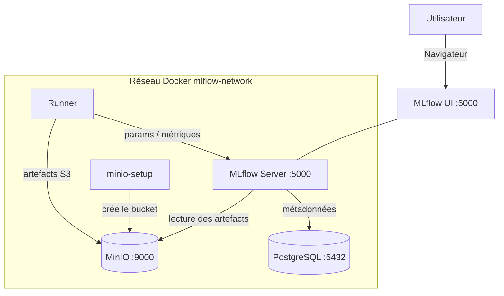

# MLflow + Docker - Tutoriel avec bonnes pratiques

**Un environnement MLflow prêt à l'emploi avec Docker pour le tracking d'expériences ML, avec tutoriel en français et exemples commentés.**


Ce projet fournit :

- Un **serveur MLflow** containerisé avec backend PostgreSQL et artifact store S3 (MinIO)
- Un **tutoriel complet** en français pour apprendre MLflow ([TUTORIAL.md](TUTORIAL.md))
- Des **exemples de code** avec les bonnes pratiques

## Sommaire

- [Architecture](#architecture)
- [Démarrage rapide](#démarrage-rapide)
- [Configuration](#configuration)
- [Structure du projet](#structure-du-projet)
- [Licences & composants](#licences--composants)
- [Ports exposés](#ports-exposés)
- [Commandes utiles](#commandes-utiles)
- [Exemples inclus](#exemples-inclus)
- [Documentation](#documentation)
- [Troubleshooting](#troubleshooting)

## Architecture

Le `docker compose up` orchestre **5 services** (un conteneur `minio-setup` éphémère
crée le bucket S3 au démarrage puis s'arrête) :

| Service | Image / Build | Port interne | Port hôte | Rôle |
|---|---|---|---|---|
| `mlflow` | build `./mlflow` (Python 3.11 + MLflow 2.19.0) | 5000 | 5000 | Serveur de tracking + UI |
| `postgres` | `postgres:15-alpine` | 5432 | *(non exposé)* | Backend store (métadonnées) |
| `minio` | `minio/minio:latest` | 9000 / 9001 | 9000 / 9001 | Artifact store S3 + console |
| `minio-setup` | `minio/mc:latest` | — | — | Crée le bucket `mlflow-artifacts` puis s'arrête |
| `runner` | build `./examples` (Python 3.11) | — | *(non exposé)* | Environnement d'exécution des exemples |



> Détails structurels (flux, décisions, réseaux/volumes) :
> [documentation/architecture.md](documentation/architecture.md).
> Détails pédagogiques (rôle de chaque brique, concepts MLflow) :
> [TUTORIAL.md](TUTORIAL.md).

## Démarrage rapide

**Prérequis** :

- **WSL 2** (recommandé) avec une distribution Linux (ex : Ubuntu)
- [Docker Desktop](https://www.docker.com/products/docker-desktop/) avec l'intégration WSL 2 activée
- Aucune installation Python locale requise (tout tourne dans le conteneur `runner`)

**Lancer les services** :

```bash
cp .env.example .env        # renseigner les secrets
docker compose up -d
docker compose ps           # vérifier le statut
```

**Accéder à MLflow** : ouvrir **http://localhost:5000** dans le navigateur.

**Exécuter un exemple** :

```bash
docker compose exec runner python sklearn_example.py
```

Le service `runner` contient un environnement Python isolé avec toutes les dépendances.
Il exécute d'ailleurs `sklearn_example.py` **automatiquement au démarrage** (voir la
directive `command` dans `docker-compose.yml`), puis reste actif pour un usage interactif.

| Service | URL |
|---|---|
| MLflow UI | http://localhost:5000 |
| MinIO API (S3) | http://localhost:9000 |
| MinIO Console | http://localhost:9001 |

## Configuration

Copiez `.env.example` en `.env`, puis renseignez les valeurs. Variables réelles
(source : [`.env.example`](.env.example)) :

| Variable | Défaut (`.env.example`) | Effet |
|---|---|---|
| `POSTGRES_USER` | `mlflow` | Utilisateur du backend store PostgreSQL |
| `POSTGRES_PASSWORD` | `CHANGEZ_MOI_EN_PRODUCTION` | Mot de passe PostgreSQL (**à changer**) |
| `POSTGRES_DB` | `mlflow` | Nom de la base de métadonnées |
| `MINIO_ROOT_USER` | `minio_admin` | Identifiant admin MinIO = `AWS_ACCESS_KEY_ID` |
| `MINIO_ROOT_PASSWORD` | `CHANGEZ_MOI_EN_PRODUCTION` | Secret MinIO = `AWS_SECRET_ACCESS_KEY` (**à changer**) |
| `MINIO_BUCKET` | `mlflow-artifacts` | Bucket S3 des artefacts (créé par `minio-setup`) |
| `MLFLOW_TRACKING_URI` | `http://localhost:5000` | URL du serveur MLflow (usage depuis l'hôte) |

**Attention** : `.env` contient les secrets et n'est **pas** versionné (voir
`.gitignore`). Ne jamais committer ce fichier. Détails :
[documentation/SECURITY.md](documentation/SECURITY.md).

## Structure du projet

```text
MLflow-Test-Bench/
├── docker-compose.yml       # Orchestration des 5 services
├── .env.example             # Modèle de configuration (à copier en .env)
├── mlflow/
│   ├── Dockerfile           # Image serveur MLflow (multi-stage, non-root)
│   └── entrypoint.sh        # Lancement de `mlflow server`
├── examples/
│   ├── Dockerfile           # Image du runner Python
│   ├── requirements.txt     # Dépendances des exemples
│   ├── basic_example.py     # Logging manuel : params, métriques, tags
│   ├── autolog_example.py   # Auto-logging scikit-learn
│   ├── dataset_example.py   # Logging de datasets
│   └── sklearn_example.py   # Exemple complet : comparaison + Model Registry
├── documentation/
│   ├── architecture.md      # Architecture technique : flux, décisions, volumes
│   └── SECURITY.md          # Posture de sécurité (secrets, réseau, conteneurs)
├── TUTORIAL.md              # Tutoriel pédagogique complet
├── LICENSE                  # MIT
└── README.md
```

## Licences & composants

Briques réellement utilisées (source : `docker-compose.yml`, `mlflow/Dockerfile`,
`examples/requirements.txt`) et leur licence. Valeurs à vérifier avant tout usage
en production.

| Composant | Rôle | Licence |
|---|---|---|
| MLflow 2.19.0 | Serveur de tracking + Model Registry | Apache-2.0 |
| PostgreSQL 15 | Backend store (métadonnées) | PostgreSQL License (open-source, proche BSD/MIT) |
| MinIO | Artifact store S3 | AGPL-3.0 |
| MinIO Client (`mc`) | Création du bucket au démarrage | AGPL-3.0 |
| Python 3.11 | Runtime des images | PSF License |
| scikit-learn, pandas, numpy | ML & données (exemples) | BSD-3-Clause |
| matplotlib | Graphiques (matrices de confusion) | Matplotlib License (type BSD) |
| boto3 | Client S3 pour MinIO | Apache-2.0 |
| psycopg2-binary | Driver PostgreSQL du serveur | LGPL-3.0 *(à confirmer)* |
| python-dotenv | Chargement du `.env` | BSD-3-Clause |
| **Ce projet** | Code & documentation | MIT — Copyright (c) 2026 Florian H. |

> Le tag `minio/minio:latest` n'épingle pas de version : la licence exacte dépend de
> l'image tirée au moment du build. À figer et vérifier pour un usage sérieux.

Ce projet est sous licence **MIT** — voir le fichier [LICENSE](LICENSE) pour le détail.

---

## Ports exposés

| Service | Port | URL |
|---|---|---|
| MLflow UI | 5000 | http://localhost:5000 |
| MinIO API | 9000 | http://localhost:9000 |
| MinIO Console | 9001 | http://localhost:9001 |

## Commandes utiles

```bash
# Démarrer les services
docker compose up -d

# Voir les logs
docker compose logs -f mlflow

# Arrêter les services
docker compose down

# Réinitialiser (supprime les données)
docker compose down -v
docker compose up -d --build
```

## Exemples inclus

| Fichier | Description |
|---|---|
| `examples/basic_example.py` | Logging manuel : paramètres, métrique suivie par étape, tags |
| `examples/autolog_example.py` | Auto-logging scikit-learn : aucun appel à `log_param` ni `log_metric` |
| `examples/dataset_example.py` | Logging des datasets d'entraînement et de test avec `log_input` |
| `examples/sklearn_example.py` | Exemple complet de bout en bout : chargement du dataset **Wine**, comparaison de 4 modèles scikit-learn (Random Forest, Logistic Regression, SVM RBF, Random Forest Large), logging des paramètres/métriques/artefacts (matrices de confusion via `log_figure`), puis enregistrement du meilleur modèle dans le **Model Registry** avec l'alias `@champion` |

Chaque script se lance dans le conteneur `runner` :
`docker compose exec runner python <script>.py`.

## Documentation

| Document | Contenu |
|---|---|
| [documentation/architecture.md](documentation/architecture.md) | Architecture technique : services, flux de bout en bout, décisions, réseaux et volumes |
| [documentation/SECURITY.md](documentation/SECURITY.md) | Posture de sécurité : secrets, isolation réseau, conteneurs, risques connus |
| [TUTORIAL.md](TUTORIAL.md) | Tutoriel pédagogique complet : concepts, guide pratique, Model Registry, troubleshooting |

Pour apprendre à utiliser MLflow, commencez par le [tutoriel complet](TUTORIAL.md).

## Troubleshooting

| Problème | Solution |
|---|---|
| "Connection refused" | `docker compose up -d` puis attendre environ 30 secondes |
| L'UI est vide | Exécutez un exemple, puis rafraîchissez |
| Erreur S3 | Vérifiez que les variables d'environnement MinIO sont bien configurées |
| "Permission denied" sur `entrypoint.sh` | `chmod +x mlflow/entrypoint.sh` (permissions perdues au passage Windows → WSL) |

> Guide de dépannage détaillé (causes et solutions) : [TUTORIAL.md](TUTORIAL.md#troubleshooting).
