# Tutoriel MLflow avec Docker

> **Guide complet pour maîtriser le tracking d'expériences ML avec MLflow**
>
> Pour une simple visite du projet et de son interface, voir le [manuel utilisateur](documentation/manuel-utilisateur.md).

---

## Table des matières

1. [Introduction](#introduction)
2. [Architecture détaillée](#architecture-détaillée)
3. [Prérequis](#prérequis)
4. [Concepts clés](#concepts-clés-de-mlflow)
5. [Guide pratique](#guide-pratique)
6. [De la commande à l'interface](#de-la-commande-à-linterface)
7. [Model Registry](#model-registry)
8. [Logged Models et évaluation](#logged-models-et-évaluation)
9. [GenAI : tracing et évaluation](#genai--tracing-et-évaluation)
10. [Comparaison des runs](#comparaison-des-runs-dans-mlflow)
11. [Troubleshooting](#troubleshooting)
12. [Ressources supplémentaires](#ressources-supplémentaires)

---

## Introduction

### Qu'est-ce que MLflow ?

**MLflow** est une plateforme open-source pour gérer le cycle de vie complet du Machine Learning. Elle répond aux défis courants des data scientists :

| Problème | Solution MLflow |
|----------|-----------------|
| "Quels hyperparamètres ai-je utilisé ?" | **Tracking** - Enregistrement automatique |
| "Quel modèle était le meilleur ?" | **Tracking** - Comparaison des runs |
| "Comment déployer mon modèle ?" | **Models** - Format standardisé |
| "Quelle version est en production ?" | **Registry** - Gestion des versions |

### Architecture détaillée

Ce projet utilise une architecture conteneurisée moderne pour garantir la reproductibilité et l'isolation. Voici le rôle de chaque composant :

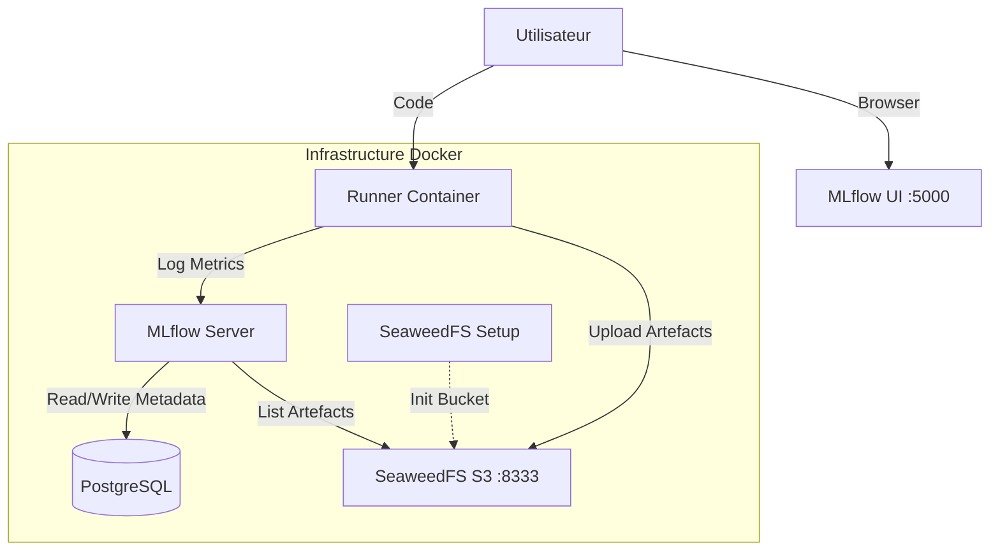

#### 1. PostgreSQL (Backend Store)
Base de données relationnelle qui stocke toutes les **métadonnées légères** :
- La liste des expériences et des runs
- Les paramètres, métriques et tags
- L'historique des versions du Model Registry
- *Pourquoi ?* Offre performance et intégrité des données par rapport à un stockage fichier.

#### 2. SeaweedFS (Artifact Store)
Serveur de stockage d'objets doté d'une passerelle compatible Amazon S3. Il stocke les **fichiers lourds** (Artefacts) :
- Modèles sérialisés (`model.skops`)
- Graphiques et images
- Datasets
- *Pourquoi ?* Simule un environnement cloud (AWS S3) en local. MLflow ne stocke pas les fichiers dans la base de données.

#### 3. SeaweedFS Setup
Conteneur éphémère qui ne tourne que quelques secondes au démarrage.
- *Rôle* : Créer automatiquement le bucket `mlflow-artifacts` dans SeaweedFS.
- *Pourquoi ?* SeaweedFS démarre vide par défaut. Ce service nous évite de devoir configurer manuellement le bucket à chaque lancement.

#### 4. Runner
Environnement d'exécution isolé contenant Python et les librairies nécessaires.
- *Rôle* : Exécuter vos scripts d'entraînement.
- *Pourquoi ?* Garantit que le code tourne exactement de la même manière pour tout le monde, indépendamment de votre machine hôte (plus de "ça marche sur ma machine").

#### Pourquoi un Dockerfile custom au lieu d'une image tierce ?

On aurait pu partir d'une image prête à l'emploi comme `ghcr.io/mlflow/mlflow`. Construire la nôtre a deux intérêts ici :

- **Contrôle** : on choisit chaque dépendance, dont le driver PostgreSQL (`psycopg`) et le client S3 (`boto3`) dont ce projet a besoin.
- **Apprentissage** : chaque étape est lisible (build multi-stage, utilisateur non-root, entrypoint, healthcheck).

Le coût : les mises à jour sont à notre charge. L'image finale pèse environ 1 Go.

> [!TIP]
> **En production**, une image maintenue permet de démarrer plus vite, après avoir vérifié qu'elle embarque le driver PostgreSQL et `boto3`. Le Dockerfile custom de ce tutoriel est avant tout **pédagogique**.

---

## Prérequis

### Logiciels requis

| Logiciel | Usage | Vérification |
|----------|-------|--------------|
| WSL 2 (Ubuntu) | Environnement Linux sous Windows | `wsl --version` |
| Docker | Moteur de conteneurisation | `docker --version` |
| Docker Compose | Orchestration des services | `docker compose version` |

> [!TIP]
> **Pourquoi WSL ?** MLflow et de nombreux outils MLOps sont conçus pour Linux. WSL vous offre un environnement natif performant sans les problèmes de compatibilité de Windows.

### Démarrage du projet

1. **Créer la configuration** :
   ```bash
   cp .env.example .env
   ```
   Puis remplacez les valeurs `CHANGEZ_MOI_EN_PRODUCTION` dans `.env`.

2. **Lancer les services** :
   ```bash
   docker compose up -d
   ```

3. **Vérifier l'état** :
   ```bash
   docker compose ps
   ```
   Résultat attendu (colonnes abrégées) :
   ```text
   NAME               SERVICE     STATUS
   mlflow-postgres    postgres    Up 7 minutes (healthy)
   mlflow-runner      runner      Up 7 minutes
   mlflow-seaweedfs   seaweedfs   Up 7 minutes (healthy)
   mlflow-server      mlflow      Up 7 minutes (healthy)
   ```
   `mlflow-server`, `mlflow-seaweedfs` et `mlflow-postgres` doivent être `healthy`. `mlflow-runner` est `running`, sans état de santé. `mlflow-seaweedfs-setup` n'apparaît pas dans la liste : il s'arrête une fois le bucket créé.

4. **Accéder à l'interface** :
   Ouvrez [http://localhost:5000](http://localhost:5000)

5. **Lancer un premier entraînement** :
   ```bash
   docker compose exec runner python sklearn_example.py
   ```
   Chaque exécution ajoute 4 runs et une nouvelle version du modèle `wine-classifier`. Rien ne s'entraîne au démarrage : un `docker compose up` ne crée pas de version et ne déplace pas l'alias `@champion`.

6. **Choisir le mode de l'interface** :
   En haut à gauche, un bouton bascule entre **GenAI**, affiché par défaut, et **Model training**. Les captures de ce tutoriel sont en mode **Model training**, sauf le chapitre GenAI. Le panneau **MLflow Assistant**, ouvert à la première visite, se ferme avec sa croix.

---

## Concepts clés de MLflow

### 1. Expérience (Experiment)

Une **expérience** est un conteneur pour organiser vos runs. Par exemple :
- `detection-pneumonie-v1`
- `classification-images-resnet`

```python
import mlflow

# Créer ou sélectionner une expérience
mlflow.set_experiment("mon-experience")
```

### 2. Run

Un **run** est une exécution unique d'un entraînement. Chaque run a :
- Un **ID unique**
- Des **paramètres** (hyperparamètres)
- Des **métriques** (résultats)
- Des **artefacts** (fichiers)
- Des **tags** (métadonnées)

```python
with mlflow.start_run(run_name="test-lr-0.01"):
    # Votre code d'entraînement
    pass
```

### 3. Paramètres vs Métriques

| Paramètres | Métriques |
|------------|-----------|
| Valeurs **fixes** en entrée | Valeurs **calculées** en sortie |
| Ex: learning_rate, batch_size | Ex: accuracy, loss |
| Log une seule fois | Peuvent être loggées plusieurs fois (par époque) |

```python
# Paramètres
mlflow.log_param("learning_rate", 0.01)
mlflow.log_param("epochs", 100)

# Métriques
mlflow.log_metric("accuracy", 0.95)
mlflow.log_metric("loss", 0.1, step=10)  # Avec numéro d'étape
```

### 4. Artefacts

Les **artefacts** sont des fichiers associés au run :
- Modèles entraînés
- Graphiques (courbes de loss, matrices de confusion)
- Fichiers de configuration
- Datasets

```python
# Logger un fichier générique (texte, json, etc)
mlflow.log_artifact("config.yaml")

# Logger une figure Matplotlib, visible dans l'onglet "Artifacts" du run
mlflow.log_figure(fig, "confusion_matrix.png")

# Logger un modèle scikit-learn
mlflow.sklearn.log_model(model, name="model")
```

---

## Guide pratique

Chaque exemple est un script de `examples/`, à lancer dans le conteneur `runner`.

### Exemple 1 : Logging basique

Script : [`examples/basic_example.py`](examples/basic_example.py)

```bash
docker compose exec runner python basic_example.py
```

```python
mlflow.set_experiment("tutoriel-basique")

with mlflow.start_run(run_name="premier-run") as run:
    # Paramètres : les valeurs d'entrée, loggées une seule fois
    mlflow.log_param("algorithm", "random_forest")
    mlflow.log_param("n_estimators", 100)

    # Métrique : plusieurs valeurs au fil des étapes (donne une courbe)
    for step, loss in enumerate([0.9, 0.5, 0.3, 0.2, 0.15]):
        mlflow.log_metric("loss", loss, step=step)
    mlflow.log_metric("accuracy", 0.92)

    # Tags : métadonnées libres, utiles pour filtrer
    mlflow.set_tag("auteur", "tutoriel")
```

Le terminal affiche le lien direct vers le run dans l'interface :

```text
🏃 View run premier-run at: http://mlflow:5000/#/experiments/<id>/runs/<run_id>
Run terminé : <run_id>
```

> Ce lien utilise `mlflow:5000`, l'adresse du serveur dans le réseau Docker. Depuis votre navigateur, remplacez `mlflow` par `localhost`.

**Dans l'interface** : ouvrez l'onglet **Model metrics** du run. Les 5 valeurs de `loss` forment une courbe, alors que `accuracy`, enregistrée une seule fois, reste une barre.


### Exemple 2 : Auto-logging avec scikit-learn

Script : [`examples/autolog_example.py`](examples/autolog_example.py)

```bash
docker compose exec runner python autolog_example.py
```

MLflow enregistre seul les hyperparamètres, les métriques d'entraînement et le modèle :

```python
# À appeler avant fit() : c'est lui qui déclenche l'enregistrement
mlflow.sklearn.autolog()

with mlflow.start_run(run_name="random-forest-autolog") as run:
    RandomForestClassifier(n_estimators=100, random_state=42).fit(X_train, y_train)
```

Sans aucun appel à `log_param` ni `log_metric`, le run contient 19 paramètres et 7 métriques :

```text
Paramètres enregistrés : 19
Métriques enregistrées : ['training_accuracy_score', 'training_f1_score', 'training_log_loss', 'training_precision_score', 'training_recall_score', 'training_roc_auc', 'training_score']
```

**Dans l'interface** : les compteurs **Metrics (7)** et **Parameters (19)** correspondent à la sortie du terminal. L'autolog a aussi enregistré un dataset et le modèle.

Le terminal affiche un avertissement sur le format pickle : l'autolog sérialise en cloudpickle, alors que `log_model` utilise skops par défaut. Ne chargez un tel modèle que s'il vient d'une source de confiance.

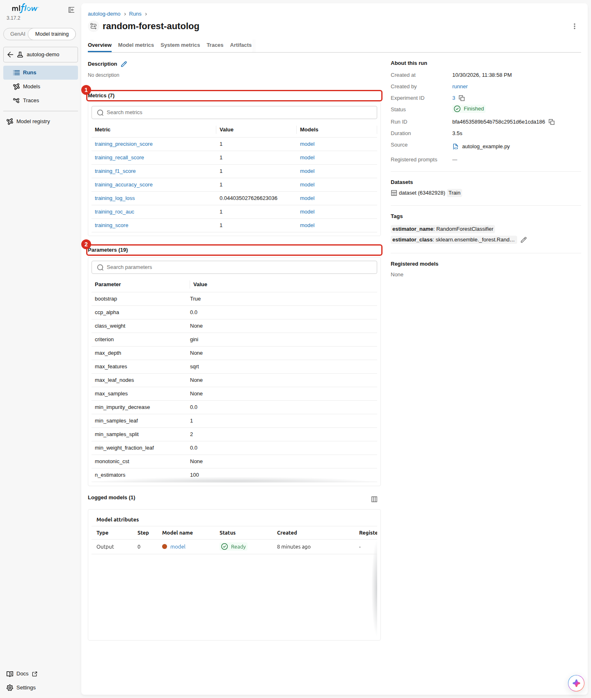

### Exemple 3 : Comparaison de modèles

Le script [`examples/sklearn_example.py`](examples/sklearn_example.py) entraîne 4 modèles sur le dataset Wine, compare leurs performances et enregistre le meilleur dans le Model Registry. Chaque modèle est un `Pipeline` qui inclut le `StandardScaler`.

```bash
docker compose exec runner python sklearn_example.py
```

Le terminal résume les performances et désigne le meilleur modèle :

```text
                     test_accuracy  f1_score   cv_mean
Logistic Regression       0.972222   0.97197  0.993103
Random Forest             1.000000   1.00000  0.986207
SVM RBF                   0.972222   0.97197  0.986207
Random Forest Large       1.000000   1.00000  0.979064

🏆 Meilleur modèle: Logistic Regression
   CV Score: 0.9931
   Accuracy (test): 0.9722
```

Le classement se fait sur la validation croisée (`cv_mean`), à score égal sur la plus faible dispersion (`cv_std`). Le jeu de test ne sert pas à choisir : il reste une estimation indépendante. Voilà pourquoi la Logistic Regression l'emporte malgré ses 0,97 sur le test, contre 1,00 pour les Random Forest.

**Dans l'interface** : chaque modèle devient une ligne de l'expérience `comparaison-modeles`. Seul le meilleur porte `wine-classifier` dans la colonne Models, les autres affichent leur Logged Model `model`.


### Exemple 4 : Logging du Dataset

Script : [`examples/dataset_example.py`](examples/dataset_example.py)

```bash
docker compose exec runner python dataset_example.py
```

`log_input` relie le run aux données qui l'ont nourri. MLflow garde le nom, la source, une empreinte (digest) et le schéma, mais ne copie pas les données :

```python
for df_split, context in [(df_train, "training"), (df_test, "test")]:
    dataset = mlflow.data.from_pandas(
        df_split,
        source="sklearn.datasets.load_wine",
        name=f"wine_{context}",
    )
    # context : rôle du dataset dans ce run ("training", "validation", "test")
    mlflow.log_input(dataset, context=context)
```

```text
Dataset wine_training : digest 4f1188a9, training
Dataset wine_test : digest 0ef539ce, test
```

**Dans l'interface** : **Datasets** affiche `wine_training` et le digest `4f1188a9` du terminal. Le bouton `+1` déplie le second dataset.

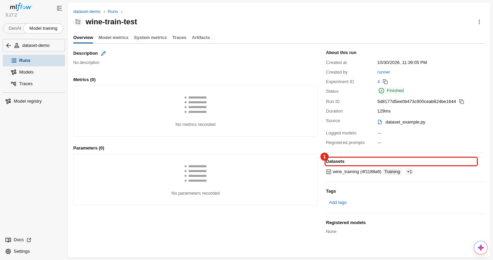

---

## De la commande à l'interface

Chaque appel Python laisse une trace à un endroit précis de l'interface, et ses données sont rangées dans l'un des deux stores :

| Appel Python | Où le voir sur `http://localhost:5000` | Stocké dans |
|---|---|---|
| `set_experiment("x")` | Page **Experiments** | PostgreSQL |
| `start_run(run_name="y")` | Une ligne dans **Runs**, page de l'expérience | PostgreSQL |
| `log_param` | Run > **Overview** > Parameters | PostgreSQL |
| `log_metric`, `log_metrics` | Run > **Overview** > Metrics ; courbes dans **Model metrics** | PostgreSQL |
| `start_run(log_system_metrics=True)` | Run > **System metrics** | PostgreSQL |
| `set_tag` | Run > **Overview** > Tags | PostgreSQL |
| `log_input` | Run > **Overview** > Datasets | PostgreSQL |
| `log_figure`, `log_artifact` | Run > **Artifacts** | SeaweedFS |
| `sklearn.log_model` | Expérience > **Models** ; Run > **Overview** > Logged models | Fichiers : SeaweedFS. Fiche : PostgreSQL |
| `register_model` | Page **Model registry** ; Run > **Overview** > Registered models | PostgreSQL (le fichier reste dans SeaweedFS) |
| `set_registered_model_alias` | Page **Model registry**, colonne Aliased versions | PostgreSQL |
| `models.evaluate` | Run > **Overview** > Metrics ; Run > **Artifacts** ; Expérience > **Models** | Métriques : PostgreSQL. Graphiques : SeaweedFS |
| `@mlflow.trace`, `openai.autolog` | Mode GenAI > **Traces** | PostgreSQL |
| `genai.evaluate` | Mode GenAI > **Evaluation runs** | PostgreSQL |

La capture ci-dessous repère ces éléments sur un run de `sklearn_example.py` : (1) `log_input`, (2) `set_tag`, (3) `register_model`, (4) `log_metrics`, (5) `log_param`, (6) `log_model`.


L'onglet **Artifacts** montre les fichiers de `log_figure` et `log_artifact`. L'adresse en `s3://` (2) confirme qu'ils sont rangés dans SeaweedFS.


### Suivre un artefact jusqu'à SeaweedFS

L'adresse `s3://mlflow-artifacts/1/<run_id>/artifacts/confusion_matrix.png` se lit directement dans l'interface du filer, sur `http://localhost:8888/buckets/mlflow-artifacts/`.

Le premier niveau du bucket est l'identifiant de l'expérience. Seules les expériences ayant enregistré des fichiers y figurent : `basic_example.py` et `dataset_example.py` n'en écrivent aucun. `.uploads` est un dossier interne de SeaweedFS.


Le niveau suivant contient un dossier `models` pour les Logged Models (1), et un dossier par Run ID (2) :


Le dossier d'un run contient les fichiers de `log_figure` et `log_artifact` :


Le dossier `models/<model_id>/artifacts/` contient ce qu'a écrit `sklearn.log_model`, dont `MLmodel` (1) et `model.skops` (2) :


L'état du stockage s'affiche sur `http://localhost:9333` :


La commande suivante liste les buckets et leur taille :

```bash
docker compose exec -T seaweedfs sh -c 'echo "s3.bucket.list" | weed shell -master=seaweedfs:9333 -filer=seaweedfs:8888'
```

```text
  mlflow-artifacts	size:17184168	logical:17184168	chunk:73
```

### Ce qui se passe à chaque appel

Les métadonnées passent par le serveur MLflow. Les fichiers partent directement du script vers SeaweedFS, ce qui explique que le `runner` ait besoin des identifiants S3 (serveur lancé avec `--no-serve-artifacts`).


---

## Model Registry

### Qu'est-ce que le Model Registry ?

Le **Model Registry** centralise les modèles validés et garde leur historique :

- **Versions** : chaque enregistrement crée une nouvelle version (`v1`, `v2`, `v3`). MLflow les conserve toutes.
- **Aliases** : une étiquette mobile posée sur une version. `@champion` désigne le modèle de référence, `@challenger` un candidat à évaluer. Un alias ne désigne qu'une seule version à la fois.

> [!NOTE]
> Les **stages** (`None`, `Staging`, `Production`, `Archived`) et `transition_model_version_stage` sont dépréciés depuis MLflow 2.9. Les aliases les remplacent, c'est pourquoi `sklearn_example.py` les utilise.

**Dans l'interface** : la page **Model registry** liste les modèles et leurs aliases.


Chaque version renvoie vers le run (1) et le Logged Model (2) qui l'ont produite, et affiche ses aliases (3).


### Enregistrer un modèle

```python
# model_info : valeur renvoyée par mlflow.sklearn.log_model
model_version = mlflow.register_model(
    model_uri=model_info.model_uri,
    name="wine-classifier"
)
```

### Désigner le modèle de référence

```python
client = MlflowClient()
client.set_registered_model_alias(
    name="wine-classifier",
    alias="champion",
    version=model_version.version
)
```

Pour revenir en arrière, reposez l'alias sur une version précédente, en passant le numéro entre guillemets (`version="1"`). Le code qui charge `@champion` n'a pas à changer.

### Charger un modèle

```python
# Par alias (recommandé pour les applications)
model = mlflow.sklearn.load_model("models:/wine-classifier@champion")

# Par version
model = mlflow.sklearn.load_model("models:/wine-classifier/1")
```

Le modèle enregistré est un `Pipeline` complet : il accepte directement des données brutes et les normalise lui-même.

---

## Logged Models et évaluation

Script : [`examples/evaluation_example.py`](examples/evaluation_example.py)

```bash
docker compose exec runner python evaluation_example.py
```

Le script compare un modèle candidat à une référence naïve, et n'approuve le candidat que s'il respecte des seuils. Le terminal résume les trois étapes (extrait, sans les journaux de MLflow) :

```text
--- Évaluation ---
reference : accuracy 0.3889, f1 0.2178
candidat : accuracy 1.0000, f1 1.0000

--- Seuils raisonnables ---
Validation réussie

--- Seuil impossible, pour voir un refus ---
Validation refusée : Metric accuracy_score value threshold check failed: candidate model accuracy_score = 1.0, accuracy_score threshold = 1.01.

--- Logged Models de l'expérience, par accuracy décroissante ---
candidat : m-d0fc1241a4514929b026397a4c6932df, accuracy 1.0000, validation=approuve
reference : m-89c6edc476654d6c93573550d27431fb, accuracy 0.3889, validation=-
```

### Logged Models

Depuis MLflow 3, un modèle n'est plus un simple dossier dans les artefacts d'un run : `log_model` crée un **Logged Model**, avec son identifiant (`m-...`), ses métriques et ses fichiers.

```python
model_info = mlflow.sklearn.log_model(modele, name=nom, input_example=X.head(5),
                                      skops_trusted_types=TYPES_SKOPS_DE_CONFIANCE)
print(model_info.model_uri)  # models:/m-d0fc1241a4514929b026397a4c6932df
```

| Dans MLflow 2 | Dans MLflow 3 |
|---|---|
| `log_model(modele, artifact_path="model")` | `log_model(modele, name="model")` |
| `runs:/<run_id>/model` | `model_info.model_uri`, soit `models:/<model_id>` |
| Run > Artifacts > `model` | Expérience > **Models**, et Run > Overview > Logged models |
| `s3://.../<run_id>/artifacts/model/` | `s3://.../models/<model_id>/artifacts/` |
| Format `model.pkl` (cloudpickle) | Format `model.skops` |

**skops** refuse de charger un type qu'il ne connaît pas. Le Random Forest contient `sklearn.tree._tree.Tree`, d'où `skops_trusted_types`. Sans ce paramètre, `log_model` échoue. Cette liste est lue dans le fichier `MLmodel` du modèle : charger un modèle reste donc une action de confiance, quel que soit le format.

**Dans l'interface** : l'onglet **Models** de l'expérience liste les Logged Models (1), avec leurs métriques en colonnes (2).

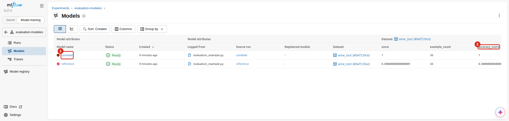

Chaque Logged Model garde ses métriques (1), rattachées au dataset qui a servi à les calculer (2).

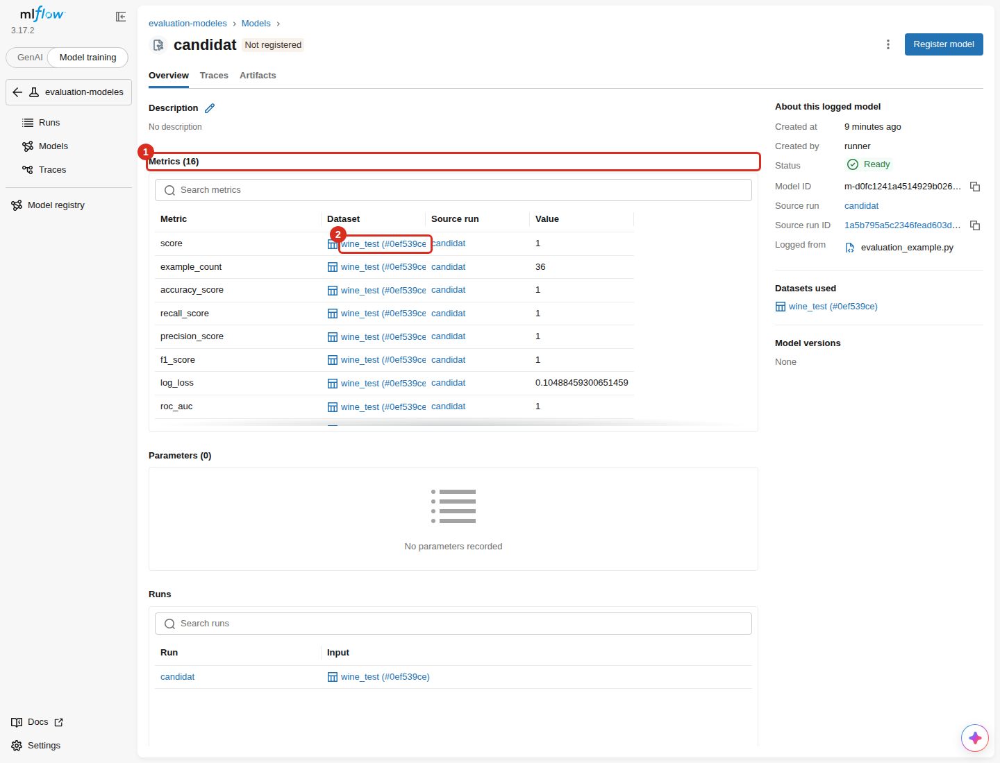

### Évaluation

`mlflow.models.evaluate` calcule les métriques standard et produit des graphiques, à partir du modèle et d'un dataset :

```python
dataset_test = mlflow.data.from_pandas(df_test, source="sklearn.datasets.load_wine",
                                       targets="target", name="wine_test")
resultat = mlflow.models.evaluate(
    model_info.model_uri,
    data=dataset_test,
    model_type="classifier",
    evaluators="default",
    evaluator_config={"log_explainer": False, "log_model_explainability": False},
)
print(resultat.metrics["accuracy_score"])
```

`evaluator_config` désactive ici les explications SHAP, car le paquet `shap` n'est pas installé.

**Dans l'interface** : l'onglet **Artifacts** du run contient les graphiques (matrice de confusion, ROC, précision-rappel, calibration) et `per_class_metrics.csv`.

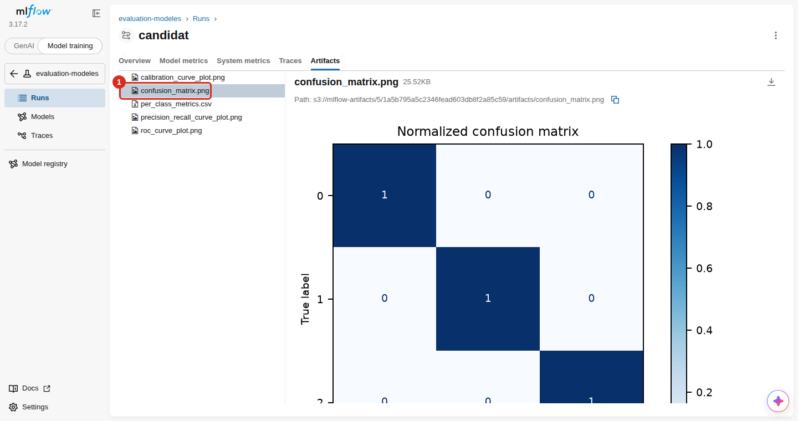

### Validation par seuils

`mlflow.validate_evaluation_results` lève une exception si le candidat ne respecte pas les seuils. C'est le contrôle à placer avant une promotion :

```python
from mlflow.models import MetricThreshold

mlflow.validate_evaluation_results(
    {"accuracy_score": MetricThreshold(
        threshold=0.9,             # au moins 0,9 dans l'absolu
        min_relative_change=0.05,  # et au moins 5 % de mieux que la référence
        greater_is_better=True,
    )},
    candidat,
    reference,
)
```

> [!NOTE]
> Le script note le résultat dans le tag `validation` du Logged Model. L'interface 3.17 n'affiche pas les tags des Logged Models : ils se relisent en Python, avec `search_logged_models`.

### Métriques système

`log_system_metrics=True` relève le CPU, la mémoire, le disque et le réseau pendant le run. Il faut le paquet `psutil`.

```python
# Toutes les secondes au lieu de 10 : ces runs ne durent que quelques secondes
mlflow.set_system_metrics_sampling_interval(1)
mlflow.set_system_metrics_samples_before_logging(1)

with mlflow.start_run(run_name=nom, log_system_metrics=True):
    ...
```

**Dans l'interface** : onglet **System metrics** du run.

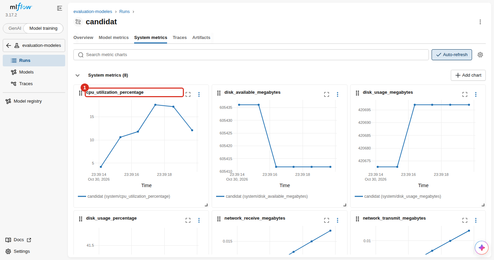

---

## GenAI : tracing et évaluation

Script : [`examples/genai_example.py`](examples/genai_example.py)

Un petit assistant répond à des questions sur le dataset Wine à partir de fiches. Le LLM tourne en local avec Ollama : aucune clé payante n'est nécessaire.

> [!IMPORTANT]
> Cet exemple a besoin d'un serveur Ollama, que ce projet ne fournit pas. Il a été testé avec le conteneur `ollama-central` sur le réseau Docker `llm-net` et le modèle `gemma4:e4b`. Il n'est pas lancé par la CI, faute d'Ollama. Avec un autre serveur, adaptez `OLLAMA_BASE_URL` et `OLLAMA_MODEL`.

Reliez le runner au réseau d'Ollama, puis lancez le script. Le premier appel peut prendre une minute, le temps de charger le modèle :

```bash
docker network connect llm-net mlflow-runner
```

```bash
docker compose exec -e OLLAMA_BASE_URL=http://ollama-central:11434/v1 runner python genai_example.py
```

La connexion réseau est à refaire si le conteneur `runner` est recréé.

```text
--- Une question, une trace ---
Combien de classes contient le dataset Wine ?
-> Le dataset Wine contient trois classes de vins : class_0, class_1 et class_2.
Trace : tr-d3cf5db52e5bfce269d34adfa4e94cc1

--- Évaluation sur le jeu de questions ---
Run d'évaluation : f002718798b9412fb62ece18506c9e93
contient_mot_cle/mean : 1.00
correctness/mean : 1.00
en_francais/mean : 1.00

--- Détail par question ---
{"question": "Combien de caractéristiques décrivent un vin ?"}
-> "Chaque vin est décrit par 13 caractéristiques chimiques, dont l'alcool et le magnésium."
   {'contient_mot_cle': True, 'en_francais': 'yes', 'correctness': 'yes'}
```

### Tracing

Une **trace** enregistre une exécution complète de l'assistant. Elle se compose de **spans**, un par étape. Deux lignes suffisent :

```python
mlflow.openai.autolog()  # un span par appel au LLM : messages, réponse, jetons

@mlflow.trace(span_type=SpanType.RETRIEVER)  # un span pour une fonction à vous
def chercher_fiche(question):
    ...
```

**Dans l'interface** : passez en mode **GenAI** en haut à gauche, puis ouvrez **Traces**. Chaque ligne associe une question (1) à sa réponse (2), avec sa durée et ses jetons.

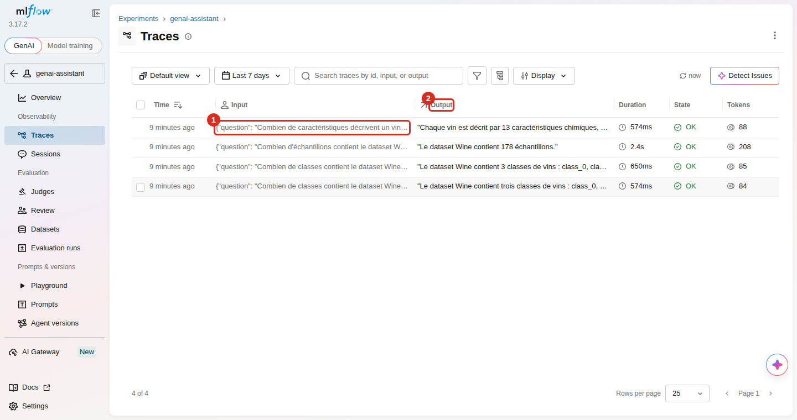

Un clic ouvre le détail : la recherche de fiche (1) et l'appel au LLM (2), avec leurs entrées et sorties.

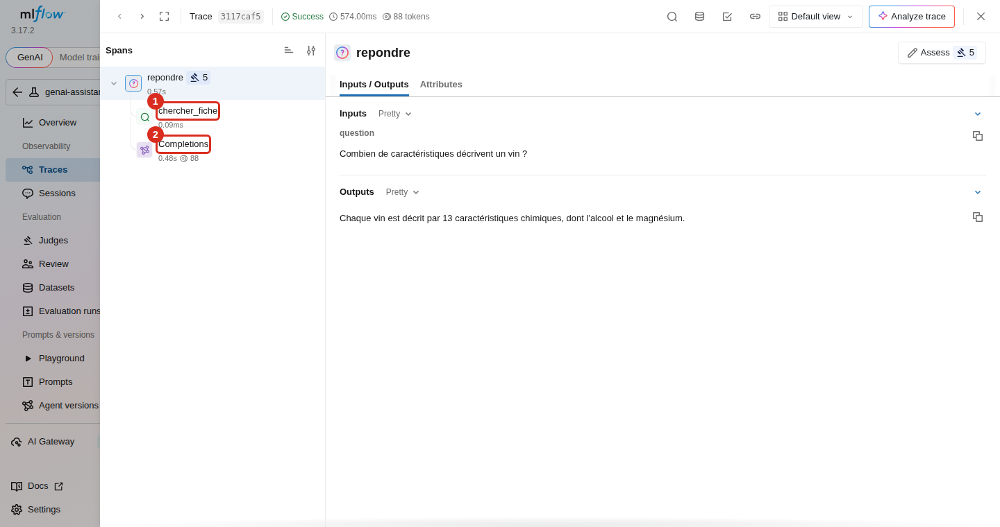

Les spans sont gardés dans PostgreSQL : la table `spans` en contient 12 après une exécution, soit 3 pour chacune des 4 traces. MLflow peut aussi écrire un fichier `traces/<trace_id>/artifacts/traces.json` dans SeaweedFS : il est apparu pour une trace sur 4 lors d'une exécution, et pour aucune lors d'une autre. Il n'est donc pas surprenant de voir ou non un dossier pour cette expérience dans le bucket.

### Évaluation

`mlflow.genai.evaluate` exécute l'assistant sur un jeu de questions et note chaque réponse avec des **scorers** :

```python
@scorer
def contient_mot_cle(outputs, expectations):  # critère en Python, sans LLM
    return expectations["mot_cle"] in outputs

resultat = mlflow.genai.evaluate(
    data=QUESTIONS,
    predict_fn=repondre,
    scorers=[
        contient_mot_cle,
        Correctness(model=JUGE),  # faits attendus, notés par un LLM : le juge
        Guidelines(name="en_francais", guidelines="La réponse doit être rédigée en français.", model=JUGE),
    ],
)
```

Ici le juge est le même modèle local que l'assistant, désigné par `openai:/gemma4:e4b`. Il passe par LiteLLM et l'API compatible OpenAI d'Ollama.

**Dans l'interface** : **Evaluation runs** donne un score moyen par critère.

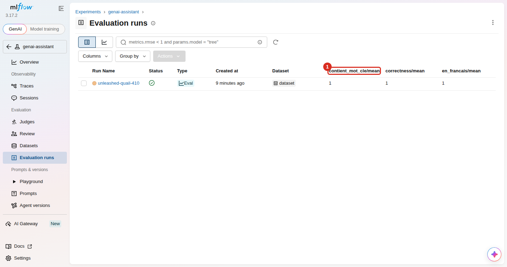

Un clic sur le run affiche chaque réponse (1) et ses notes (2).

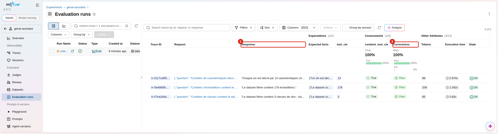

> [!WARNING]
> Un LLM ne donne pas toujours la même réponse. Dans la sortie ci-dessus, la première réponse écrit « trois » : elle est juste, mais `contient_mot_cle` la refuserait, car il cherche `3`. Lors d'un essai, ce critère est tombé à 0,67 alors que `correctness` restait à 1,00. Pour la même raison, un juge local n'a pas la fiabilité d'un jeu de tests : 3 questions montrent la mécanique, elles ne mesurent pas la qualité d'un assistant.

### Non couvert

L'interface 3.x propose aussi Sessions, Judges, Review, Datasets, Playground, Prompts, Agent versions, AI Gateway, MCP registry et MLflow Assistant. Ce tutoriel ne les couvre pas et ils n'ont pas été testés ici. L'évaluation en ligne des traces a besoin de l'exécuteur de tâches du serveur, désactivé par `MLFLOW_SERVER_ENABLE_JOB_EXECUTION` dans `docker-compose.yml` pour économiser la mémoire.

---

## Comparaison des Runs dans MLflow

### Utilisation de l'onglet "Compare"

1. Sélectionnez plusieurs runs (checkbox)
2. Cliquez sur "Compare"


3. Explorez les visualisations natives (Parallel Coordinates, Scatter Plot, Box Plot, Contour Plot). Sur la capture, les axes ont été choisis à la main : `model_type`, `cv_mean` et `test_accuracy`.


Les matrices de confusion enregistrées avec `mlflow.log_figure()` se consultent dans l'onglet **Artifacts** de chaque run.

---

## Troubleshooting

### Problème : "Connection refused" sur port 5000

**Solution :**
```bash
# Vérifier que les services sont lancés
docker compose ps

# Si non, les démarrer
docker compose up -d

# Attendre que MLflow soit healthy (30 secondes)
docker compose logs -f mlflow
```

### Problème : "Permission denied" sur scripts shell

**Cause :** Les scripts `.sh` peuvent perdre leurs permissions d'exécution lors du passage Windows -> WSL.

**Solution :**
```bash
chmod +x mlflow/entrypoint.sh
```

### Problème : "Cannot set a deleted experiment"

**Cause :** Vous avez supprimé l'expérience dans l'interface MLflow. MLflow ne supprime pas définitivement l'expérience (soft delete), mais le nom reste réservé.

**Solution :**
1.  **Réinitialiser la base de données** (le plus simple, mais supprime tous les runs et artefacts) :
    ```bash
    docker compose down -v
    docker compose up -d
    ```
2.  Ou changer le nom de l'expérience dans le script Python (`experiment_name = "..."`).

### Problème : "Error connecting to S3"

**Cause :** Les credentials S3 ne sont pas configurés.

**Solution :** Vérifiez que `.env` existe et contient `S3_ACCESS_KEY` et `S3_SECRET_KEY`. Dans le conteneur `runner`, `docker-compose.yml` les transmet automatiquement. Depuis l'hôte, `load_dotenv()` lit ce même fichier et le script vise `http://localhost:8333` par défaut.

### Problème : L'interface MLflow est vide

**Solution :**
1. Rien ne s'entraîne au démarrage : exécutez un script d'exemple
2. Choisissez **Model training** en haut à gauche, le mode **GenAI** masque les runs
3. Ouvrez la bonne expérience depuis **Experiments**

### Problème : le serveur répond 403 à un script

**Cause :** Depuis MLflow 3.5, le serveur refuse les en-têtes `Host` qu'il ne connaît pas.

**Solution :** Ajoutez l'adresse utilisée par le client à `MLFLOW_SERVER_ALLOWED_HOSTS` dans `docker-compose.yml`.

### Problème : "Detected out-of-date database schema"

**Cause :** La base a été créée par une version plus ancienne de MLflow.

**Solution :** Sauvegardez la base, puis lancez la migration avec PostgreSQL démarré :
```bash
docker compose run --rm --entrypoint sh mlflow -c 'mlflow db upgrade "$MLFLOW_BACKEND_STORE_URI"'
```
Le passage de MLflow 2.19 à 3.17 n'a pas eu besoin de cette commande : le serveur a migré la base seul au démarrage. Ce message n'a pas été rencontré ici. La commande a seulement été lancée sur une base déjà à jour, où elle n'a rien changé.

### Réinitialiser complètement

```bash
# Arrêter et supprimer tout
docker compose down -v

# Relancer proprement
docker compose up -d --build
```

---

## Ressources supplémentaires

- [Documentation officielle MLflow](https://mlflow.org/docs/latest/index.html)
- [MLflow GitHub](https://github.com/mlflow/mlflow)
- [Tutoriels vidéo MLflow](https://www.youtube.com/results?search_query=mlflow+tutorial)

---
