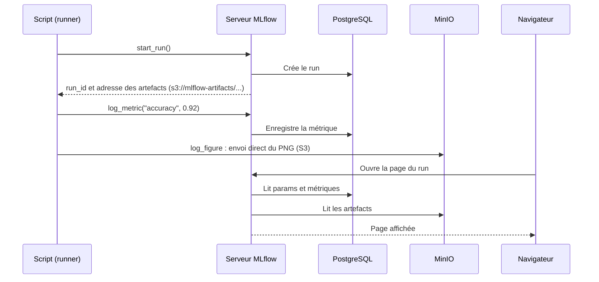

# Tutoriel MLflow avec Docker

> **Guide complet pour maîtriser le tracking d'expériences ML avec MLflow**

---

## Table des matières

1. [Introduction](#introduction)
2. [Architecture détaillée](#architecture-détaillée)
3. [Prérequis](#prérequis)
4. [Concepts clés](#concepts-clés-de-mlflow)
5. [Guide pratique](#guide-pratique)
6. [De la commande à l'interface](#de-la-commande-à-linterface)
7. [Model Registry](#model-registry)
8. [Comparaison des runs](#comparaison-des-runs-dans-mlflow)
9. [Troubleshooting](#troubleshooting)
10. [Ressources supplémentaires](#ressources-supplémentaires)

---

## Introduction

### Qu'est-ce que MLflow ?

**MLflow** est une plateforme open-source pour gérer le cycle de vie complet du Machine Learning. Elle répond aux défis courants des data scientists :

| Problème | Solution MLflow |
|----------|-----------------|
| "Quels hyperparamètres ai-je utilisé ?" | **Tracking** - Enregistrement automatique |
| "Quel modèle était le meilleur ?" | **Tracking** - Comparaison des runs |
| "Comment déployer mon modèle ?" | **Models** - Format standardisé |
| "Quelle version est en production ?" | **Registry** - Gestion des versions |

### Architecture détaillée

Ce projet utilise une architecture conteneurisée moderne pour garantir la reproductibilité et l'isolation. Voici le rôle de chaque composant :


#### 1. PostgreSQL (Backend Store)
Base de données relationnelle qui stocke toutes les **métadonnées légères** :
- La liste des expériences et des runs
- Les paramètres, métriques et tags
- L'historique des versions du Model Registry
- *Pourquoi ?* Offre performance et intégrité des données par rapport à un stockage fichier.

#### 2. MinIO (Artifact Store)
Serveur de stockage d'objets compatible Amazon S3. Il stocke les **fichiers lourds** (Artefacts) :
- Modèles sérialisés (`.pkl`, `.h5`)
- Graphiques et images
- Datasets
- *Pourquoi ?* Simule un environnement cloud (AWS S3) en local. MLflow ne stocke pas les fichiers dans la base de données.

#### 3. MinIO Setup
Conteneur éphémère qui ne tourne que quelques secondes au démarrage.
- *Rôle* : Créer automatiquement le bucket `mlflow-artifacts` dans MinIO.
- *Pourquoi ?* MinIO démarre vide par défaut. Ce service nous évite de devoir configurer manuellement le bucket à chaque lancement.

#### 4. Runner
Environnement d'exécution isolé contenant Python et les librairies nécessaires.
- *Rôle* : Exécuter vos scripts d'entraînement.
- *Pourquoi ?* Garantit que le code tourne exactement de la même manière pour tout le monde, indépendamment de votre machine hôte (plus de "ça marche sur ma machine").

#### Pourquoi un Dockerfile custom au lieu d'une image tierce ?

On aurait pu partir d'une image prête à l'emploi comme `ghcr.io/mlflow/mlflow`. Construire la nôtre a deux intérêts ici :

- **Contrôle** : on choisit chaque dépendance, dont le driver PostgreSQL (`psycopg2-binary`) et le client S3 (`boto3`) dont ce projet a besoin.
- **Apprentissage** : chaque étape est lisible (build multi-stage, utilisateur non-root, entrypoint, healthcheck).

Le coût : les mises à jour sont à notre charge. L'image finale pèse environ 1 Go.

> [!TIP]
> **En production**, une image maintenue permet de démarrer plus vite, après avoir vérifié qu'elle embarque le driver PostgreSQL et `boto3`. Le Dockerfile custom de ce tutoriel est avant tout **pédagogique**.

---

## Prérequis

### Logiciels requis

| Logiciel | Usage | Vérification |
|----------|-------|--------------|
| WSL 2 (Ubuntu) | Environnement Linux sous Windows | `wsl --version` |
| Docker | Moteur de conteneurisation | `docker --version` |
| Docker Compose | Orchestration des services | `docker compose version` |

> [!TIP]
> **Pourquoi WSL ?** MLflow et de nombreux outils MLOps sont conçus pour Linux. WSL vous offre un environnement natif performant sans les problèmes de compatibilité de Windows.

### Démarrage du projet

1. **Créer la configuration** :
   ```bash
   cp .env.example .env
   ```
   Puis remplacez les valeurs `CHANGEZ_MOI_EN_PRODUCTION` dans `.env`.

2. **Lancer les services** :
   ```bash
   docker compose up -d
   ```

3. **Vérifier l'état** :
   ```bash
   docker compose ps
   ```
   `mlflow-server`, `mlflow-minio` et `mlflow-postgres` doivent être `healthy`. `mlflow-runner` est `running`, sans état de santé. `mlflow-minio-setup` n'apparaît pas dans la liste : il s'arrête une fois le bucket créé.

4. **Accéder à l'interface** :
   Ouvrez [http://localhost:5000](http://localhost:5000)

5. **Regarder le premier entraînement** :
   Le conteneur `runner` lance `sklearn_example.py` à son démarrage. Suivez-le avec :
   ```bash
   docker compose logs -f runner
   ```

6. **Relancer un entraînement** :
   ```bash
   docker compose exec runner python sklearn_example.py
   ```
   Chaque exécution ajoute 4 runs et une nouvelle version du modèle `wine-classifier`.

---

## Concepts clés de MLflow

### 1. Expérience (Experiment)

Une **expérience** est un conteneur pour organiser vos runs. Par exemple :
- `detection-pneumonie-v1`
- `classification-images-resnet`

```python
import mlflow

# Créer ou sélectionner une expérience
mlflow.set_experiment("mon-experience")
```

### 2. Run

Un **run** est une exécution unique d'un entraînement. Chaque run a :
- Un **ID unique**
- Des **paramètres** (hyperparamètres)
- Des **métriques** (résultats)
- Des **artefacts** (fichiers)
- Des **tags** (métadonnées)

```python
with mlflow.start_run(run_name="test-lr-0.01"):
    # Votre code d'entraînement
    pass
```

### 3. Paramètres vs Métriques

| Paramètres | Métriques |
|------------|-----------|
| Valeurs **fixes** en entrée | Valeurs **calculées** en sortie |
| Ex: learning_rate, batch_size | Ex: accuracy, loss |
| Log une seule fois | Peuvent être loggées plusieurs fois (par époque) |

```python
# Paramètres
mlflow.log_param("learning_rate", 0.01)
mlflow.log_param("epochs", 100)

# Métriques
mlflow.log_metric("accuracy", 0.95)
mlflow.log_metric("loss", 0.1, step=10)  # Avec numéro d'étape
```

### 4. Artefacts

Les **artefacts** sont des fichiers associés au run :
- Modèles entraînés
- Graphiques (courbes de loss, matrices de confusion)
- Fichiers de configuration
- Datasets

```python
# Logger un fichier générique (texte, json, etc)
mlflow.log_artifact("config.yaml")

# Logger une figure Matplotlib, visible dans l'onglet "Artifacts" du run
mlflow.log_figure(fig, "confusion_matrix.png")

# Logger un modèle scikit-learn
mlflow.sklearn.log_model(model, "model")
```

---

## Guide pratique

Chaque exemple est un script de `examples/`, à lancer dans le conteneur `runner`.

### Exemple 1 : Logging basique

Script : [`examples/basic_example.py`](examples/basic_example.py)

```bash
docker compose exec runner python basic_example.py
```

```python
mlflow.set_experiment("tutoriel-basique")

with mlflow.start_run(run_name="premier-run") as run:
    # Paramètres : les valeurs d'entrée, loggées une seule fois
    mlflow.log_param("algorithm", "random_forest")
    mlflow.log_param("n_estimators", 100)

    # Métrique : plusieurs valeurs au fil des étapes (donne une courbe)
    for step, loss in enumerate([0.9, 0.5, 0.3, 0.2, 0.15]):
        mlflow.log_metric("loss", loss, step=step)
    mlflow.log_metric("accuracy", 0.92)

    # Tags : métadonnées libres, utiles pour filtrer
    mlflow.set_tag("auteur", "tutoriel")
```

Le terminal affiche le lien direct vers le run dans l'interface :

```text
🏃 View run premier-run at: http://mlflow:5000/#/experiments/<id>/runs/<run_id>
Run terminé : <run_id>
```

> Ce lien utilise `mlflow:5000`, l'adresse du serveur dans le réseau Docker. Depuis votre navigateur, remplacez `mlflow` par `localhost`.

### Exemple 2 : Auto-logging avec scikit-learn

Script : [`examples/autolog_example.py`](examples/autolog_example.py)

```bash
docker compose exec runner python autolog_example.py
```

MLflow enregistre seul les hyperparamètres, les métriques d'entraînement et le modèle :

```python
# À appeler avant fit() : c'est lui qui déclenche l'enregistrement
mlflow.sklearn.autolog()

with mlflow.start_run(run_name="random-forest-autolog") as run:
    RandomForestClassifier(n_estimators=100, random_state=42).fit(X_train, y_train)
```

Sans aucun appel à `log_param` ni `log_metric`, le run contient 19 paramètres et 7 métriques :

```text
Paramètres enregistrés : 19
Métriques enregistrées : ['training_accuracy_score', 'training_f1_score', 'training_log_loss', 'training_precision_score', 'training_recall_score', 'training_roc_auc', 'training_score']
```

### Exemple 3 : Comparaison de modèles

Le script [`examples/sklearn_example.py`](examples/sklearn_example.py) entraîne 4 modèles sur le dataset Wine, compare leurs performances et enregistre le meilleur dans le Model Registry.

```bash
docker compose exec runner python sklearn_example.py
```

### Exemple 4 : Logging du Dataset

Script : [`examples/dataset_example.py`](examples/dataset_example.py)

```bash
docker compose exec runner python dataset_example.py
```

`log_input` relie le run aux données qui l'ont nourri. MLflow garde le nom, la source, une empreinte (digest) et le schéma, mais ne copie pas les données :

```python
for df_split, context in [(df_train, "training"), (df_test, "test")]:
    dataset = mlflow.data.from_pandas(
        df_split,
        source="sklearn.datasets.load_wine",
        name=f"wine_{context}",
    )
    # context : rôle du dataset dans ce run ("training", "validation", "test")
    mlflow.log_input(dataset, context=context)
```

```text
Dataset wine_training : digest 4f1188a9, training
Dataset wine_test : digest 0ef539ce, test
```

---

## De la commande à l'interface

Chaque appel Python laisse une trace à un endroit précis de l'interface, et ses données sont rangées dans l'un des deux stores :

| Appel Python | Où le voir sur `http://localhost:5000` | Stocké dans |
|---|---|---|
| `set_experiment("x")` | Page **Experiments**, liste de gauche | PostgreSQL |
| `start_run(run_name="y")` | Une ligne dans la table des runs de l'expérience | PostgreSQL |
| `log_param` | Run > **Overview** > Parameters | PostgreSQL |
| `log_metric`, `log_metrics` | Run > **Overview** > Metrics ; courbes dans **Model metrics** | PostgreSQL |
| `set_tag` | Run > **Overview** > Tags | PostgreSQL |
| `log_input` | Run > **Overview** > Datasets used | PostgreSQL |
| `log_figure`, `log_artifact` | Run > **Artifacts** | MinIO |
| `sklearn.log_model` | Run > **Artifacts** > `model` ; Run > **Overview** > Logged models | MinIO |
| `register_model` | Page **Models** ; Run > **Overview** > Registered models | PostgreSQL (le fichier reste dans MinIO) |
| `set_registered_model_alias` | Page **Models** > `wine-classifier`, colonne Aliases | PostgreSQL |

### Ce qui se passe à chaque appel

Les métadonnées passent par le serveur MLflow. Les fichiers partent directement du script vers MinIO, ce qui explique que le `runner` ait besoin des identifiants S3.



---

---

## Model Registry

### Qu'est-ce que le Model Registry ?

Le **Model Registry** centralise les modèles validés et garde leur historique :

- **Versions** : chaque enregistrement crée une nouvelle version (`v1`, `v2`, `v3`). MLflow les conserve toutes.
- **Aliases** : une étiquette mobile posée sur une version. `@champion` désigne le modèle de référence, `@challenger` un candidat à évaluer. Un alias ne désigne qu'une seule version à la fois.

> [!NOTE]
> Les **stages** (`None`, `Staging`, `Production`, `Archived`) et `transition_model_version_stage` sont dépréciés depuis MLflow 2.9. Les aliases les remplacent, c'est pourquoi `sklearn_example.py` les utilise.

### Enregistrer un modèle

```python
model_version = mlflow.register_model(
    model_uri=f"runs:/{run_id}/model",
    name="wine-classifier"
)
```

### Désigner le modèle de référence

```python
client = MlflowClient()
client.set_registered_model_alias(
    name="wine-classifier",
    alias="champion",
    version=model_version.version
)
```

Pour revenir en arrière, reposez l'alias sur une version précédente. Le code qui charge `@champion` n'a pas à changer.

### Charger un modèle

```python
# Par alias (recommandé pour les applications)
model = mlflow.sklearn.load_model("models:/wine-classifier@champion")

# Par version
model = mlflow.sklearn.load_model("models:/wine-classifier/1")
```

> [!WARNING]
> Dans `sklearn_example.py`, le modèle a été entraîné sur des données normalisées et le `StandardScaler` n'est pas enregistré avec lui. Il faut donc lui donner des données normalisées de la même façon. En conditions réelles, enregistrez plutôt un `Pipeline` scikit-learn complet.

---

## Comparaison des Runs dans MLflow

### Utilisation de l'onglet "Compare"

1. Sélectionnez plusieurs runs (checkbox)
2. Cliquez sur "Compare"
3. Explorez les visualisations natives (Scatter Plot, Contour Plot, Parallel Coordinates)

Les matrices de confusion enregistrées avec `mlflow.log_figure()` se consultent dans l'onglet **Artifacts** de chaque run.

---

## Troubleshooting

### Problème : "Connection refused" sur port 5000

**Solution :**
```bash
# Vérifier que les services sont lancés
docker compose ps

# Si non, les démarrer
docker compose up -d

# Attendre que MLflow soit healthy (30 secondes)
docker compose logs -f mlflow
```

### Problème : "Permission denied" sur scripts shell

**Cause :** Les scripts `.sh` peuvent perdre leurs permissions d'exécution lors du passage Windows -> WSL.

**Solution :**
```bash
chmod +x mlflow/entrypoint.sh
```

### Problème : "Cannot set a deleted experiment"

**Cause :** Vous avez supprimé l'expérience dans l'interface MLflow. MLflow ne supprime pas définitivement l'expérience (soft delete), mais le nom reste réservé.

**Solution :**
1.  **Réinitialiser la base de données** (le plus simple, mais supprime tous les runs et artefacts) :
    ```bash
    docker compose down -v
    docker compose up -d
    ```
2.  Ou changer le nom de l'expérience dans le script Python (`experiment_name = "..."`).

### Problème : "Error connecting to S3"

**Cause :** Les credentials MinIO ne sont pas configurés.

**Solution :** Vérifiez que `.env` existe et contient `MINIO_ROOT_USER` et `MINIO_ROOT_PASSWORD`. Dans le conteneur `runner`, `docker-compose.yml` les transmet automatiquement. Depuis l'hôte, `load_dotenv()` lit ce même fichier et le script vise `http://localhost:9000` par défaut.

### Problème : L'interface MLflow est vide

**Solution :**
1. Vérifiez que vous avez exécuté un script d'exemple
2. Rafraîchissez la page
3. Sélectionnez la bonne expérience dans le menu déroulant

### Réinitialiser complètement

```bash
# Arrêter et supprimer tout
docker compose down -v

# Relancer proprement
docker compose up -d --build
```

---

## Ressources supplémentaires

- [Documentation officielle MLflow](https://mlflow.org/docs/latest/index.html)
- [MLflow GitHub](https://github.com/mlflow/mlflow)
- [Tutoriels vidéo MLflow](https://www.youtube.com/results?search_query=mlflow+tutorial)

---
