# Tutoriel MLflow avec Docker

> **Guide complet pour maîtriser le tracking d'expériences ML avec MLflow**
>
> Pour une simple visite du projet et de son interface, voir le [manuel utilisateur](documentation/manuel-utilisateur.md).

---

## Table des matières

1. [Introduction](#introduction)
2. [Architecture détaillée](#architecture-détaillée)
3. [Prérequis](#prérequis)
4. [Concepts clés](#concepts-clés-de-mlflow)
5. [Guide pratique](#guide-pratique)
6. [De la commande à l'interface](#de-la-commande-à-linterface)
7. [Model Registry](#model-registry)
8. [Logged Models et évaluation](#logged-models-et-évaluation)
9. [Mise en production](#mise-en-production)
10. [Autres types de modèles](#autres-types-de-modèles)
11. [Images, tableaux et recherche d'hyperparamètres](#images-tableaux-et-recherche-dhyperparamètres)
12. [GenAI : du prompt au service](#genai--du-prompt-au-service)
13. [Comparaison des runs](#comparaison-des-runs-dans-mlflow)
14. [Bonnes pratiques](#bonnes-pratiques)
15. [Troubleshooting](#troubleshooting)
16. [Ressources supplémentaires](#ressources-supplémentaires)

---

## Introduction

### Qu'est-ce que MLflow ?

**MLflow** est une plateforme open-source pour gérer le cycle de vie complet du Machine Learning. Elle répond aux défis courants des data scientists :

| Problème | Solution MLflow |
|----------|-----------------|
| "Quels hyperparamètres ai-je utilisé ?" | **Tracking** - Enregistrement automatique |
| "Quel modèle était le meilleur ?" | **Tracking** - Comparaison des runs |
| "Comment déployer mon modèle ?" | **Models** - Format standardisé |
| "Quelle version est en production ?" | **Registry** - Gestion des versions |

### Le parcours complet

Ce tutoriel suit un modèle de l'entraînement jusqu'à l'API, avec un script par étape :

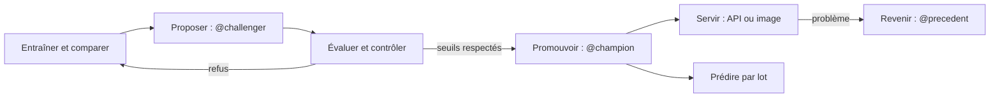

| Étape | Script ou commande | Chapitre |
|---|---|---|
| Suivre les essais | `basic_example.py`, `autolog_example.py`, `dataset_example.py` | [Guide pratique](#guide-pratique) |
| Comparer, proposer un candidat | `sklearn_example.py`, `recherche_example.py` | [Guide pratique](#guide-pratique), [Recherche](#recherche-dhyperparamètres) |
| Suivre des images et des tableaux | `images_example.py` | [Images](#images-par-étape) |
| Évaluer | `evaluation_example.py` | [Évaluation](#évaluation) |
| Promouvoir sous contrôle | `promotion_example.py` | [Promotion](#1-promotion-contrôlée) |
| Servir et interroger | `model-server`, `serving_example.py` | [API](#2-api-de-prédiction) |
| Livrer une image autonome | `mlflow models generate-dockerfile` | [Image](#4-image-autonome) |
| Changer de framework | `xgboost_example.py`, `pyfunc_example.py`, `pytorch_example.py` | [Autres types](#autres-types-de-modèles) |
| Faire de même avec un LLM | `genai_example.py` | [GenAI](#genai--du-prompt-au-service) |

### Architecture détaillée

Ce projet utilise une architecture conteneurisée moderne pour garantir la reproductibilité et l'isolation. Voici le rôle de chaque composant :

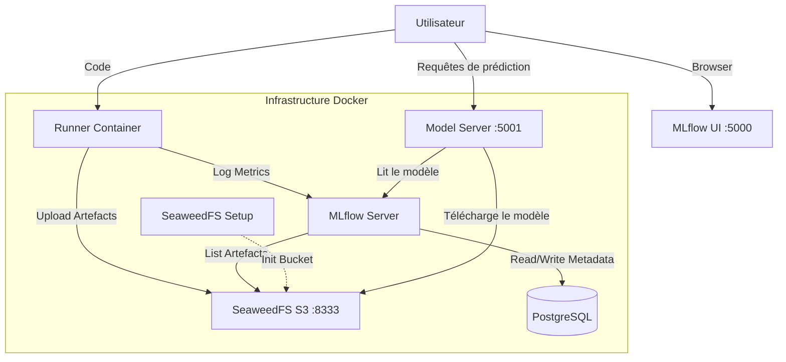

#### 1. PostgreSQL (Backend Store)
Base de données relationnelle qui stocke toutes les **métadonnées légères** :
- La liste des expériences et des runs
- Les paramètres, métriques et tags
- L'historique des versions du Model Registry
- *Pourquoi ?* Offre performance et intégrité des données par rapport à un stockage fichier.

#### 2. SeaweedFS (Artifact Store)
Serveur de stockage d'objets doté d'une passerelle compatible Amazon S3. Il stocke les **fichiers lourds** (Artefacts) :
- Modèles sérialisés (`model.skops`)
- Graphiques et images
- Datasets
- *Pourquoi ?* Simule un environnement cloud (AWS S3) en local. MLflow ne stocke pas les fichiers dans la base de données.

#### 3. SeaweedFS Setup
Conteneur éphémère qui ne tourne que quelques secondes au démarrage.
- *Rôle* : Créer automatiquement le bucket `mlflow-artifacts` dans SeaweedFS.
- *Pourquoi ?* SeaweedFS démarre vide par défaut. Ce service nous évite de devoir configurer manuellement le bucket à chaque lancement.

#### 4. Runner
Environnement d'exécution isolé contenant Python et les librairies nécessaires.
- *Rôle* : Exécuter vos scripts d'entraînement.
- *Pourquoi ?* Garantit que le code tourne exactement de la même manière pour tout le monde, indépendamment de votre machine hôte (plus de "ça marche sur ma machine").

#### 5. Services à la demande
Deux services ne démarrent que si on les demande, grâce aux *profils* de Docker Compose :
- `model-server` (profil `serving`) : l'API de prédiction, qui sert le modèle `@champion`.
- `runner-torch` (profil `deep`) : le runner avec PyTorch, séparé car son image pèse 900 Mo de plus.

#### Pourquoi un Dockerfile custom au lieu d'une image tierce ?

On aurait pu partir d'une image prête à l'emploi comme `ghcr.io/mlflow/mlflow`. Construire la nôtre a deux intérêts ici :

- **Contrôle** : on choisit chaque dépendance, dont le driver PostgreSQL (`psycopg`) et le client S3 (`boto3`) dont ce projet a besoin.
- **Apprentissage** : chaque étape est lisible (build multi-stage, utilisateur non-root, entrypoint, healthcheck).

Le coût : les mises à jour sont à notre charge. L'image finale pèse environ 1 Go.

> [!TIP]
> **En production**, une image maintenue permet de démarrer plus vite, après avoir vérifié qu'elle embarque le driver PostgreSQL et `boto3`. Le Dockerfile custom de ce tutoriel est avant tout **pédagogique**.

---

## Prérequis

### Logiciels requis

| Logiciel | Usage | Vérification |
|----------|-------|--------------|
| WSL 2 (Ubuntu) | Environnement Linux sous Windows | `wsl --version` |
| Docker | Moteur de conteneurisation | `docker --version` |
| Docker Compose | Orchestration des services | `docker compose version` |

> [!TIP]
> **Pourquoi WSL ?** MLflow et de nombreux outils MLOps sont conçus pour Linux. WSL vous offre un environnement natif performant sans les problèmes de compatibilité de Windows.

### Démarrage du projet

1. **Créer la configuration** :
   ```bash
   cp .env.example .env
   ```
   Puis remplacez les valeurs `CHANGEZ_MOI_EN_PRODUCTION` dans `.env`.

2. **Lancer les services** :
   ```bash
   docker compose up -d
   ```

3. **Vérifier l'état** :
   ```bash
   docker compose ps
   ```
   Résultat attendu (colonnes abrégées) :
   ```text
   NAME               SERVICE     STATUS
   mlflow-postgres    postgres    Up 7 minutes (healthy)
   mlflow-runner      runner      Up 7 minutes
   mlflow-seaweedfs   seaweedfs   Up 7 minutes (healthy)
   mlflow-server      mlflow      Up 7 minutes (healthy)
   ```
   `mlflow-server`, `mlflow-seaweedfs` et `mlflow-postgres` doivent être `healthy`. `mlflow-runner` est `running`, sans état de santé. `mlflow-seaweedfs-setup` n'apparaît pas dans la liste : il s'arrête une fois le bucket créé.

4. **Accéder à l'interface** :
   Ouvrez [http://localhost:5000](http://localhost:5000)

5. **Lancer un premier entraînement** :
   ```bash
   docker compose exec runner python sklearn_example.py
   ```
   Chaque exécution ajoute 4 runs et une nouvelle version du modèle `wine-classifier`, qui reçoit l'alias `@challenger`. Rien ne s'entraîne au démarrage : un `docker compose up` ne crée pas de version et ne déplace aucun alias.

6. **Choisir le mode de l'interface** :
   En haut à gauche, un bouton bascule entre **GenAI**, affiché par défaut, et **Model training**. Les captures de ce tutoriel sont en mode **Model training**, sauf le chapitre GenAI. Le panneau **MLflow Assistant**, ouvert à la première visite, se ferme avec sa croix.

---

## Concepts clés de MLflow

### 1. Expérience (Experiment)

Une **expérience** est un conteneur pour organiser vos runs. Par exemple :
- `detection-pneumonie-v1`
- `classification-images-resnet`

```python
import mlflow

# Créer ou sélectionner une expérience
mlflow.set_experiment("mon-experience")
```

### 2. Run

Un **run** est une exécution unique d'un entraînement. Chaque run a :
- Un **ID unique**
- Des **paramètres** (hyperparamètres)
- Des **métriques** (résultats)
- Des **artefacts** (fichiers)
- Des **tags** (métadonnées)

```python
with mlflow.start_run(run_name="test-lr-0.01"):
    # Votre code d'entraînement
    pass
```

### 3. Paramètres vs Métriques

| Paramètres | Métriques |
|------------|-----------|
| Valeurs **fixes** en entrée | Valeurs **calculées** en sortie |
| Ex: learning_rate, batch_size | Ex: accuracy, loss |
| Log une seule fois | Peuvent être loggées plusieurs fois (par époque) |

```python
# Paramètres
mlflow.log_param("learning_rate", 0.01)
mlflow.log_param("epochs", 100)

# Métriques
mlflow.log_metric("accuracy", 0.95)
mlflow.log_metric("loss", 0.1, step=10)  # Avec numéro d'étape
```

### 4. Artefacts

Les **artefacts** sont des fichiers associés au run :
- Modèles entraînés
- Graphiques (courbes de loss, matrices de confusion)
- Fichiers de configuration
- Datasets

```python
# Logger un fichier générique (texte, json, etc)
mlflow.log_artifact("config.yaml")

# Logger une figure Matplotlib, visible dans l'onglet "Artifacts" du run
mlflow.log_figure(fig, "confusion_matrix.png")

# Logger un modèle scikit-learn
mlflow.sklearn.log_model(model, name="model")
```

---

## Guide pratique

Chaque exemple est un script de `examples/`, à lancer dans le conteneur `runner`.

### Exemple 1 : Logging basique

Script : [`examples/basic_example.py`](examples/basic_example.py)

```bash
docker compose exec runner python basic_example.py
```

```python
mlflow.set_experiment("tutoriel-basique")

with mlflow.start_run(run_name="premier-run") as run:
    # Paramètres : les valeurs d'entrée, loggées une seule fois
    mlflow.log_param("algorithm", "random_forest")
    mlflow.log_param("n_estimators", 100)

    # Métrique : plusieurs valeurs au fil des étapes (donne une courbe)
    for step, loss in enumerate([0.9, 0.5, 0.3, 0.2, 0.15]):
        mlflow.log_metric("loss", loss, step=step)
    mlflow.log_metric("accuracy", 0.92)

    # Tags : métadonnées libres, utiles pour filtrer
    mlflow.set_tag("auteur", "tutoriel")
```

Le terminal affiche le lien direct vers le run dans l'interface :

```text
🏃 View run premier-run at: http://mlflow:5000/#/experiments/<id>/runs/<run_id>
Run terminé : <run_id>
```

> Ce lien utilise `mlflow:5000`, l'adresse du serveur dans le réseau Docker. Depuis votre navigateur, remplacez `mlflow` par `localhost`.

**Dans l'interface** : ouvrez l'onglet **Model metrics** du run. Les 5 valeurs de `loss` forment une courbe, alors que `accuracy`, enregistrée une seule fois, reste une barre.

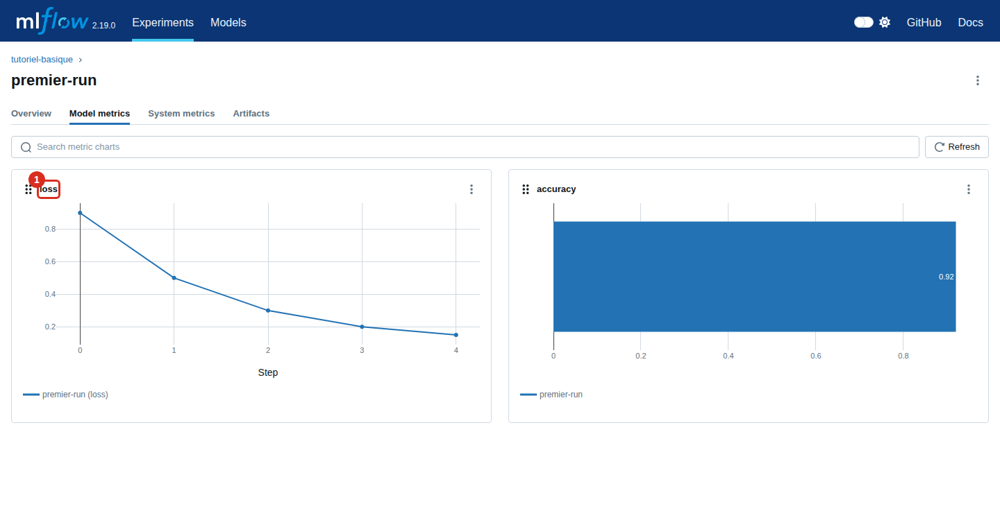

### Exemple 2 : Auto-logging avec scikit-learn

Script : [`examples/autolog_example.py`](examples/autolog_example.py)

```bash
docker compose exec runner python autolog_example.py
```

MLflow enregistre seul les hyperparamètres, les métriques d'entraînement et le modèle :

```python
# À appeler avant fit() : c'est lui qui déclenche l'enregistrement
mlflow.sklearn.autolog()

with mlflow.start_run(run_name="random-forest-autolog") as run:
    RandomForestClassifier(n_estimators=100, random_state=42).fit(X_train, y_train)
```

Sans aucun appel à `log_param` ni `log_metric`, le run contient 19 paramètres et 7 métriques :

```text
Paramètres enregistrés : 19
Métriques enregistrées : ['training_accuracy_score', 'training_f1_score', 'training_log_loss', 'training_precision_score', 'training_recall_score', 'training_roc_auc', 'training_score']
```

**Dans l'interface** : les compteurs **Metrics (7)** et **Parameters (19)** correspondent à la sortie du terminal. L'autolog a aussi enregistré un dataset et le modèle.

Le terminal affiche un avertissement sur le format pickle : l'autolog sérialise en cloudpickle, alors que `log_model` utilise skops par défaut. Ne chargez un tel modèle que s'il vient d'une source de confiance.


### Exemple 3 : Comparaison de modèles

Le script [`examples/sklearn_example.py`](examples/sklearn_example.py) entraîne 4 modèles sur le dataset Wine, compare leurs performances et enregistre le meilleur dans le Model Registry. Chaque modèle est un `Pipeline` qui inclut le `StandardScaler`.

```bash
docker compose exec runner python sklearn_example.py
```

Le terminal résume les performances et désigne le meilleur modèle :

```text
                     test_accuracy  f1_score   cv_mean
Logistic Regression       0.972222   0.97197  0.993103
Random Forest             1.000000   1.00000  0.986207
SVM RBF                   0.972222   0.97197  0.986207
Random Forest Large       1.000000   1.00000  0.979064

🏆 Meilleur modèle: Logistic Regression
   CV Score: 0.9931
   Accuracy (test): 0.9722
```

Le classement se fait sur la validation croisée (`cv_mean`), à score égal sur la plus faible dispersion (`cv_std`). Le jeu de test ne sert pas à choisir : il reste une estimation indépendante. Voilà pourquoi la Logistic Regression l'emporte malgré ses 0,97 sur le test, contre 1,00 pour les Random Forest.

**Dans l'interface** : chaque modèle devient une ligne de l'expérience `comparaison-modeles`. Seul le meilleur porte `wine-classifier` dans la colonne Models, les autres affichent leur Logged Model `model`.

Ce meilleur modèle reçoit l'alias `@challenger` : c'est un candidat, pas encore le modèle de référence. La [promotion](#1-promotion-contrôlée) décide de la suite.

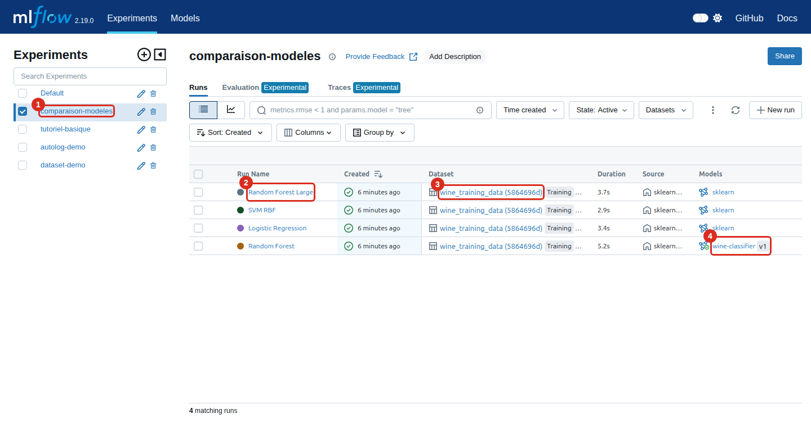

### Exemple 4 : Logging du Dataset

Script : [`examples/dataset_example.py`](examples/dataset_example.py)

```bash
docker compose exec runner python dataset_example.py
```

`log_input` relie le run aux données qui l'ont nourri. MLflow garde le nom, la source, une empreinte (digest) et le schéma, mais ne copie pas les données :

```python
for df_split, context in [(df_train, "training"), (df_test, "test")]:
    dataset = mlflow.data.from_pandas(
        df_split,
        source="sklearn.datasets.load_wine",
        name=f"wine_{context}",
    )
    # context : rôle du dataset dans ce run ("training", "validation", "test")
    mlflow.log_input(dataset, context=context)
```

```text
Dataset wine_training : digest 4f1188a9, training
Dataset wine_test : digest 0ef539ce, test
```

**Dans l'interface** : **Datasets** affiche `wine_training` et le digest `4f1188a9` du terminal. Le bouton `+1` déplie le second dataset.


---

## De la commande à l'interface

Chaque appel Python laisse une trace à un endroit précis de l'interface, et ses données sont rangées dans l'un des deux stores :

| Appel Python | Où le voir sur `http://localhost:5000` | Stocké dans |
|---|---|---|
| `set_experiment("x")` | Page **Experiments** | PostgreSQL |
| `start_run(run_name="y")` | Une ligne dans **Runs**, page de l'expérience | PostgreSQL |
| `log_param` | Run > **Overview** > Parameters | PostgreSQL |
| `log_metric`, `log_metrics` | Run > **Overview** > Metrics ; courbes dans **Model metrics** | PostgreSQL |
| `start_run(log_system_metrics=True)` | Run > **System metrics** | PostgreSQL |
| `set_tag` | Run > **Overview** > Tags | PostgreSQL |
| `log_input` | Run > **Overview** > Datasets | PostgreSQL |
| `log_figure`, `log_artifact` | Run > **Artifacts** | SeaweedFS |
| `log_image(key=..., step=...)` | Run > **Model metrics**, avec un curseur ; Run > **Artifacts** > `images` | SeaweedFS |
| `log_table` | Run > **Artifacts**, affiché en tableau | SeaweedFS |
| `sklearn.log_model` | Expérience > **Models** ; Run > **Overview** > Logged models | Fichiers : SeaweedFS. Fiche : PostgreSQL |
| `register_model` | Page **Model registry** ; Run > **Overview** > Registered models | PostgreSQL (le fichier reste dans SeaweedFS) |
| `set_registered_model_alias` | Page **Model registry**, colonne Aliased versions | PostgreSQL |
| `set_model_version_tag` | Page d'une version > **Tags** | PostgreSQL |
| `models.evaluate` | Run > **Overview** > Metrics ; Run > **Artifacts** ; Expérience > **Models** | Métriques : PostgreSQL. Graphiques : SeaweedFS |
| `genai.register_prompt`, `genai.set_prompt_alias` | Mode GenAI > **Prompts** | PostgreSQL |
| `@mlflow.trace`, `openai.autolog` | Mode GenAI > **Traces** | PostgreSQL |
| `genai.evaluate` | Mode GenAI > **Evaluation runs** | PostgreSQL |

La capture ci-dessous repère ces éléments sur un run de `sklearn_example.py` : (1) `log_input`, (2) `set_tag`, (3) `register_model`, (4) `log_metrics`, (5) `log_param`, (6) `log_model`.

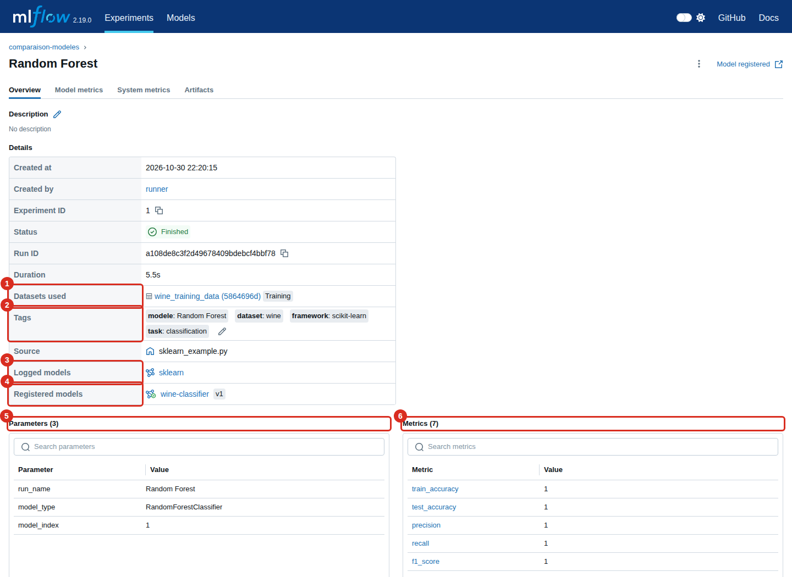

L'onglet **Artifacts** montre les fichiers de `log_figure` et `log_artifact`. L'adresse en `s3://` (2) confirme qu'ils sont rangés dans SeaweedFS.

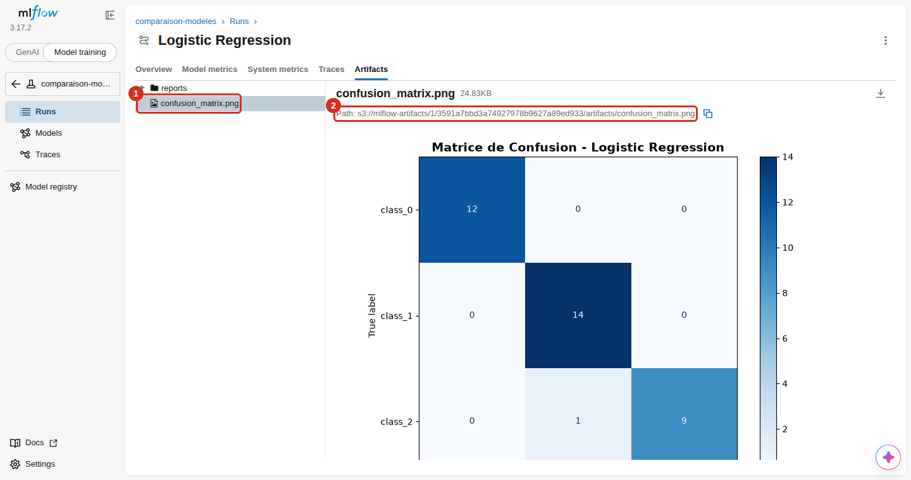

### Suivre un artefact jusqu'à SeaweedFS

L'adresse `s3://mlflow-artifacts/1/<run_id>/artifacts/confusion_matrix.png` se lit directement dans l'interface du filer, sur `http://localhost:8888/buckets/mlflow-artifacts/`.

Le premier niveau du bucket est l'identifiant de l'expérience. Seules les expériences ayant enregistré des fichiers y figurent : `basic_example.py` et `dataset_example.py` n'en écrivent aucun. `.uploads` est un dossier interne de SeaweedFS.

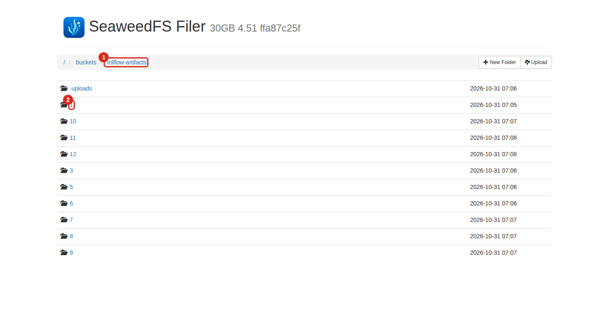

Le niveau suivant contient un dossier `models` pour les Logged Models (1), et un dossier par Run ID (2) :

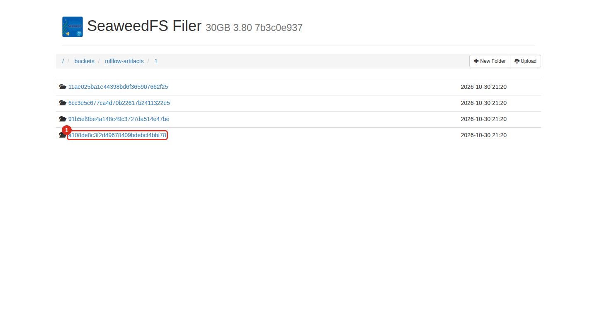

Le dossier d'un run contient les fichiers de `log_figure` et `log_artifact` :

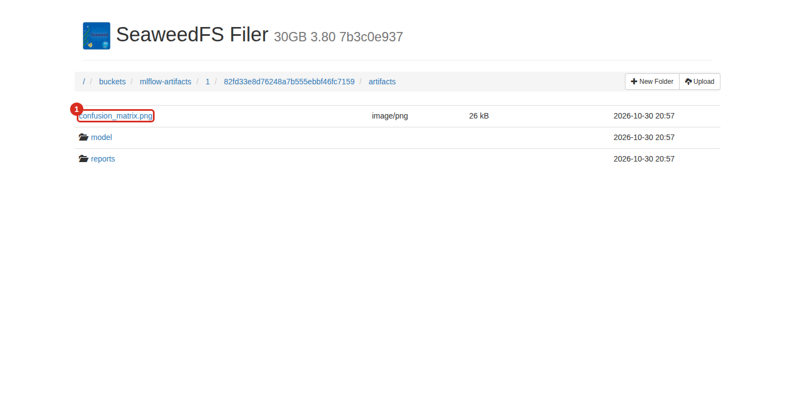

Le dossier `models/<model_id>/artifacts/` contient ce qu'a écrit `sklearn.log_model`, dont `MLmodel` (1) et `model.skops` (2) :

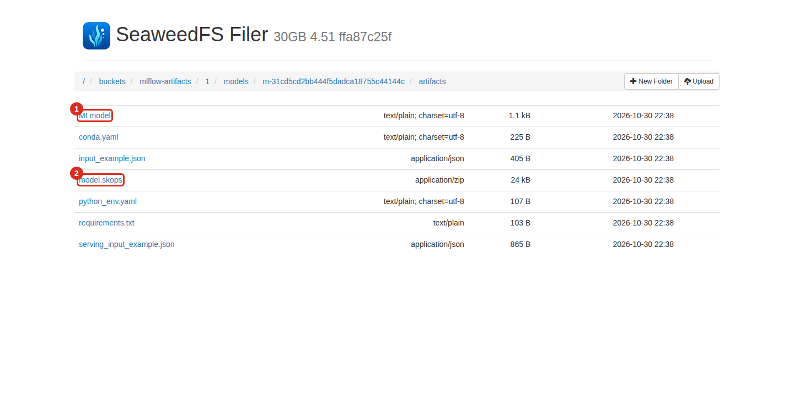

L'état du stockage s'affiche sur `http://localhost:9333` :

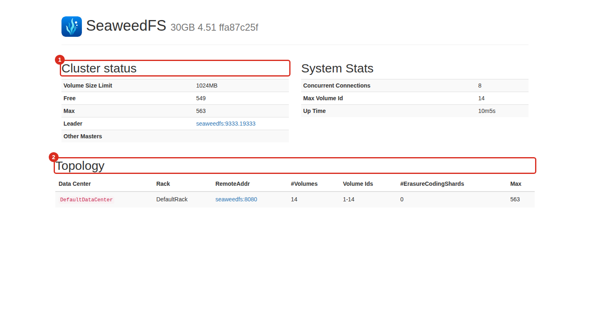

La commande suivante liste les buckets et leur taille :

```bash
docker compose exec -T seaweedfs sh -c 'echo "s3.bucket.list" | weed shell -master=seaweedfs:9333 -filer=seaweedfs:8888'
```

```text
  mlflow-artifacts	size:18922424	logical:18922424	chunk:183
```

### Ce qui se passe à chaque appel

Les métadonnées passent par le serveur MLflow. Les fichiers partent directement du script vers SeaweedFS, ce qui explique que le `runner` ait besoin des identifiants S3 (serveur lancé avec `--no-serve-artifacts`).


---

## Model Registry

### Qu'est-ce que le Model Registry ?

Le **Model Registry** centralise les modèles validés et garde leur historique :

- **Versions** : chaque enregistrement crée une nouvelle version (`v1`, `v2`, `v3`). MLflow les conserve toutes.
- **Aliases** : une étiquette mobile posée sur une version. `@champion` désigne le modèle de référence, `@challenger` un candidat à évaluer, `@precedent` l'ancien champion. Un alias ne désigne qu'une seule version à la fois.

> [!NOTE]
> Les **stages** (`None`, `Staging`, `Production`, `Archived`) et `transition_model_version_stage` sont dépréciés depuis MLflow 2.9. Les aliases les remplacent, c'est pourquoi `sklearn_example.py` les utilise.

**Dans l'interface** : la page **Model registry** liste les modèles (1) et leurs aliases (2). Le bouton `+1` indique qu'un autre alias existe : la page du modèle les affiche tous.

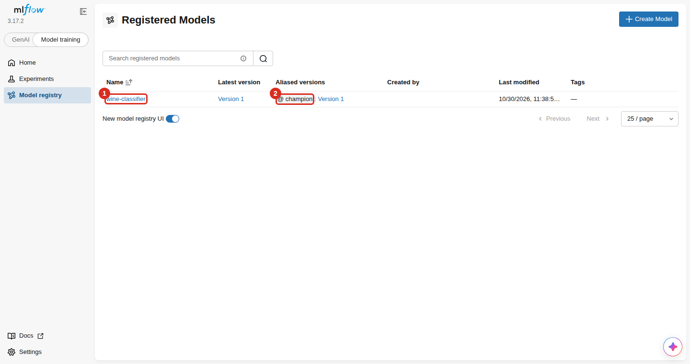

Chaque version renvoie vers le run (1) et le Logged Model (2) qui l'ont produite, et affiche ses aliases (3).

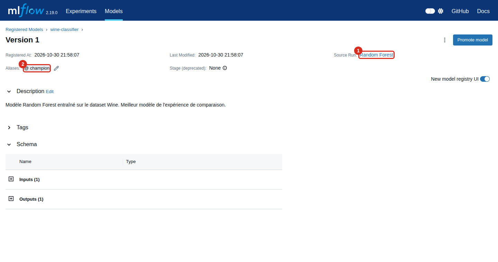

### Enregistrer un modèle

```python
# model_info : valeur renvoyée par mlflow.sklearn.log_model
model_version = mlflow.register_model(
    model_uri=model_info.model_uri,
    name="wine-classifier"
)
```

### Désigner le modèle de référence

Dans ce projet, seul `promotion_example.py` fait cet appel, après [contrôle](#1-promotion-contrôlée). Il reste possible à la main :

```python
client = MlflowClient()
client.set_registered_model_alias(
    name="wine-classifier",
    alias="champion",
    version=model_version.version
)
```

Pour revenir en arrière, reposez l'alias sur une version précédente, en passant le numéro entre guillemets (`version="1"`). Le code qui charge `@champion` n'a pas à changer.

### Charger un modèle

```python
# Par alias (recommandé pour les applications)
model = mlflow.sklearn.load_model("models:/wine-classifier@champion")

# Par version
model = mlflow.sklearn.load_model("models:/wine-classifier/1")
```

Le modèle enregistré est un `Pipeline` complet : il accepte directement des données brutes et les normalise lui-même.

---

## Logged Models et évaluation

Script : [`examples/evaluation_example.py`](examples/evaluation_example.py)

```bash
docker compose exec runner python evaluation_example.py
```

Le script compare un modèle candidat à une référence naïve, et n'approuve le candidat que s'il respecte des seuils. Le terminal résume les trois étapes (extrait, sans les journaux de MLflow) :

```text
--- Évaluation ---
reference : accuracy 0.3889, f1 0.2178
candidat : accuracy 1.0000, f1 1.0000

--- Seuils raisonnables ---
Validation réussie

--- Seuil impossible, pour voir un refus ---
Validation refusée : Metric accuracy_score value threshold check failed: candidate model accuracy_score = 1.0, accuracy_score threshold = 1.01.

--- Logged Models de l'expérience, par accuracy décroissante ---
candidat : m-d0fc1241a4514929b026397a4c6932df, accuracy 1.0000, validation=approuve
reference : m-89c6edc476654d6c93573550d27431fb, accuracy 0.3889, validation=-
```

### Logged Models

Depuis MLflow 3, un modèle n'est plus un simple dossier dans les artefacts d'un run : `log_model` crée un **Logged Model**, avec son identifiant (`m-...`), ses métriques et ses fichiers.

```python
model_info = mlflow.sklearn.log_model(modele, name=nom, input_example=X.head(5),
                                      skops_trusted_types=TYPES_SKOPS_DE_CONFIANCE)
print(model_info.model_uri)  # models:/m-d0fc1241a4514929b026397a4c6932df
```

| Dans MLflow 2 | Dans MLflow 3 |
|---|---|
| `log_model(modele, artifact_path="model")` | `log_model(modele, name="model")` |
| `runs:/<run_id>/model` | `model_info.model_uri`, soit `models:/<model_id>` |
| Run > Artifacts > `model` | Expérience > **Models**, et Run > Overview > Logged models |
| `s3://.../<run_id>/artifacts/model/` | `s3://.../models/<model_id>/artifacts/` |
| Format `model.pkl` (cloudpickle) | Format `model.skops` |

**skops** refuse de charger un type qu'il ne connaît pas. Le Random Forest contient `sklearn.tree._tree.Tree`, d'où `skops_trusted_types`. Sans ce paramètre, `log_model` échoue. Cette liste est lue dans le fichier `MLmodel` du modèle : charger un modèle reste donc une action de confiance, quel que soit le format.

**Dans l'interface** : l'onglet **Models** de l'expérience liste les Logged Models (1), avec leurs métriques en colonnes (2).


Chaque Logged Model garde ses métriques (1), rattachées au dataset qui a servi à les calculer (2).


### Évaluation

`mlflow.models.evaluate` calcule les métriques standard et produit des graphiques, à partir du modèle et d'un dataset :

```python
dataset_test = mlflow.data.from_pandas(df_test, source="sklearn.datasets.load_wine",
                                       targets="target", name="wine_test")
resultat = mlflow.models.evaluate(
    model_info.model_uri,
    data=dataset_test,
    model_type="classifier",
    evaluators="default",
    evaluator_config={"log_explainer": False, "log_model_explainability": False},
)
print(resultat.metrics["accuracy_score"])
```

`evaluator_config` désactive ici les explications SHAP, car le paquet `shap` n'est pas installé.

**Dans l'interface** : l'onglet **Artifacts** du run contient les graphiques (matrice de confusion, ROC, précision-rappel, calibration) et `per_class_metrics.csv`.


### Validation par seuils

`mlflow.validate_evaluation_results` lève une exception si le candidat ne respecte pas les seuils. C'est le contrôle à placer avant une promotion :

```python
from mlflow.models import MetricThreshold

mlflow.validate_evaluation_results(
    {"accuracy_score": MetricThreshold(
        threshold=0.9,             # au moins 0,9 dans l'absolu
        min_relative_change=0.05,  # et au moins 5 % de mieux que la référence
        greater_is_better=True,
    )},
    candidat,
    reference,
)
```

> [!NOTE]
> Le script note le résultat dans le tag `validation` du Logged Model. L'interface 3.17 n'affiche pas les tags des Logged Models : ils se relisent en Python, avec `search_logged_models`. Ce script compare deux modèles sans toucher au registre : le contrôle qui déplace `@champion` est décrit dans la [mise en production](#1-promotion-contrôlée).

### Métriques système

`log_system_metrics=True` relève le CPU, la mémoire, le disque et le réseau pendant le run. Il faut le paquet `psutil`.

```python
# Toutes les secondes au lieu de 10 : ces runs ne durent que quelques secondes
mlflow.set_system_metrics_sampling_interval(1)
mlflow.set_system_metrics_samples_before_logging(1)

with mlflow.start_run(run_name=nom, log_system_metrics=True):
    ...
```

**Dans l'interface** : onglet **System metrics** du run.


---

## Mise en production

Ici, un modèle est en production quand une version du registre porte `@champion` et qu'un service la charge. Le registre ne sert pas le modèle lui-même : il dit seulement laquelle utiliser.

### 1. Promotion contrôlée

Script : [`examples/promotion_example.py`](examples/promotion_example.py)

La règle : **l'entraînement propose, le contrôle décide**. `sklearn_example.py` pose `@challenger`, et seul ce script déplace `@champion`.

```bash
docker compose exec runner python sklearn_example.py
```

```bash
docker compose exec runner python promotion_example.py
```

Le candidat est évalué sur le jeu de test, qui n'a pas servi à le choisir. S'il respecte les seuils, il devient `@champion` (extrait, sans les journaux de MLflow) :

```text
--- Évaluation sur le jeu de test ---
@challenger (v1) : accuracy 0.9722

--- Décision ---
Approuvé : @champion passe sur la version 1

--- Alias de wine-classifier ---
@challenger : version 1, validation=approuve
@champion : version 1, validation=approuve
```

Le contrôle tient en quelques lignes :

```python
# Au moins 0,9 dans l'absolu, et pas moins bien que le champion en place
seuil = MetricThreshold(
    threshold=0.9, min_relative_change=0.0 if champion else None, greater_is_better=True
)
try:
    mlflow.validate_evaluation_results({"accuracy_score": seuil}, resultat, reference)
except MlflowException as e:
    decision = "refuse"
else:
    decision = "approuve"
    if champion and champion != challenger:
        client.set_registered_model_alias(modele, "precedent", champion)
    client.set_registered_model_alias(modele, "champion", challenger)

# La décision et sa preuve restent attachées à la version
client.set_model_version_tag(modele, challenger, "validation", decision)
client.set_model_version_tag(modele, challenger, "validation_run_id", run_id)
```

Pour voir un refus, `--modele-degrade` enregistre d'abord un modèle qui prédit toujours la même classe :

```bash
docker compose exec runner python promotion_example.py --modele-degrade
```

```text
--- Évaluation sur le jeu de test ---
@challenger (v2) : accuracy 0.3889
@champion (v1) : accuracy 0.9722

--- Décision ---
Refusé : Metric accuracy_score value threshold check failed: candidate model accuracy_score = 0.3888888888888889, accuracy_score threshold = 0.9. Metric accuracy_score minimum relative change check failed: candidate model accuracy_score = 0.3888888888888889, baseline model accuracy_score = 0.9722222222222222, accuracy_score minimum relative change threshold = 0.0.

--- Alias de wine-classifier ---
@challenger : version 2, validation=refuse
@champion : version 1, validation=approuve
```

Le terminal affiche aussi `the model type looks like None` : MLflow ne déduit pas le type du modèle à partir de ces étiquettes, et utilise celui indiqué par `model_type`. Ce message est sans conséquence ici.

**Dans l'interface** : la page du modèle montre `@champion` (1) et `@challenger` (2) sur des versions différentes, avec la décision de chacune dans ses tags.

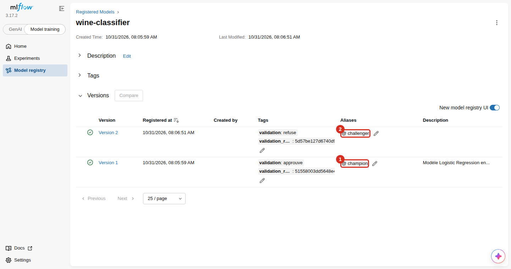

La page de la version refusée indique le tag `validation` (1) et sa valeur (2). `validation_run_id` donne le run qui contient les métriques et les graphiques de cette évaluation.

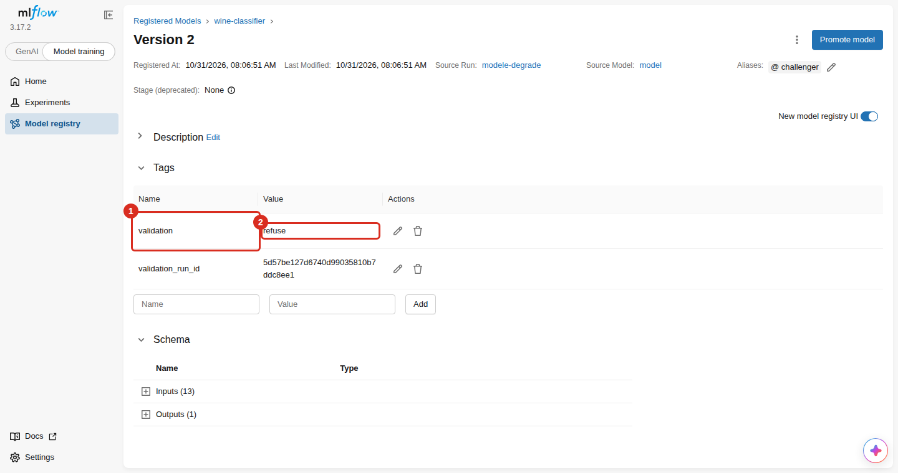

> [!NOTE]
> Le bouton **Promote model** de l'interface copie une version vers un autre modèle enregistré. Il ne déplace pas `@champion` et ne fait aucun contrôle. Le crayon à côté d'un alias le déplace, sans contrôle lui non plus.

### 2. API de prédiction

Le service `model-server` sert `@champion` avec `mlflow models serve`, dans le profil `serving`. Il répond sur `http://localhost:5001` :

```bash
docker compose --profile serving up -d --wait model-server
```

```bash
curl -X POST http://localhost:5001/invocations -H 'Content-Type: application/json' -d '{"dataframe_records":[{"alcohol":14.2,"malic_acid":1.7,"ash":2.4,"alcalinity_of_ash":15.6,"magnesium":127,"total_phenols":2.8,"flavanoids":3.06,"nonflavanoid_phenols":0.28,"proanthocyanins":2.29,"color_intensity":5.64,"hue":1.04,"od280/od315_of_diluted_wines":3.92,"proline":1065}]}'
```

```text
{"predictions": [0]}
```

| Route | Rôle |
|---|---|
| `GET /ping` | État du service : 200 une fois le modèle chargé. C'est le healthcheck |
| `GET /version` | Version de MLflow |
| `POST /invocations` | Prédiction. Le corps contient `dataframe_records`, `dataframe_split`, ou `inputs` pour un tableau |

La signature enregistrée avec le modèle sert de contrat. Une requête qui ne la respecte pas reçoit une erreur 400 :

```text
Model is missing inputs ['alcohol'].
Failed to convert column alcohol to type 'float64'. Error: 'ValueError("could not convert string to float: 'pas un nombre'")'
```

Ce contrôle repose sur des colonnes nommées : voilà pourquoi `sklearn_example.py` entraîne et enregistre le modèle à partir d'un DataFrame.

Le script [`examples/serving_example.py`](examples/serving_example.py) enchaîne ces appels et les compare à une prédiction par lot :

```bash
docker compose exec runner python serving_example.py
```

```text
--- État du service ---
/ping : 200
/version : MLflow 3.17.2

--- Prédiction en ligne ---
5 premières prédictions : [0, 1, 0, 1, 1]
5 premières valeurs réelles : [0, 2, 0, 1, 1]

--- Requête invalide : une colonne manque ---
HTTP 400 : Model is missing inputs ['alcohol'].

--- Prédiction par lot ---
Accuracy sur 36 lignes : 0.9722
Identique à l'API : True
```

> [!IMPORTANT]
> Le service lit l'alias **à son démarrage**. Après une promotion, il continue de servir l'ancienne version tant qu'il n'a pas redémarré. Test réalisé : l'alias déplacé sur un modèle différent, la réponse n'a changé qu'après ce redémarrage, qui prend environ 10 secondes.
>
> ```bash
> docker compose --profile serving restart model-server
> ```

### 3. Prédiction par lot

Pour traiter un fichier entier, un serveur n'est pas nécessaire. Le même alias se charge dans un script, à lancer par exemple chaque nuit :

```python
modele = mlflow.pyfunc.load_model("models:/wine-classifier@champion")
predictions = modele.predict(X_test)
```

`mlflow.pyfunc` offre la même interface pour tous les frameworks : ce code ne change pas si le champion passe de scikit-learn à XGBoost.

### 4. Image autonome

`model-server` dépend de la stack : il télécharge le modèle au démarrage et suit l'alias. Pour livrer un modèle ailleurs, on préfère une **image immuable** qui contient le modèle et ses dépendances :

```bash
docker compose exec runner mlflow models generate-dockerfile -m models:/wine-classifier@champion -d /tmp/image-champion --env-manager local
```

```bash
docker cp mlflow-runner:/tmp/image-champion .
```

```bash
docker build -t wine-classifier:champion image-champion
```

```bash
docker run --rm -d --name wine-autonome -e MLFLOW_MODELS_WORKERS=1 -p 127.0.0.1:5002:8080 wine-classifier:champion
```

Le conteneur répond sur le port 5002 avec la même API, et n'a accès ni à MLflow ni à SeaweedFS : il ne contient aucun identifiant. Le Dockerfile installe le fichier `requirements.txt` du modèle : vérifiez-le dans **Artifacts** avant de livrer.

| | `model-server` | Image autonome |
|---|---|---|
| Version servie | Celle de l'alias, au démarrage | Figée à la construction |
| Besoin de MLflow et de SeaweedFS | Oui | Non |
| Changer de version | Redémarrer | Construire et déployer une nouvelle image |
| Retour arrière | Reposer l'alias, redémarrer | Relancer l'image précédente |
| Dépendances | Celles du runner | Celles du modèle |

Mesures ici : l'image de `wine-classifier` pèse 1,19 Go. Sans `MLFLOW_MODELS_WORKERS`, le serveur lance un processus par cœur, soit 2,1 Gio de RAM sur 12 cœurs. Le Dockerfile généré ne définit pas d'utilisateur, donc les processus tournent en root : à durcir avant une vraie livraison.

### 5. Retour arrière

`promotion_example.py` garde l'ancien champion sous `@precedent`. Le retour arrière tient en deux commandes :

```bash
docker compose exec runner python -c "from mlflow import MlflowClient; c = MlflowClient(); c.set_registered_model_alias('wine-classifier', 'champion', c.get_model_version_by_alias('wine-classifier', 'precedent').version)"
```

```bash
docker compose --profile serving restart model-server
```

### 6. Ce que ce service ne fait pas

Ce parcours couvre le cycle de vie du modèle, pas l'exploitation d'un service public. Non couvert et non testé ici, à ajouter avant une vraie mise en production :

- **Authentification et chiffrement** : l'API répond à quiconque l'atteint, d'où sa publication sur `127.0.0.1` uniquement. Prévoyez un reverse-proxy.
- **Montée en charge** : un seul conteneur, sans répartition de charge ni déploiement progressif.
- **Surveillance des prédictions** : MLflow trace les appels à un LLM, mais `model-server` ne garde ni les entrées ni les prédictions d'un modèle classique. La dérive des données n'est pas suivie.
- **Réentraînement automatique** : rien ne déclenche ces scripts. Un orchestrateur s'en charge en général.

---

## Autres types de modèles

Changer de type de modèle ne change presque que la ligne qui l'enregistre. Le registre, les alias et l'API restent les mêmes. Voici ce qui a réellement été exécuté :

| Type | Script | Enregistrement | Testé jusqu'à |
|---|---|---|---|
| scikit-learn | `sklearn_example.py` | `mlflow.sklearn.log_model` | API et image autonome |
| XGBoost | `xgboost_example.py` | `mlflow.xgboost.log_model` | Contrôle de promotion, API et image autonome |
| Code maison | `pyfunc_example.py` | `mlflow.pyfunc.log_model` | API |
| PyTorch | `pytorch_example.py` | `mlflow.pytorch.log_model` | API dans `runner-torch` et image autonome |
| Assistant LLM | `genai_example.py` | `mlflow.pyfunc.log_model` | Promotion sur ses notes, API |

MLflow 3.17 prend aussi en charge d'autres frameworks, dont LightGBM, CatBoost, TensorFlow, Transformers et statsmodels. Ils suivent le même principe, mais **n'ont pas été testés ici**. Pour tout le reste, `pyfunc` enveloppe n'importe quel code Python.

Pour servir un autre modèle, `MODELE_SERVI` remplace `@champion` de `wine-classifier` :

```bash
MODELE_SERVI=models:/wine-xgboost@champion docker compose --profile serving up -d --wait model-server
```

### XGBoost

Script : [`examples/xgboost_example.py`](examples/xgboost_example.py)

```bash
docker compose exec runner python xgboost_example.py
```

```bash
docker compose exec runner python promotion_example.py --modele wine-xgboost
```

```python
mlflow.xgboost.autolog(log_models=False, log_datasets=False)

with mlflow.start_run(run_name="xgboost"):
    modele = XGBClassifier(n_estimators=200, max_depth=3, early_stopping_rounds=10, random_state=42)
    modele.fit(X_fit, y_fit, eval_set=[(X_val, y_val)], verbose=False)
    info = mlflow.xgboost.log_model(modele, name="model", input_example=X_train.head(5), pip_requirements=[...])

# Le code qui consomme le modèle ne sait pas de quel framework il vient
charge = mlflow.pyfunc.load_model("models:/wine-xgboost@challenger")
```

```text
Arbres retenus par l'arrêt anticipé : 36 sur 200
Prédictions : [0, 2, 0, 1, 1], réel : [0, 2, 0, 1, 1]
```

Le même contrôle de promotion s'applique, car ce modèle prédit lui aussi une classe sur les mêmes données.

**Dans l'interface** : l'autolog trace la courbe d'apprentissage (1) dans **Model metrics**. L'arrêt anticipé s'y lit : la perte ne baisse plus après une trentaine d'arbres.

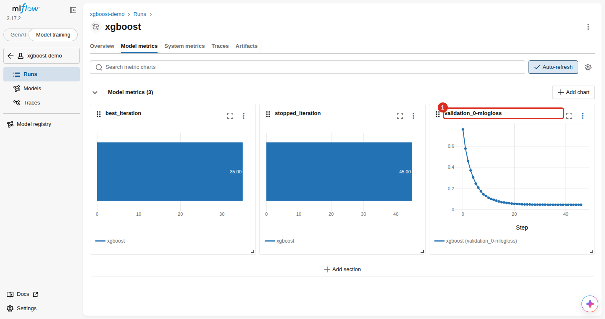

> [!WARNING]
> **Regardez toujours le `requirements.txt` du modèle.** Le runner installe `xgboost-cpu`, bien plus léger. Laissé à lui-même, MLflow ajoutait `xgboost` à la liste, avec sa dépendance GPU : l'image autonome pesait 2,01 Go. Avec `pip_requirements`, elle pèse 1,22 Go.

### Code maison avec pyfunc

Scripts : [`examples/pyfunc_example.py`](examples/pyfunc_example.py) et [`examples/modele_maison.py`](examples/modele_maison.py)

`pyfunc` sert quand le framework n'est pas pris en charge, ou qu'il faut du code autour du modèle : pré-traitement, règles métier, sortie sur mesure. Ici, le modèle renvoie le nom de la classe et sa confiance, et signale les cas à vérifier.

```bash
docker compose exec runner python pyfunc_example.py
```

Le code est un fichier, enregistré tel quel avec le modèle (*models from code*). Rien n'est sérialisé en pickle :

```python
class ClassifieurExplique(mlflow.pyfunc.PythonModel):
    def load_context(self, context):
        self.classifieur = mlflow.sklearn.load_model(context.artifacts["classifieur"])

    def predict(self, context, model_input: pd.DataFrame, params=None):
        seuil = (params or {}).get("seuil", 0.8)
        ...

mlflow.models.set_model(ClassifieurExplique())
```

```python
info = mlflow.pyfunc.log_model(
    name="model",
    python_model="modele_maison.py",           # le code, en clair
    artifacts={"classifieur": chemin},         # ses fichiers
    input_example=(X_train.head(3), {"seuil": 0.8}),  # déclare aussi le paramètre
)
```

`params` règle un comportement à chaque requête, sans réenregistrer le modèle :

```text
--- Seuil par défaut (0,8) ---
    classe  confiance  a_verifier
0  class_0     0.9997       False
1  class_1     0.5404        True
2  class_0     0.9920       False
3  class_1     0.7075        True

--- Seuil de 0,999, passé à la requête ---
    classe  confiance  a_verifier
0  class_0     0.9997       False
1  class_1     0.5404        True
2  class_0     0.9920        True
3  class_1     0.7075        True
```

L'API accepte le même réglage dans le champ `params` du corps de la requête :

```json
{"dataframe_records": [...], "params": {"seuil": 0.9999}}
```

```text
{"predictions": [{"classe": "class_0", "confiance": 0.9996, "a_verifier": true}]}
```

Ce script et `pytorch_example.py` posent directement `@champion`, pour la démonstration : `promotion_example.py` ne s'applique qu'aux modèles qui prédisent une classe du dataset Wine. Un vrai parcours leur donnerait leur propre contrôle.

### PyTorch

Script : [`examples/pytorch_example.py`](examples/pytorch_example.py)

Un petit réseau convolutif apprend à reconnaître des chiffres. PyTorch alourdit l'image, d'où un service séparé, dans le profil `deep`. Son image pèse 3,05 Go, contre 2,18 Go pour le runner, en version CPU :

```bash
docker compose --profile deep up -d --build runner-torch
```

```bash
docker compose exec runner-torch python pytorch_example.py
```

La boucle d'entraînement reste la vôtre, avec une métrique et une image par époque :

```python
with mlflow.start_run(run_name="reseau-chiffres"):
    mlflow.log_params(parametres)
    for epoque in range(EPOQUES):
        ...
        mlflow.log_metrics({"loss": valeur.item(), "accuracy": accuracy}, step=epoque)
        mlflow.log_image(matrice_en_image(y_test, y_pred), key="matrice_confusion", step=epoque)

    info = mlflow.pytorch.log_model(
        reseau,
        name="model",
        input_example=X_train[:2],
        # torch vient de l'index CPU de PyTorch : à déclarer pour réinstaller le modèle ailleurs
        extra_pip_requirements=["--extra-index-url https://download.pytorch.org/whl/cpu"],
    )
```

```text
Époque 0 : loss 2.159, accuracy 0.5267
Époque 9 : loss 0.911, accuracy 0.8933

chiffres-pytorch v1 désormais @champion
Prédictions : [8, 0, 9, 1, 5], réel : [1, 0, 9, 1, 5]
```

**Dans l'interface** : la matrice de la dernière époque, en plein écran. L'[image par étape](#images-par-étape) fonctionne comme avec scikit-learn.

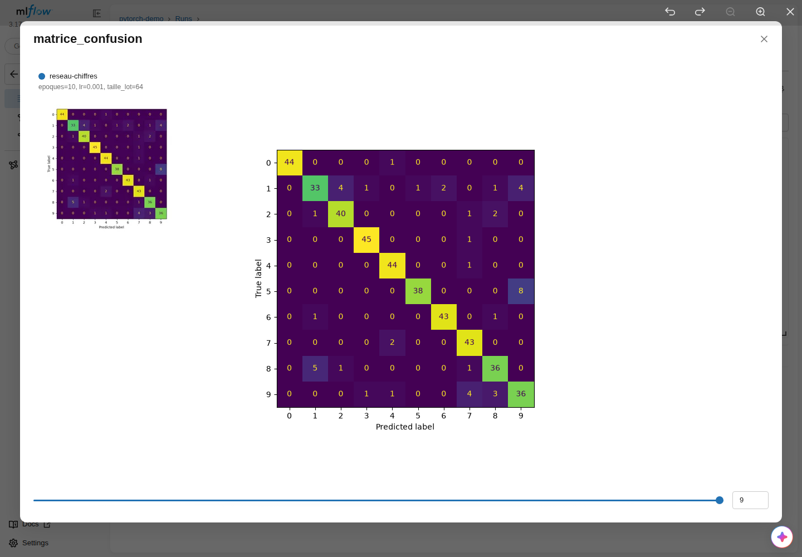

Les entrées sont un tableau et non des colonnes. L'API les reçoit donc dans `inputs`, et le service tourne dans l'image qui contient PyTorch :

```bash
docker compose exec -d runner-torch mlflow models serve -m models:/chiffres-pytorch@champion --env-manager local --host 0.0.0.0 --port 8080
```

Ce service n'est joignable que sur le réseau Docker, à l'adresse `http://runner-torch:8080`. L'image autonome se construit comme au chapitre précédent, depuis `mlflow-runner-torch` : elle a répondu avec une image de 2,26 Go et 500 Mio de RAM pour un processus.

> [!NOTE]
> MLflow retire le suffixe `+cpu` du `requirements.txt` du modèle et y écrit `torch==2.14.0`. L'index ajouté par `extra_pip_requirements` permet quand même d'installer la version CPU. Le modèle est sérialisé en pickle : ne le chargez que si vous connaissez son origine.

---

## Images, tableaux et recherche d'hyperparamètres

### Images par étape

Script : [`examples/images_example.py`](examples/images_example.py)

Une métrique résume un entraînement en un nombre. Une image montre où il se trompe. `log_image` en garde une par étape :

```bash
docker compose exec runner python images_example.py
```

```python
for epoque in range(EPOQUES):
    ...
    mlflow.log_metric("accuracy", accuracy, step=epoque)
    # La même clé à chaque étape : l'interface affiche un curseur
    mlflow.log_image(matrice_en_image(y_test, y_pred), key="matrice_confusion", step=epoque)
```

```text
Époque 0 : accuracy 0.6444
Époque 3 : accuracy 0.8800
Époque 7 : accuracy 0.8978

Erreurs sur le test : 46 sur 450
```

| Appel | Résultat | Quand l'utiliser |
|---|---|---|
| `log_image(image, key=..., step=...)` | Une image par étape, avec un curseur | Suivre une évolution : matrice de confusion, exemples générés |
| `log_figure(fig, "nom.png")` | Une figure, dans **Artifacts** | Un résultat final |
| `log_table(df, artifact_file="nom.json")` | Un tableau, dans **Artifacts**, relisible avec `load_table` | Le détail des erreurs, des échantillons |

**Dans l'interface** : l'onglet **Model metrics** affiche la matrice avec un curseur. Un clic agrandit l'image, ici à la dernière étape.

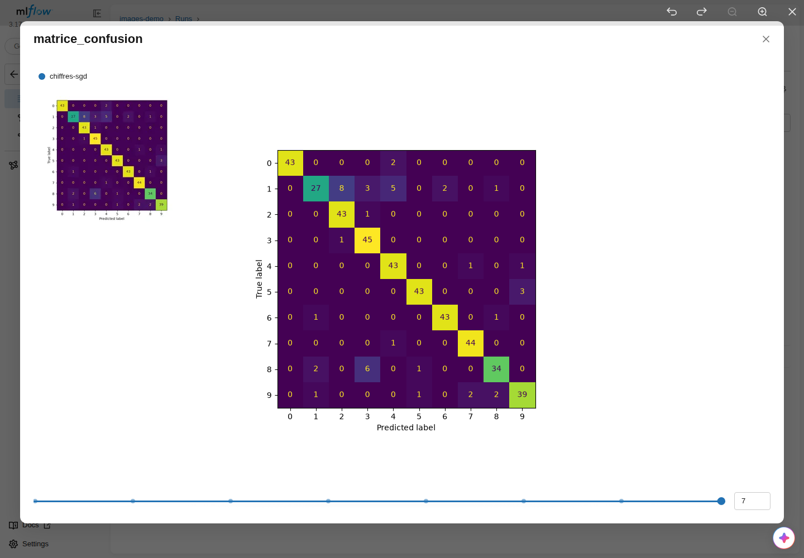

L'onglet **Artifacts** affiche `erreurs.json` en tableau (1) :

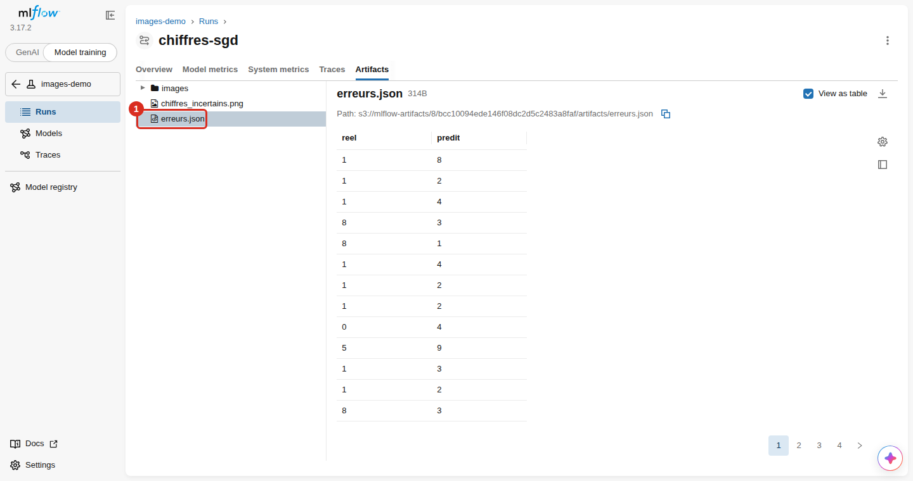

Chaque étape écrit deux fichiers, l'image et sa miniature : 8 époques donnent 16 fichiers. Sur un long entraînement, gardez une image toutes les N époques.

### Recherche d'hyperparamètres

Script : [`examples/recherche_example.py`](examples/recherche_example.py)

Une recherche produit de nombreux runs. L'autolog les range sous un run parent, et `search_runs` les interroge en Python :

```bash
docker compose exec runner python recherche_example.py
```

```python
mlflow.sklearn.autolog(max_tuning_runs=None, log_models=False, log_datasets=False, silent=True)

grille = {"modele__C": [0.001, 0.01, 0.1, 1, 10], "modele__solver": ["lbfgs", "saga"]}
recherche = GridSearchCV(creer_pipeline(LogisticRegression(max_iter=5000, random_state=42)), grille, cv=5)

with mlflow.start_run(run_name="recherche-logreg") as parent:
    recherche.fit(X_train, y_train)
    # Seul le meilleur modèle est enregistré, en skops
    mlflow.sklearn.log_model(recherche.best_estimator_, name="model", input_example=X_train.head(5))

enfants = mlflow.search_runs(
    experiment_ids=[experience.experiment_id],
    filter_string=f"tags.mlflow.parentRunId = '{parent.info.run_id}'",
    order_by=["metrics.mean_test_score DESC"],
)
```

```text
Meilleurs paramètres : {'modele__C': 0.1, 'modele__solver': 'lbfgs'}

--- Les 3 meilleurs runs enfants, avec search_runs ---
10 combinaisons testées
params.modele__C params.modele__solver  metrics.mean_test_score
               1                  saga                 0.993103
               1                 lbfgs                 0.993103
             0.1                 lbfgs                 0.993103
```

Plusieurs combinaisons sont à égalité. L'ordre des ex æquo peut changer d'une exécution à l'autre.

**Dans l'interface** : le run parent (1) se déplie sur un run par combinaison. Seul le parent porte le modèle.

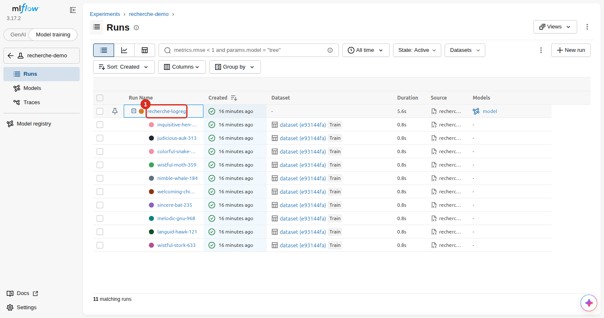

---

## GenAI : du prompt au service

Scripts : [`examples/genai_example.py`](examples/genai_example.py) et [`examples/assistant_modele.py`](examples/assistant_modele.py)

Un petit assistant répond à des questions sur le dataset Wine à partir de fiches. Il suit le même parcours qu'un modèle classique : versionner, évaluer, contrôler, promouvoir, servir. Le LLM tourne en local avec Ollama : aucune clé payante n'est nécessaire.

> [!IMPORTANT]
> Cet exemple a besoin d'un serveur Ollama, que ce projet ne fournit pas. Il a été testé avec le conteneur `ollama-central` sur le réseau Docker `llm-net` et le modèle `gemma4:e4b`. Avec un autre serveur, adaptez `OLLAMA_BASE_URL` et `OLLAMA_MODEL`.

Reliez le runner au réseau d'Ollama, puis lancez le script. Le premier appel peut prendre une minute, le temps de charger le modèle :

```bash
docker network connect llm-net mlflow-runner
```

```bash
docker compose exec -e OLLAMA_BASE_URL=http://ollama-central:11434/v1 runner python genai_example.py
```

La connexion réseau est à refaire si le conteneur `runner` est recréé.

```text
--- Prompt ---
Prompt assistant-wine-prompt : version 1, alias production

--- Une question, une trace ---
Combien de classes contient le dataset Wine ?
-> Le dataset Wine contient 3 classes de vins : class_0, class_1 et class_2.
Trace : tr-5df96b7ce02f9bd242eee4ba9c12e138

--- Évaluation sur le jeu de questions ---
Run d'évaluation : 7ccc39eea8fb49db9f9216c1c2b1b560
contient_mot_cle/mean : 1.00
correctness/mean : 1.00
en_francais/mean : 1.00

--- Détail par question ---
{"question": "Combien de caractéristiques décrivent un vin ?"}
-> "Chaque vin est décrit par 13 caractéristiques chimiques."
   {'contient_mot_cle': True, 'en_francais': 'yes', 'correctness': 'yes'}

--- Promotion ---
Version 1 désormais @champion
```

### Registre de prompts

Un prompt change souvent, et chaque changement peut dégrader les réponses. Il se versionne donc comme un modèle, et un alias désigne celui en production :

```python
TEMPLATE = "Réponds en français, en une phrase, d'après cette fiche : {{fiche}}"

actuel = mlflow.genai.load_prompt(f"prompts:/{PROMPT}@latest", allow_missing=True)
if actuel is None or actuel.template != TEMPLATE:
    actuel = mlflow.genai.register_prompt(PROMPT, TEMPLATE, commit_message="Réponse courte, d'après une fiche")
mlflow.genai.set_prompt_alias(PROMPT, "production", actuel.version)
```

L'assistant lit ensuite le prompt par son alias :

```python
prompt = mlflow.genai.load_prompt(f"prompts:/{PROMPT}@production")
messages = [{"role": "system", "content": prompt.format(fiche=fiche)}, ...]
```

Relancer le script ne crée pas de nouvelle version tant que le texte ne change pas.

**Dans l'interface** : en mode **GenAI**, le menu **Prompts** montre chaque version, son alias (1) et son texte (2).

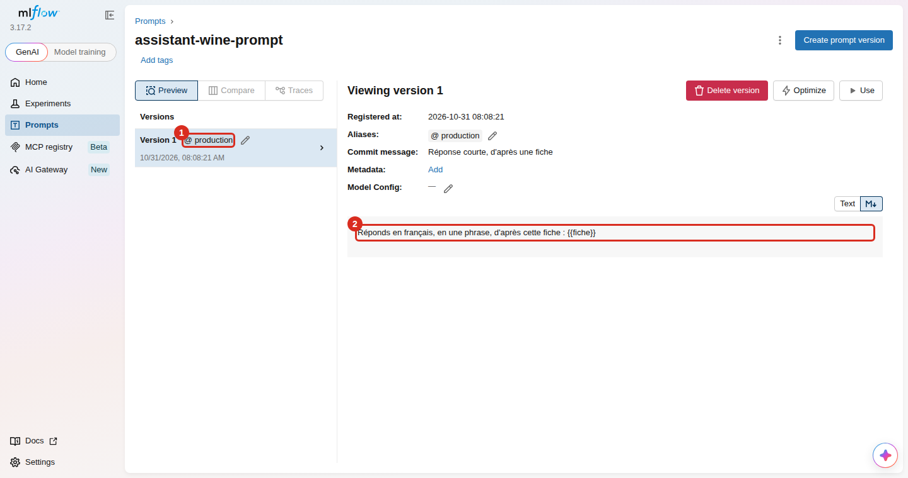

> [!WARNING]
> Les prompts et les modèles enregistrés partagent les mêmes noms. Lors d'un essai, un prompt et un modèle tous deux nommés `assistant-wine` ont fait échouer la pose de l'alias, avec `Registered Model with name='assistant-wine' not found`. Donnez-leur des noms distincts, d'où `assistant-wine-prompt`.

### Tracing

Une **trace** enregistre une exécution complète de l'assistant. Elle se compose de **spans**, un par étape. Deux lignes suffisent :

```python
mlflow.openai.autolog()  # un span par appel au LLM : messages, réponse, jetons

@mlflow.trace(span_type=SpanType.RETRIEVER)  # un span pour une fonction à vous
def chercher_fiche(question):
    ...
```

**Dans l'interface** : passez en mode **GenAI** en haut à gauche, puis ouvrez **Traces**. Chaque ligne associe une question (1) à sa réponse (2), avec sa durée et ses jetons.


Un clic ouvre le détail : la recherche de fiche (1) et l'appel au LLM (2), avec leurs entrées et sorties. **1 linked prompt** renvoie à la version du prompt utilisée.


Les spans sont gardés dans PostgreSQL. MLflow peut aussi écrire un fichier `traces/<trace_id>/artifacts/traces.json` dans SeaweedFS : il est apparu pour une trace sur 4 lors d'une exécution, et pour aucune lors d'une autre. Il n'est donc pas surprenant de voir ou non ce dossier dans le bucket.

### Évaluation

`mlflow.genai.evaluate` exécute l'assistant sur un jeu de questions et note chaque réponse avec des **scorers** :

```python
@scorer
def contient_mot_cle(outputs, expectations):  # critère en Python, sans LLM
    return any(mot in outputs for mot in expectations["mots_cles"])

resultat = mlflow.genai.evaluate(
    data=QUESTIONS,
    predict_fn=repondre,
    scorers=[
        contient_mot_cle,
        Correctness(model=JUGE),  # faits attendus, notés par un LLM : le juge
        Guidelines(name="en_francais", guidelines="La réponse doit être rédigée en français.", model=JUGE),
    ],
    model_id=info.model_id,  # rattache les notes au Logged Model de l'assistant
)
```

Ici le juge est le même modèle local que l'assistant, désigné par `openai:/gemma4:e4b`. Il passe par LiteLLM et l'API compatible OpenAI d'Ollama.

**Dans l'interface** : **Evaluation runs** donne un score moyen par critère.


Un clic sur le run affiche chaque réponse (1) et ses notes (2).


### Promotion et service

Le code de l'assistant est enregistré tel quel, relié à son prompt, comme un [modèle maison](#code-maison-avec-pyfunc). Il ne devient `@champion` que si chaque note atteint son seuil :

```python
info = mlflow.pyfunc.log_model(name="assistant", python_model="assistant_modele.py", prompts=[prompt])
mlflow.set_active_model(model_id=info.model_id)  # les traces suivantes s'y rattachent
...
SEUILS = {"contient_mot_cle/mean": 1.0, "correctness/mean": 1.0, "en_francais/mean": 1.0}
# Un critère absent compte pour 0 : un juge en erreur ne promeut pas l'assistant
ecarts = [nom for nom, seuil in SEUILS.items() if metriques.get(nom, 0) < seuil]
```

L'assistant se sert ensuite comme un autre modèle, avec le service relié au réseau d'Ollama :

```bash
MODELE_SERVI=models:/assistant-wine@champion OLLAMA_BASE_URL=http://ollama-central:11434/v1 docker compose --profile serving up -d --wait model-server
```

```bash
docker network connect llm-net mlflow-model-server
```

```bash
curl -X POST http://localhost:5001/invocations -H 'Content-Type: application/json' -d '{"inputs": ["Combien de classes contient le dataset Wine ?"]}'
```

```text
{"predictions": ["Le dataset Wine contient 3 classes de vins."]}
```

Chaque requête servie devient aussi une trace dans l'expérience `genai-assistant` : c'est la surveillance de base d'un assistant en production. Changer l'alias `production` du prompt prend effet sans redémarrage ni nouvelle version du code. Testé : la réponse suit encore l'ancien prompt juste après le changement, et le nouveau 75 secondes plus tard. MLflow garde un prompt lu par alias en cache 60 secondes par défaut (`MLFLOW_ALIAS_PROMPT_CACHE_TTL_SECONDS`).

> [!WARNING]
> Un LLM ne donne pas toujours la même réponse, même avec `temperature=0` : la même question a reçu « 3 classes de vins » et « 3 classes de vins : class_0, class_1 et class_2 ». Un contrôle automatique doit le tolérer. Lors d'un essai, `contient_mot_cle` ne cherchait que `3` et la réponse juste « trois classes » a fait refuser l'assistant, avec une note de 0,67. Le critère accepte maintenant `3` et `trois`. Pour la même raison, un juge local n'a pas la fiabilité d'un jeu de tests : 3 questions montrent la mécanique, elles ne mesurent pas la qualité d'un assistant.

### Tester sans LLM

La CI n'a pas d'Ollama. [`examples/faux_llm.py`](examples/faux_llm.py) imite son API : il renvoie la fiche et note toujours `yes`. Le parcours tourne ainsi en quelques secondes. Il vérifie la mécanique, pas la qualité.

```bash
docker compose exec -d runner python faux_llm.py
```

```bash
docker compose exec -e OLLAMA_BASE_URL=http://localhost:11434/v1 runner python genai_example.py
```

### Non couvert

L'interface 3.x propose aussi Sessions, Judges, Review, Datasets, Playground, Agent versions, AI Gateway, MCP registry et MLflow Assistant. Ce tutoriel ne les couvre pas et ils n'ont pas été testés ici. L'évaluation en ligne des traces a besoin de l'exécuteur de tâches du serveur, désactivé par `MLFLOW_SERVER_ENABLE_JOB_EXECUTION` dans `docker-compose.yml` pour économiser la mémoire.

---

## Comparaison des Runs dans MLflow

### Utilisation de l'onglet "Compare"

1. Sélectionnez plusieurs runs (checkbox)
2. Cliquez sur "Compare"

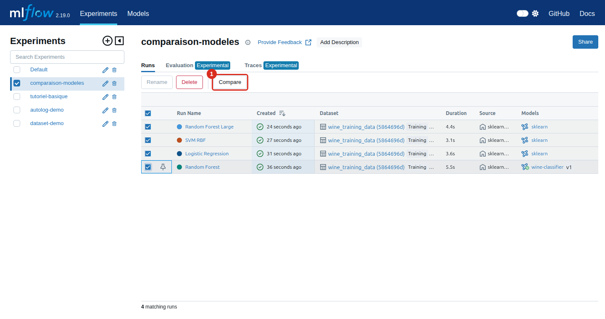

3. Explorez les visualisations natives (Parallel Coordinates, Scatter Plot, Box Plot, Contour Plot). Sur la capture, les axes ont été choisis à la main : `model_type`, `cv_mean` et `test_accuracy`.

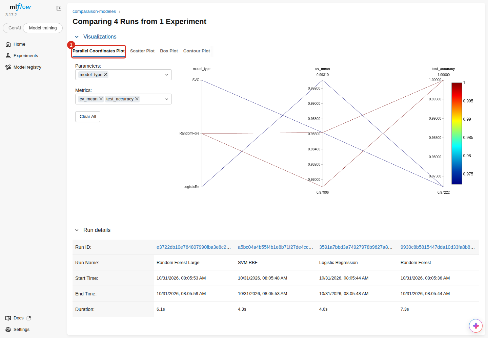

Les matrices de confusion enregistrées avec `mlflow.log_figure()` se consultent dans l'onglet **Artifacts** de chaque run.

---

## Bonnes pratiques

Chaque règle ci-dessous est appliquée dans les scripts de ce projet.

**Suivi**
- Enregistrez les hyperparamètres et le dataset : un résultat sans son contexte ne sert à rien.
- Gardez l'autolog pour explorer, et `log_model` pour le modèle retenu : c'est lui qui choisit le format skops.
- Rangez une recherche sous un run parent, et n'enregistrez que le meilleur modèle.

**Modèle**
- Mettez le pré-traitement dans le modèle, avec un `Pipeline` : il s'ajuste sans voir les données de validation, et le service reçoit des données brutes.
- Donnez un `input_example` à colonnes nommées : la signature devient le contrat de l'API.
- Choisissez sur la validation croisée, et gardez le jeu de test pour le contrôle.
- Relisez le `requirements.txt` du modèle : c'est lui qui sera installé en production.

**Promotion**
- L'entraînement propose, le contrôle décide : un script d'entraînement ne déplace pas `@champion`.
- Comparez le candidat au modèle en place, sur les mêmes données.
- Gardez la décision et le run qui la justifie dans les tags de la version.
- Utilisez des alias, pas des numéros de version ni les stages dépréciés.

**Service**
- Utilisez `pyfunc.load_model` et l'API : le code qui consomme le modèle ne dépend pas du framework.
- Après une promotion, redémarrez le service : il ne relit pas l'alias seul.
- Pour une livraison, préférez une image autonome, immuable et sans identifiants.
- N'exposez pas le service sans authentification.

**GenAI**
- Versionnez les prompts, avec des noms distincts de ceux des modèles.
- Évaluez sur un jeu de questions avant de promouvoir, avec des critères qui tolèrent les variations.
- Enregistrez le code en clair (*models from code*) plutôt qu'en pickle.

**Sécurité et exploitation**
- Gardez les secrets dans `.env`, et ne chargez que des modèles dont vous connaissez l'origine : charger un modèle peut exécuter son code.
- Verrouillez les dépendances, et auditez-les avec `pip-audit`.
- Sauvegardez ensemble PostgreSQL et SeaweedFS : l'un sans l'autre ne permet pas de retrouver un run complet.

---

## Troubleshooting

### Problème : "port is already allocated" au démarrage

**Cause :** Un autre programme utilise le port 5000, par exemple un autre MLflow.

**Solution :** Ajoutez `MLFLOW_PORT=15000` à votre `.env` : l'interface passe sur `http://localhost:15000`. Les conteneurs ne sont pas concernés, ils utilisent le réseau Docker.

### Problème : "Connection refused" sur port 5000

**Solution :**
```bash
# Vérifier que les services sont lancés
docker compose ps

# Si non, les démarrer
docker compose up -d

# Attendre que MLflow soit healthy (30 secondes)
docker compose logs -f mlflow
```

### Problème : "Permission denied" sur scripts shell

**Cause :** Les scripts `.sh` peuvent perdre leurs permissions d'exécution lors du passage Windows -> WSL.

**Solution :**
```bash
chmod +x mlflow/entrypoint.sh
```

### Problème : "Cannot set a deleted experiment"

**Cause :** Vous avez supprimé l'expérience dans l'interface MLflow. MLflow ne supprime pas définitivement l'expérience (soft delete), mais le nom reste réservé.

**Solution :**
1.  **Réinitialiser la base de données** (le plus simple, mais supprime tous les runs et artefacts) :
    ```bash
    docker compose down -v
    docker compose up -d
    ```
2.  Ou changer le nom de l'expérience dans le script Python (`experiment_name = "..."`).

### Problème : `model-server` reste "unhealthy"

**Cause :** Le modèle à servir n'existe pas encore, ou l'alias n'est pas posé : `Registered model alias champion not found` dans ses journaux.

**Solution :** Lancez `sklearn_example.py` puis `promotion_example.py`. Le service redémarre en boucle tant qu'il échoue, et repart seul dès que l'alias existe.

### Problème : "Network mlflow-network Resource is still in use"

**Cause :** `docker compose down` n'arrête pas les services des profils `serving` et `deep`.

**Solution :**
```bash
docker compose --profile serving --profile deep down
```

### Problème : "Error connecting to S3"

**Cause :** Les credentials S3 ne sont pas configurés.

**Solution :** Vérifiez que `.env` existe et contient `S3_ACCESS_KEY` et `S3_SECRET_KEY`. Dans le conteneur `runner`, `docker-compose.yml` les transmet automatiquement. Depuis l'hôte, `load_dotenv()` lit ce même fichier et le script vise `http://localhost:8333` par défaut.

### Problème : L'interface MLflow est vide

**Solution :**
1. Rien ne s'entraîne au démarrage : exécutez un script d'exemple
2. Choisissez **Model training** en haut à gauche, le mode **GenAI** masque les runs
3. Ouvrez la bonne expérience depuis **Experiments**

### Problème : le serveur répond 403 à un script

**Cause :** Depuis MLflow 3.5, le serveur refuse les en-têtes `Host` qu'il ne connaît pas.

**Solution :** Ajoutez l'adresse utilisée par le client à `MLFLOW_SERVER_ALLOWED_HOSTS` dans `docker-compose.yml`.

### Problème : "Detected out-of-date database schema"

**Cause :** La base a été créée par une version plus ancienne de MLflow.

**Solution :** Sauvegardez la base, puis lancez la migration avec PostgreSQL démarré :
```bash
docker compose run --rm --entrypoint sh mlflow -c 'mlflow db upgrade "$MLFLOW_BACKEND_STORE_URI"'
```
Cette commande a été testée sur une base créée par MLflow 2.19 : le schéma passe de `0584bdc529eb` à `dc11669786a5`, et l'expérience, le paramètre et la métrique restent lisibles. Ce message d'erreur n'a toutefois pas été rencontré : en 3.17, le serveur migre la base seul au démarrage, et même un client qui se connecte directement à la base la migre. Sauvegardez donc **avant** de pointer une nouvelle version sur une base existante.

### Réinitialiser complètement

```bash
# Arrêter et supprimer tout, services à la demande compris
docker compose --profile serving --profile deep down -v

# Relancer proprement
docker compose up -d --build
```

---

## Ressources supplémentaires

- [Documentation officielle MLflow](https://mlflow.org/docs/latest/index.html)
- [MLflow GitHub](https://github.com/mlflow/mlflow)
- [Tutoriels vidéo MLflow](https://www.youtube.com/results?search_query=mlflow+tutorial)

---
