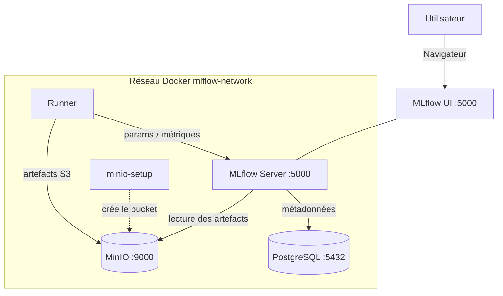

# Architecture — MLflow + Docker

## 1. Vue d'ensemble

Cet environnement orchestre un **serveur de tracking MLflow** adossé à deux stores :
**PostgreSQL** pour les métadonnées (runs, paramètres, métriques, Model Registry) et
**MinIO** (compatible S3) pour les artefacts lourds (modèles sérialisés, figures). Un
conteneur `runner` fournit un environnement Python isolé pour exécuter les scripts
d'exemple. L'ensemble est décrit dans [`docker-compose.yml`](../docker-compose.yml) et
tourne sur un unique réseau Docker `mlflow-network`.

Ce document décrit la **structure** du système. Pour l'usage de MLflow (concepts,
guide pratique, Model Registry), voir [TUTORIAL.md](../TUTORIAL.md). Pour la posture de
sécurité, voir [SECURITY.md](SECURITY.md).

---

## 2. Services / Composants

Le `docker compose up` orchestre **5 services** (`minio-setup` est éphémère : il crée le
bucket au démarrage puis s'arrête).

| Service | Image / Build | Port interne | Port hôte | Rôle |
|---|---|---|---|---|
| `mlflow` | build [`./mlflow`](../mlflow/Dockerfile) (Python 3.11 + MLflow 2.19.0) | 5000 | 5000 | Serveur de tracking + UI |
| `postgres` | `postgres:15-alpine` | 5432 | *(non exposé)* | Backend store (métadonnées) |
| `minio` | `minio/minio:latest` | 9000 / 9001 | 9000 / 9001 | Artifact store S3 + console |
| `minio-setup` | `minio/mc:latest` | — | — | Crée le bucket `mlflow-artifacts` puis s'arrête |
| `runner` | build [`./examples`](../examples/Dockerfile) (Python 3.11) | — | *(non exposé)* | Environnement d'exécution des exemples |

## 3. Stack technologique

Versions lues dans le projet (`mlflow/Dockerfile`, `examples/requirements.txt`,
`docker-compose.yml`).

| Couche | Technologie | Version |
|---|---|---|
| Serveur de tracking | MLflow | 2.19.0 (avec SQLAlchemy < 2.1) |
| Runtime des images | Python | 3.11-slim |
| Backend store | PostgreSQL | 15-alpine |
| Artifact store | MinIO | `latest` *(non épinglé)* |
| Client bucket | MinIO Client (`mc`) | `latest` *(non épinglé)* |
| ML & données (exemples) | scikit-learn / pandas / numpy | >= 1.4 et <= 1.5.2 / >= 2.0 / >= 1.24 |
| Visualisation (exemples) | matplotlib | >= 3.7 |
| Client S3 | boto3 | >= 1.28 |

---

## 4. Flux de bout en bout

Parcours d'un entraînement lancé depuis le `runner` :

1. Le `runner` exécute un script Python (ex. `sklearn_example.py`) et pointe sur
   `MLFLOW_TRACKING_URI=http://mlflow:5000` (réseau Docker).
2. Le client MLflow envoie les **métadonnées** (params, métriques, tags) au serveur
   `mlflow`, qui les persiste dans **PostgreSQL**.
3. Les **artefacts** (modèle, figures) partent directement du `runner` vers le bucket
   **MinIO** `mlflow-artifacts`. Le serveur étant lancé avec une racine explicite en
   `s3://`, `--serve-artifacts` ne les fait pas passer par lui, d'où les identifiants S3
   dans l'environnement du `runner`.
4. L'utilisateur consulte les runs via l'**UI MLflow** sur `http://localhost:5000` ; le
   serveur lit les artefacts dans MinIO pour les afficher.

Séquence détaillée d'un appel, et correspondance entre appels Python et interface :
[TUTORIAL.md](../TUTORIAL.md#de-la-commande-à-linterface).

---

## 5. Réseaux & volumes

| Réseau | Services | Rôle |
|---|---|---|
| `mlflow-network` (bridge) | tous | Isolation ; seuls `mlflow` (5000) et `minio` (9000/9001) sont publiés sur l'hôte |

| Volume | Monté par | Contenu |
|---|---|---|
| `mlflow-postgres-data` | `postgres` | Métadonnées (runs, params, métriques, Model Registry) |
| `mlflow-minio-data` | `minio` | Artefacts (modèles sérialisés, figures) |

Les deux stores sont des volumes Docker **nommés** : les données survivent à
`docker compose down`, mais sont supprimées par `docker compose down -v`.

---

## 6. Décisions d'architecture

- **Dockerfile MLflow custom** *plutôt que* image tierce
  (`ghcr.io/mlflow/mlflow`), *parce que* le tutoriel vise la maîtrise complète du
  contenu (versions épinglées, user non-root, entrypoint, healthcheck). *Limite* :
  maintenance manuelle des dépendances ;
  en production une image maintenue peut suffire.
- **Backend PostgreSQL** *plutôt que* store fichier local, *parce que* les métadonnées
  y gagnent en intégrité et en performances de requête. *Limite* : un service de plus à
  gérer qu'un simple `mlruns/` local.
- **MinIO comme artifact store** *plutôt que* stockage disque, *parce qu'*il simule un
  environnement cloud S3 (AWS) en local et sépare artefacts lourds et métadonnées.
  *Limite* : image `latest` non reproductible (voir [SECURITY.md](SECURITY.md)).
- **Bucket créé par un conteneur `minio-setup` éphémère** *plutôt que* configuration
  manuelle, *parce que* MinIO démarre vide et l'automatisation évite une étape à chaque
  lancement. *Limite* : le service pose aussi un accès **anonyme en lecture** sur le
  bucket (pratique en local, à retirer en production — voir [SECURITY.md](SECURITY.md)).

---

## 7. Sécurité (récapitulatif)

Détail complet et risques connus : [SECURITY.md](SECURITY.md).

| Durcissement | Effet |
|---|---|
| Secrets en `.env` non versionné | Aucun mot de passe en dur dans le dépôt |
| PostgreSQL non exposé à l'hôte | Backend joignable uniquement via le réseau Docker |
| Images en user non-root (uid 1000) | Réduction de la surface en cas de compromission |
| Build multi-stage + runtime minimal | Image finale sans outillage de compilation |
| Healthchecks + `restart: unless-stopped` | Ordonnancement fiable et résilience |

---

## 8. Limites connues & pistes

| Aspect | Limitation / État | Recommandation |
|---|---|---|
| Auth UI MLflow | Aucune (`:5000` ouvert) | Reverse-proxy authentifié + HTTPS si exposé |
| Bucket artefacts | Lecture anonyme activée | Retirer `mc anonymous set download` hors local |
| Images MinIO | Tags `latest` non figés | Épingler des versions précises |
| Dépendances exemples | Bornes `>=`, pas de lockfile | Verrouiller pour la reproductibilité |
| Secrets | Credentials MinIO = clés S3 applicatives | Séparer les rôles (clé applicative dédiée) |
