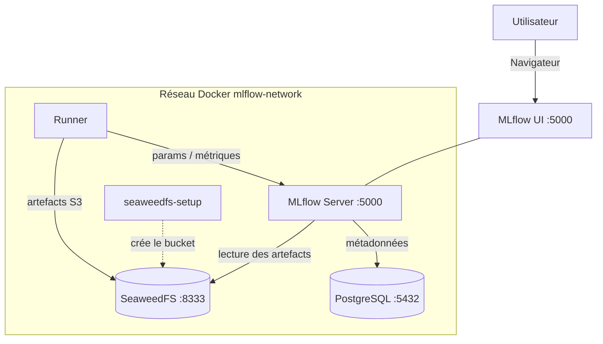

# Architecture — MLflow + Docker

## 1. Vue d'ensemble

Cet environnement orchestre un **serveur de tracking MLflow** adossé à deux stores :
**PostgreSQL** pour les métadonnées (runs, paramètres, métriques, Model Registry) et
**SeaweedFS** (compatible S3) pour les artefacts lourds (modèles sérialisés, figures). Un
conteneur `runner` fournit un environnement Python isolé pour exécuter les scripts
d'exemple. L'ensemble est décrit dans [`docker-compose.yml`](../docker-compose.yml) et
tourne sur un unique réseau Docker `mlflow-network`.

Ce document décrit la **structure** du système. Pour l'usage de MLflow (concepts,
guide pratique, Model Registry), voir [TUTORIAL.md](../TUTORIAL.md). Pour la posture de
sécurité, voir [SECURITY.md](SECURITY.md).

---

## 2. Services / Composants

Le `docker compose up` orchestre **5 services** (`seaweedfs-setup` est éphémère : il crée le
bucket au démarrage puis s'arrête).

| Service | Image / Build | Port interne | Port hôte | Rôle |
|---|---|---|---|---|
| `mlflow` | build [`./mlflow`](../mlflow/Dockerfile) (Python 3.12 + MLflow 3.17.2) | 5000 | 5000 (`127.0.0.1`) | Serveur de tracking + UI |
| `postgres` | `postgres:15-alpine` | 5432 | *(non exposé)* | Backend store (métadonnées) |
| `seaweedfs` | `chrislusf/seaweedfs:4.51` | 8333 / 8888 / 9333 | 8333 / 8888 / 9333 (`127.0.0.1`) | Artifact store S3 + interfaces web |
| `seaweedfs-setup` | `chrislusf/seaweedfs:4.51` | — | — | Crée le bucket `mlflow-artifacts` puis s'arrête |
| `runner` | build [`./examples`](../examples/Dockerfile) (Python 3.12) | — | *(non exposé)* | Environnement d'exécution des exemples |

## 3. Stack technologique

Versions lues dans le projet (`mlflow/requirements.txt`, `examples/requirements.txt`,
`docker-compose.yml`). Les fichiers `requirements.lock` fixent toutes les versions exactes.

| Couche | Technologie | Version |
|---|---|---|
| Serveur de tracking | MLflow | 3.17.2 (SQLAlchemy 2.1, psycopg 3) |
| Runtime des images | Python | 3.12-slim |
| Backend store | PostgreSQL | 15-alpine |
| Artifact store | SeaweedFS | 4.51 |
| ML & données (exemples) | scikit-learn / pandas / numpy | >= 1.6 et <= 1.9.1 / >= 2.0 / >= 1.24 |
| GenAI (exemple Ollama) | openai / litellm | >= 1.0 / >= 1.0 |
| Visualisation (exemples) | matplotlib | >= 3.7 |
| Client S3 | boto3 | >= 1.28 |

---

## 4. Flux de bout en bout

Parcours d'un entraînement lancé depuis le `runner` :

1. Le `runner` exécute un script Python (ex. `sklearn_example.py`) et pointe sur
   `MLFLOW_TRACKING_URI=http://mlflow:5000` (réseau Docker).
2. Le client MLflow envoie les **métadonnées** (params, métriques, tags) au serveur
   `mlflow`, qui les persiste dans **PostgreSQL**.
3. Les **artefacts** (modèle, figures) partent directement du `runner` vers le bucket
   **SeaweedFS** `mlflow-artifacts`. Le serveur est lancé avec `--no-serve-artifacts` et une
   racine en `s3://` : il ne les relaie pas, d'où les identifiants S3 dans l'environnement
   du `runner`.
4. L'utilisateur consulte les runs via l'**UI MLflow** sur `http://localhost:5000` ; le
   serveur lit les artefacts dans SeaweedFS pour les afficher.

Séquence détaillée d'un appel, et correspondance entre appels Python et interface :
[TUTORIAL.md](../TUTORIAL.md#de-la-commande-à-linterface).

---

## 5. Réseaux & volumes

| Réseau | Services | Rôle |
|---|---|---|
| `mlflow-network` (bridge) | tous | Isolation ; seuls `mlflow` (5000) et `seaweedfs` (8333/8888/9333) sont publiés sur l'hôte, sur `127.0.0.1` |

| Volume | Monté par | Contenu |
|---|---|---|
| `mlflow-postgres-data` | `postgres` | Métadonnées (runs, params, métriques, Model Registry) |
| `mlflow-seaweedfs-data` | `seaweedfs` | Artefacts (modèles sérialisés, figures) |

Les deux stores sont des volumes Docker **nommés** : les données survivent à
`docker compose down`, mais sont supprimées par `docker compose down -v`.

---

## 6. Décisions d'architecture

- **Dockerfile MLflow custom** *plutôt que* image tierce
  (`ghcr.io/mlflow/mlflow`), *parce que* le tutoriel vise la maîtrise complète du
  contenu (versions épinglées, user non-root, entrypoint, healthcheck). *Limite* :
  maintenance manuelle des dépendances ;
  en production une image maintenue peut suffire.
- **Backend PostgreSQL** *plutôt que* store fichier local, *parce que* les métadonnées
  y gagnent en intégrité et en performances de requête. *Limite* : un service de plus à
  gérer qu'un simple `mlruns/` local.
- **SeaweedFS comme artifact store** *plutôt que* stockage disque, *parce qu'*il simule un
  environnement cloud S3 (AWS) en local et sépare artefacts lourds et métadonnées.
  Il remplace MinIO, dont les images ont été retirées de Docker Hub et le dépôt archivé.
  *Limite* : le fichier d'identités est moins direct que deux variables d'environnement.
- **Serveur à 2 workers, sans exécuteur de tâches** *plutôt que* les réglages par défaut,
  *parce que* ceux-ci occupent 2,2 Gio de RAM, contre environ 600 Mio mesurés ici.
  *Limite* : l'évaluation en ligne des traces n'est pas disponible.
- **Runner sans entraînement au démarrage** *plutôt qu'*un exemple lancé à chaque `up`,
  *parce qu'*un redémarrage ne doit ni créer de version ni déplacer l'alias `@champion`.
  *Limite* : un premier `exec` est nécessaire pour remplir l'interface.
- **Bucket créé par un conteneur `seaweedfs-setup` éphémère** *plutôt que* configuration
  manuelle, *parce que* SeaweedFS démarre vide et l'automatisation évite une étape à chaque
  lancement.

---

## 7. Sécurité (récapitulatif)

Détail complet et risques connus : [SECURITY.md](SECURITY.md).

| Durcissement | Effet |
|---|---|
| Secrets en `.env` non versionné | Aucun mot de passe en dur dans le dépôt |
| PostgreSQL non exposé à l'hôte | Backend joignable uniquement via le réseau Docker |
| Images en user non-root (uid 1000) | Réduction de la surface en cas de compromission |
| Build multi-stage + runtime minimal | Image finale sans outillage de compilation |
| Healthchecks + `restart: unless-stopped` | Ordonnancement fiable et résilience |

---

## 8. Limites connues & pistes

| Aspect | Limitation / État | Recommandation |
|---|---|---|
| Auth UI MLflow | Aucune (`:5000` sur `127.0.0.1`) | Reverse-proxy authentifié + HTTPS si exposé |
| Interfaces SeaweedFS | Aucune authentification (`:8888` et `:9333` sur `127.0.0.1`) | Ne pas publier ces ports hors local |
| GenAI | Ollama hors de ce projet, exemple absent de la CI | Tester avec un autre serveur compatible OpenAI si besoin |
| Secrets | Une seule identité S3, avec les droits `Admin` | Séparer écriture et lecture, comme le permet le fichier d'identités |
