# Manuel utilisateur — MLflow Test Bench

Ce manuel présente le projet et montre comment s'en servir, sans connaissance préalable
de MLflow. Pour apprendre le code et les concepts en détail, voir le
[tutoriel](../TUTORIAL.md).

## Sommaire

1. [Présentation](#1-présentation)
2. [Démarrer en 5 minutes](#2-démarrer-en-5-minutes)
3. [Visite de l'interface](#3-visite-de-linterface)
4. [Scénarios d'usage](#4-scénarios-dusage)
5. [Exploitation](#5-exploitation)
6. [Questions fréquentes](#6-questions-fréquentes)
7. [Glossaire](#7-glossaire)

---

## 1. Présentation

**À quoi ça sert ?** Quand on entraîne plusieurs modèles, on perd vite le fil : quels
réglages, quels résultats, quel fichier est le bon ? MLflow enregistre tout cela et
l'affiche dans une interface web. Ce projet fournit un MLflow complet, prêt à lancer, et
des exemples pour le découvrir.

**Pour qui ?** Toute personne qui veut découvrir MLflow ou tester une configuration
proche de la production sur son poste.

**Ce que vous obtenez :**

| Élément | Rôle | Adresse |
|---|---|---|
| Serveur MLflow | Interface web et API | http://localhost:5000 |
| PostgreSQL | Garde les paramètres, les métriques et le registre | Interne |
| SeaweedFS | Garde les fichiers : modèles, images, rapports | http://localhost:8888/buckets/mlflow-artifacts/ et http://localhost:9333 |
| Runner | Exécute les scripts Python d'exemple | Interne |

**Ce que ce n'est pas :** un déploiement de production. Il n'y a ni authentification sur
MLflow, ni chiffrement. Voir [SECURITY.md](SECURITY.md).

---

## 2. Démarrer en 5 minutes

**Prérequis :** Docker avec Docker Compose. Sous Windows, WSL 2 est recommandé. Aucune
installation de Python n'est nécessaire.

**1. Créer la configuration**, puis remplacer les mots de passe dans `.env` :

```bash
cp .env.example .env
```

**2. Lancer les services.** Le premier lancement construit les images et prend quelques
minutes :

```bash
docker compose up -d
```

**3. Vérifier l'état :**

```bash
docker compose ps
```

Résultat attendu (colonnes abrégées) :

```text
NAME               SERVICE     STATUS
mlflow-postgres    postgres    Up 7 minutes (healthy)
mlflow-runner      runner      Up 7 minutes
mlflow-seaweedfs   seaweedfs   Up 7 minutes (healthy)
mlflow-server      mlflow      Up 7 minutes (healthy)
```

**4. Lancer un premier entraînement.** Le script entraîne 4 modèles sur le jeu de données
Wine, en moins d'une minute :

```bash
docker compose exec runner python sklearn_example.py
```

**5. Ouvrir http://localhost:5000.** En haut à gauche, un bouton bascule entre **GenAI**,
affiché par défaut, et **Model training** : choisissez **Model training**. Le panneau
**MLflow Assistant**, ouvert à la première visite, se ferme avec sa croix.

---

## 3. Visite de l'interface

### La table des runs

Dans **Experiments**, ouvrez `comparaison-modeles`. Chaque ligne est un entraînement,
appelé *run*.

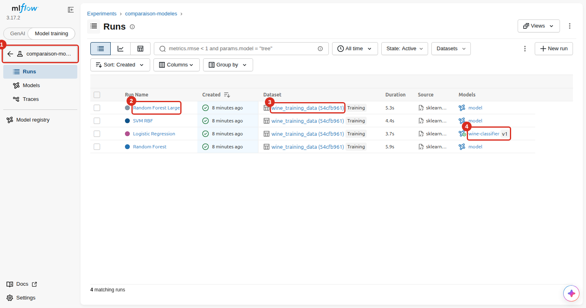

1. **L'expérience** : le dossier qui regroupe les runs d'un même objectif.
2. **Le run** : un clic ouvre son détail.
3. **Le dataset** utilisé pour l'entraînement.
4. **Le modèle enregistré** : seul le meilleur des 4 modèles a été retenu.

### Le détail d'un run

Cliquez sur `Logistic Regression`, le modèle retenu. L'onglet **Overview** résume tout ce
qui a été enregistré.

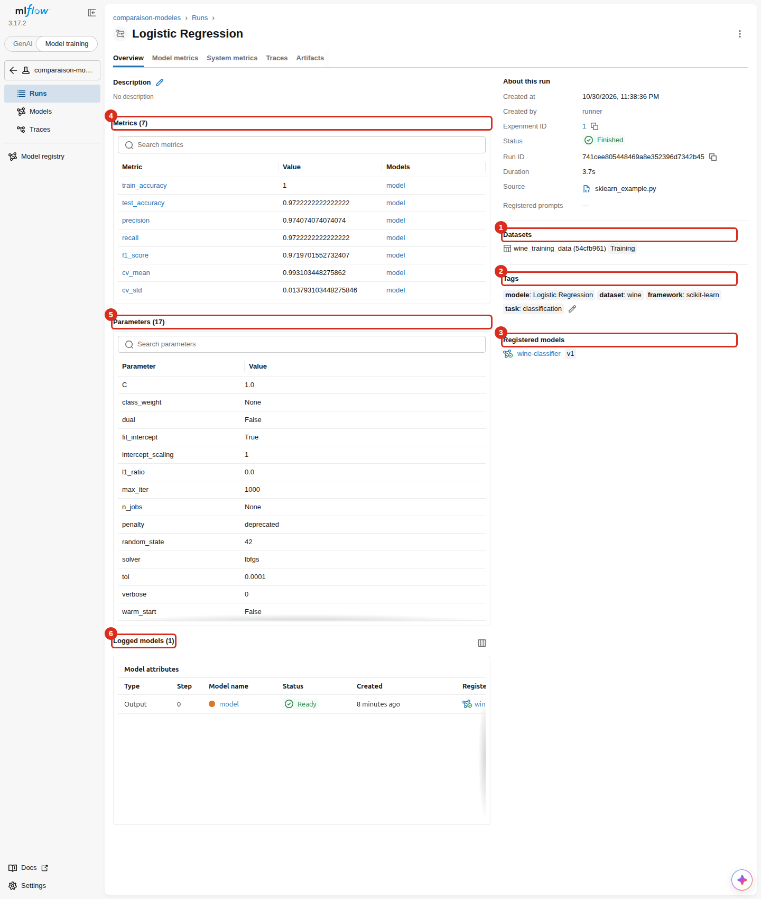

1. **Datasets** : les données d'entraînement.
2. **Tags** : des étiquettes libres, utiles pour filtrer.
3. **Registered models** : sa version dans le registre.
4. **Metrics** : les résultats mesurés.
5. **Parameters** : les réglages en entrée.
6. **Logged models** : le modèle sauvegardé avec ce run.

### Les courbes

L'onglet **Model metrics** trace les métriques. Une métrique enregistrée à plusieurs
étapes donne une courbe. Ici, le run `premier-run` de l'expérience `tutoriel-basique` :

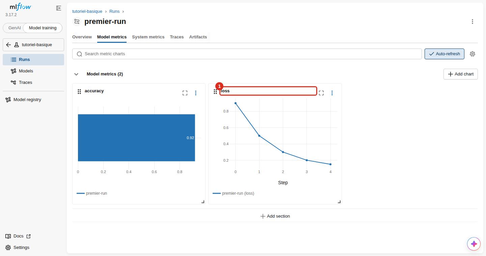

### Les fichiers

L'onglet **Artifacts** liste les fichiers du run et affiche les images.

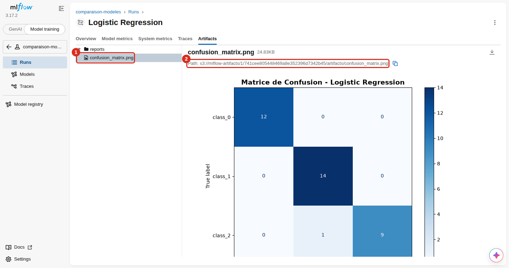

1. **Le fichier** sélectionné, ici la matrice de confusion.
2. **Son adresse** : `s3://` indique qu'il est rangé dans SeaweedFS, pas dans MLflow.

### Le registre des modèles

Le menu **Model registry** liste les modèles retenus.

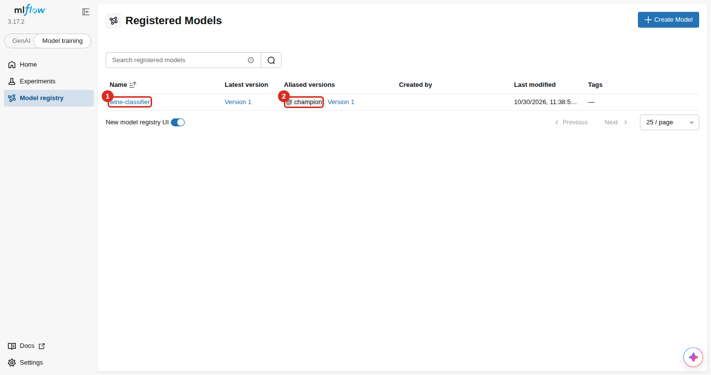

1. **Le modèle** : un clic ouvre la liste de ses versions.
2. **L'alias** `@champion` : il désigne la version de référence.

Chaque version renvoie vers le run qui l'a produite :

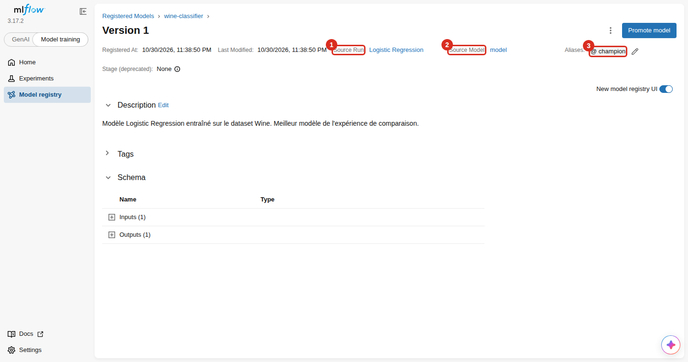

1. **Source Run** : le run d'origine, pour retrouver ses réglages et ses données.
2. **Source Model** : le Logged Model, l'objet qui porte les fichiers du modèle.
3. **Aliases** : le crayon permet de déplacer l'alias depuis l'interface.

### Le stockage

SeaweedFS montre les fichiers tels qu'ils sont réellement rangés. Ce n'est pas nécessaire
au quotidien, mais cela aide à comprendre où vont les données. Son interface, le *filer*,
s'ouvre sur http://localhost:8888/buckets/mlflow-artifacts/.

**Le bucket** contient un dossier par expérience ayant enregistré des fichiers :

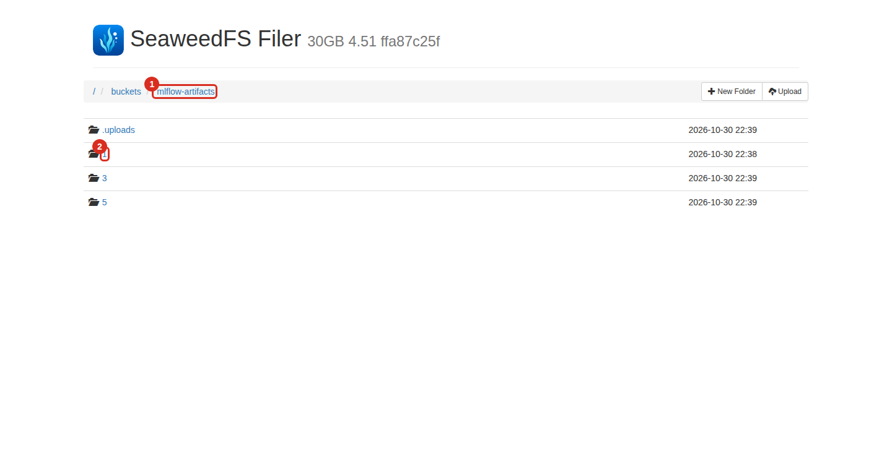

1. **Le bucket** `mlflow-artifacts`, créé au démarrage par `seaweedfs-setup`.
2. **Le dossier** porte l'identifiant de l'expérience : `1` est `comparaison-modeles`.

`tutoriel-basique` (2) et `dataset-demo` (4) n'ont pas de dossier, car leurs runs
n'enregistrent aucun fichier : ils ne contiennent que des métadonnées, gardées dans
PostgreSQL. `.uploads` est un dossier interne de SeaweedFS.

**Chaque expérience** contient un dossier pour les modèles et un dossier par run :

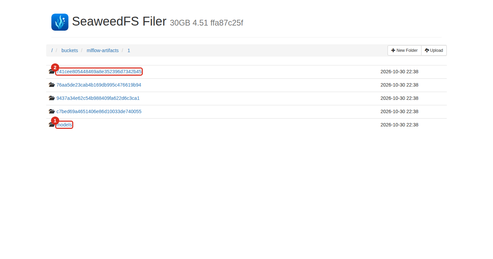

1. **`models`** contient les modèles de tous les runs de l'expérience.
2. **Le nom du dossier** est le Run ID affiché dans MLflow, ici celui du modèle `@champion`.

**Chaque run** contient ses fichiers, avec la même arborescence que l'onglet Artifacts :

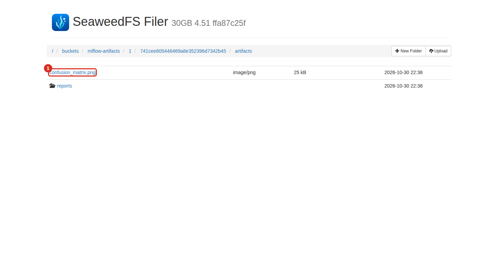

1. **La matrice de confusion** vue plus haut dans MLflow.

**Le dossier d'un modèle**, `models/<model_id>/artifacts/`, contient ce qu'il faut pour le
recharger :

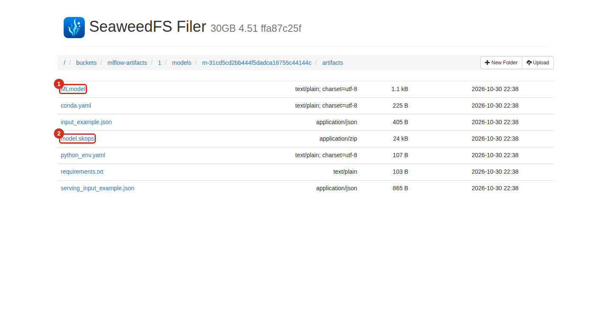

1. **`MLmodel`** décrit le modèle et comment le charger.
2. **`model.skops`** est le modèle sérialisé.

**L'état du stockage** s'affiche sur http://localhost:9333 :

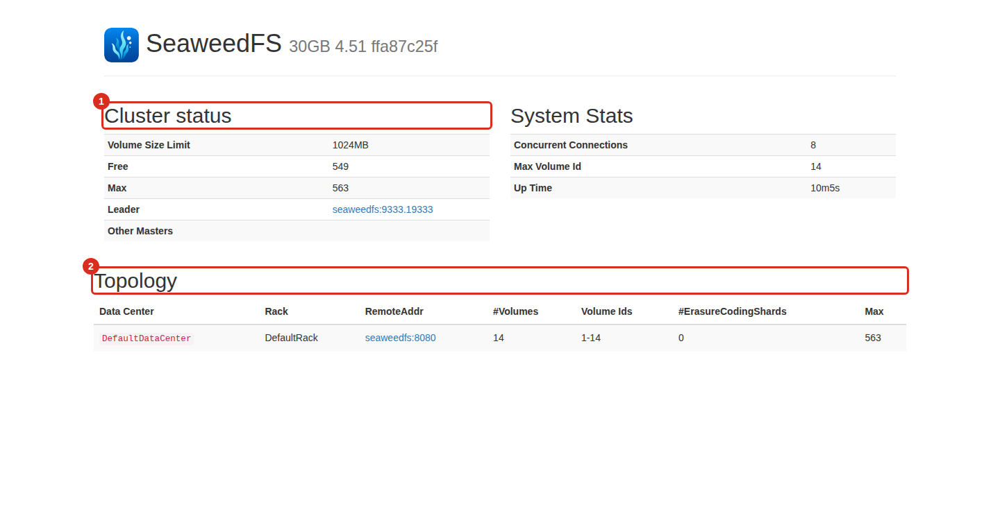

1. **Cluster status** : la capacité et le serveur principal.
2. **Topology** : les volumes, c'est-à-dire les gros fichiers où SeaweedFS range les objets.

**La même information en ligne de commande** :

```bash
docker compose exec -T seaweedfs sh -c 'echo "s3.bucket.list" | weed shell -master=seaweedfs:9333 -filer=seaweedfs:8888'
```

```text
  mlflow-artifacts	size:17184168	logical:17184168	chunk:73
```

> Ces interfaces n'ont pas d'authentification, et le filer permet de modifier les
> fichiers. Ne changez rien ici : passez par MLflow.

---

## 4. Scénarios d'usage

### Comparer des modèles

1. Dans la table des runs, cochez les runs à comparer.
2. Cliquez sur **Compare**.

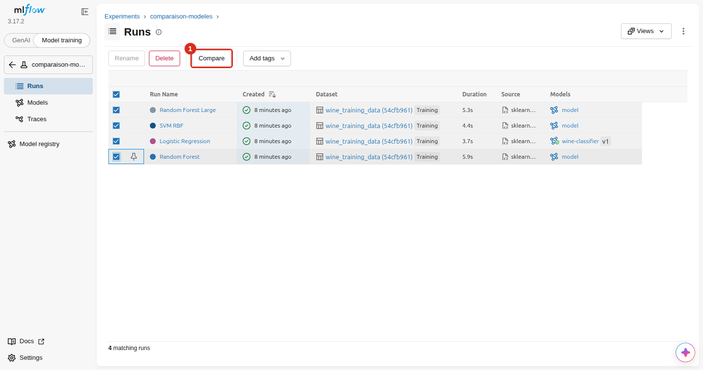

3. Explorez les graphiques, puis le tableau détaillé plus bas sur la page.

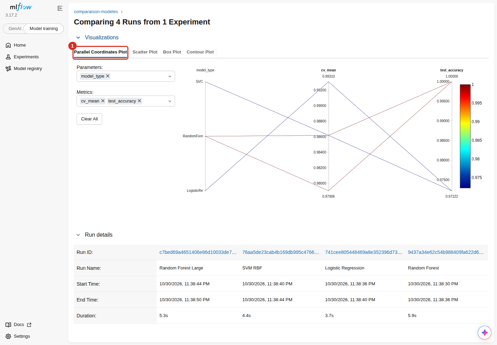

Chaque ligne du graphique est un run : on suit de gauche à droite ses paramètres jusqu'à
son résultat.

### Lancer un nouvel entraînement

```bash
docker compose exec runner python sklearn_example.py
```

Chaque exécution ajoute 4 runs et une nouvelle version de `wine-classifier`, qui reçoit
l'alias `@champion`. Le terminal résume les performances :

```text
                     test_accuracy  f1_score   cv_mean
Logistic Regression       0.972222   0.97197  0.993103
Random Forest             1.000000   1.00000  0.986207
SVM RBF                   0.972222   0.97197  0.986207
Random Forest Large       1.000000   1.00000  0.979064

🏆 Meilleur modèle: Logistic Regression
```

Le meilleur modèle est celui qui a le meilleur score en validation croisée (`cv_mean`), pas
celui qui a le meilleur score sur le jeu de test.

### Essayer les autres exemples

| Commande | Ce que ça montre | Où regarder |
|---|---|---|
| `docker compose exec runner python basic_example.py` | Enregistrement manuel | Expérience `tutoriel-basique` |
| `docker compose exec runner python autolog_example.py` | Enregistrement automatique | Expérience `autolog-demo` |
| `docker compose exec runner python dataset_example.py` | Traçabilité des données | Expérience `dataset-demo` |
| `docker compose exec runner python evaluation_example.py` | Évaluation, contrôle par seuils, CPU et mémoire | Expérience `evaluation-modeles`, onglet **Models** |

Un dernier exemple, `genai_example.py`, trace et évalue un assistant LLM. Il a besoin d'un
serveur Ollama : voir [le tutoriel](../TUTORIAL.md#genai--tracing-et-évaluation).

### Recharger le modèle de référence

```bash
docker compose exec runner python -c "import mlflow.sklearn; m = mlflow.sklearn.load_model('models:/wine-classifier@champion'); print(type(m).__name__)"
```

```text
Pipeline
```

### Revenir à une version précédente

Reposez l'alias sur l'ancienne version, depuis l'interface (crayon à côté de l'alias) ou
en ligne de commande. Le numéro de version se passe entre guillemets :

```bash
docker compose exec runner python -c "from mlflow import MlflowClient; MlflowClient().set_registered_model_alias('wine-classifier', 'champion', '1')"
```

Le code qui charge `@champion` utilisera cette version, sans autre changement. Le choix
tient après un redémarrage : seul un nouveau `sklearn_example.py` déplace l'alias.

---

## 5. Exploitation

**Voir les journaux d'un service :**

```bash
docker compose logs -f mlflow
```

**Arrêter en gardant les données :**

```bash
docker compose down
```

Au prochain `docker compose up -d`, vous retrouvez vos données telles quelles.

**Tout effacer**, y compris les runs et les modèles :

```bash
docker compose down -v
```

**Sauvegarder les métadonnées :**

```bash
docker compose exec -T postgres sh -c 'pg_dump -U "$POSTGRES_USER" "$POSTGRES_DB"' > mlflow.sql
```

**Sauvegarder les fichiers**, avec SeaweedFS arrêté pour une copie cohérente :

```bash
docker compose stop seaweedfs
```

```bash
docker compose run --rm -T --no-deps --entrypoint tar seaweedfs czf - /data > seaweedfs.tar.gz
```

```bash
docker compose start seaweedfs
```

Gardez les deux ensemble : l'une sans l'autre ne permet pas de retrouver un run complet.
Ces fichiers contiennent vos données, ne les committez pas.

**Restaurer** sur une installation vide. Cette procédure a été testée après un
`docker compose down -v` : expériences, alias, artefacts et chargement du modèle sont
revenus.

```bash
docker compose up -d postgres seaweedfs
```

```bash
docker compose stop seaweedfs
```

```bash
docker compose run --rm -T --no-deps --entrypoint tar seaweedfs xzf - -C / < seaweedfs.tar.gz
```

```bash
docker compose exec -T postgres sh -c 'psql -q -U "$POSTGRES_USER" -d "$POSTGRES_DB"' < mlflow.sql
```

```bash
docker compose up -d
```

**Monter depuis une version antérieure.** Sauvegardez d'abord : la base migrée ne redevient
pas compatible avec l'ancienne version. Le passage de MLflow 2.19 et SeaweedFS 3.80 à
MLflow 3.17 et SeaweedFS 4.51 a été testé sur les mêmes volumes. Il suffit de relancer
`docker compose up -d --build` : le serveur migre sa base seul au démarrage. Les runs,
l'alias, les artefacts et un nouvel entraînement fonctionnent. L'ancien modèle se charge,
avec un avertissement `InconsistentVersionWarning` car il vient de scikit-learn 1.5.2 :
réentraînez-le plutôt que de vous y fier.

---

## 6. Questions fréquentes

| Problème | Solution |
|---|---|
| `The "S3_ACCESS_KEY" variable is not set` | Votre `.env` date d'avant SeaweedFS. Recréez-le depuis `.env.example`. |
| « Connection refused » sur le port 5000 | Le serveur démarre encore. Vérifiez avec `docker compose ps` et attendez `healthy`. |
| L'interface est vide | Rien ne s'entraîne au démarrage : lancez `docker compose exec runner python sklearn_example.py`. |
| Je ne vois ni **Runs** ni **Models** | L'interface est en mode **GenAI** : choisissez **Model training** en haut à gauche. |
| Un lien du terminal commence par `http://mlflow:5000` | Remplacez `mlflow` par `localhost` dans le navigateur. |
| « Cannot set a deleted experiment » | Le nom reste réservé après une suppression : changez-le dans le script. |

Plus de cas : [tutoriel, section Troubleshooting](../TUTORIAL.md#troubleshooting).

---

## 7. Glossaire

| Terme | Définition |
|---|---|
| **Expérience** | Dossier qui regroupe les runs d'un même objectif. |
| **Run** | Une exécution d'un entraînement. |
| **Paramètre** | Réglage choisi avant l'entraînement. |
| **Métrique** | Résultat mesuré. Peut évoluer par étape. |
| **Artefact** | Fichier lié à un run : modèle, image, rapport. |
| **Logged Model** | Un modèle sauvegardé par un run, avec son identifiant `m-...`. |
| **Registre** | Catalogue des modèles retenus et de leurs versions. |
| **Alias** | Étiquette mobile posée sur une version, comme `@champion`. |
| **Trace** | Enregistrement complet d'une exécution d'un assistant LLM, étape par étape. |
| **Bucket** | Espace de rangement de fichiers dans un stockage S3. |
